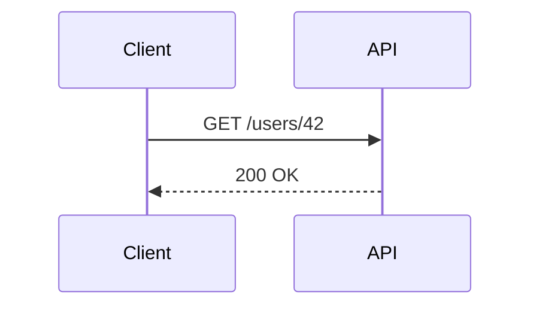

# Bostu — Backend Learning Lab 🧪

> 🇻🇳 Ứng dụng web học Backend cá nhân, song ngữ Việt–Anh, chạy hoàn toàn trên trình duyệt và deploy miễn phí lên GitHub Pages.
> 🇺🇸 A personal, bilingual (Vietnamese/English) backend learning app that runs entirely in the browser and deploys free to GitHub Pages.

**Live demo:** `https://hoangan-bonieeror.github.io/<repo-name>/`

   

---

## ✨ Tính năng / Features

| | Tính năng | Feature |
|---|---|---|
| 🏠 | **Tổng quan**: chuỗi ngày học, mục tiêu phút/ngày, heatmap hoạt động 20 tuần, gợi ý bài tiếp theo | **Dashboard**: streak, daily minutes goal, 20-week activity heatmap, next-lesson suggestion |
| 🗺️ | **Lộ trình Backend**: 12 kỹ năng (Nền tảng → Cốt lõi → Nâng cao), tự chấm 0–5 sao, % hoàn thành | **Backend roadmap**: 12 skills (Foundations → Core → Advanced), 0–5 self-rating, completion % |
| 📘 | **Bài học dạng blog**: ảnh bìa, mục lục tự động, thanh tiến độ đọc, hình minh họa SVG, sơ đồ Mermaid, hộp ghi chú màu, nút copy code, phóng to ảnh | **Blog-style lessons**: cover art, auto table of contents, reading progress, SVG illustrations, Mermaid diagrams, colored callouts, copy-code buttons, image zoom |
| 🧪 | **SQL Lab**: SQLite (WebAssembly) chạy trong trình duyệt, 12 bài tập chấm tự động, sân chơi tự do, xem schema | **SQL Lab**: in-browser SQLite (WebAssembly), 12 auto-graded exercises, free playground, schema browser |
| 🃏 | **Flashcard** dùng thuật toán lặp lại ngắt quãng SM-2, có phím tắt | **Flashcards** with SM-2 spaced repetition and keyboard shortcuts |
| 📡 | **Tech Radar bot**: mỗi tuần tự tìm repo mới nổi, bản phát hành mới, bài hot trên Hacker News/DEV rồi viết thành bài blog song ngữ | **Tech Radar bot**: weekly finds rising repos, new releases and hot HN/DEV posts, then writes a bilingual blog post |
| 🧭 | Thanh điều hướng ngang, menu thả xuống trên mobile | Top navigation bar with a mobile dropdown |
| 🌗 | Chuyển VI/EN tức thì, giao diện sáng/tối, responsive | Instant VI/EN switch, light/dark theme, responsive |
| 💾 | Lưu tiến độ bằng localStorage, xuất/nhập file JSON để sao lưu | localStorage persistence with JSON export/import backup |

### Nội dung sẵn có / Bundled content

- **6 bài học** (mỗi bài có bản VI và EN): HTTP, REST API design, SQL, Index & Transaction & N+1, Session/JWT/OAuth, Caching với Redis
- **12 bài tập SQL**: SELECT → JOIN → GROUP BY/HAVING → window function → transaction → index với `EXPLAIN QUERY PLAN`
- **6 ảnh bìa + 8 sơ đồ SVG** (mỗi sơ đồ có bản VI/EN) và **6 sơ đồ Mermaid** (sequence, flowchart)
- **44 flashcard** song ngữ: HTTP, REST, SQL, DB design, Auth, Caching, Security, Docker, Messaging

---

## 🚀 Chạy local / Run locally

Yêu cầu / Requires: **Node.js 22+**

```bash
npm install
npm start            # http://localhost:4200
```

Các lệnh khác / Other scripts:

```bash
npm run build              # production build → dist/bostu/browser
npm run validate:content   # kiểm tra JSON & liên kết nội dung / check content files
```

---

## 🌐 Deploy lên GitHub Pages

1. Tạo repo mới trên GitHub, ví dụ `bostu`, rồi push code:

   ```bash
   git init
   git add .
   git commit -m "feat: initial Bostu learning app"
   git branch -M main
   git remote add origin https://github.com/hoangan-bonieeror/bostu.git
   git push -u origin main
   ```

2. Trên GitHub, vào **Settings → Pages → Build and deployment → Source** và chọn **GitHub Actions**.
3. Mỗi lần push lên `main`, workflow `.github/workflows/deploy.yml` sẽ tự kiểm tra nội dung, build và deploy.
4. Trang sẽ có địa chỉ `https://hoangan-bonieeror.github.io/bostu/`.

> App dùng **hash routing** (`/#/lessons`) và `<base href="./">`, nên chạy được ở bất kỳ đường dẫn con nào mà không cần cấu hình thêm hay file `404.html`.

---

## 📡 Tech Radar bot

Bot nằm trong `scripts/tech-radar/` (Node.js 22; bộ crawl dùng `@mozilla/readability` + `linkedom`, cài sẵn qua `npm install`). Mỗi thứ Hai, workflow `.github/workflows/tech-radar.yml` sẽ:

1. **Thu thập** dữ liệu từ 4 nguồn:
   - GitHub: repo mới tạo trong 30 ngày, đang tăng sao nhanh, thuộc các topic backend
   - GitHub Releases: bản phát hành mới của FastAPI, Django, uv, Redis/Valkey, Kafka, Docker Compose, k6…
   - Hacker News: bài trên 120 điểm
   - DEV Community: bài top tuần theo tag
2. **Lọc và chấm điểm**: bỏ repo spam (nhiều repo cùng chủ, mô tả rỗng, ít sao), bỏ chủ đề lạc đề (crypto, game, mobile…). Một từ thông dụng như "test" hay "security" đứng một mình không đủ để coi là tin công nghệ: cần thêm một từ khóa khác, hoặc một thuật ngữ cụ thể như `postgres`, `xss`, `kubernetes` (danh sách `AMBIGUOUS_KEYWORDS`). Mỗi mục được xếp vào một chủ đề gắn với kỹ năng trên lộ trình. Điểm = độ phổ biến (thang log) + mức liên quan.
3. **Đọc nội dung bên trong từng link** (`crawl.mjs`):
   - Repo GitHub → đọc README; bản phát hành → đọc release notes; bài DEV → lấy qua DEV API; bài viết khác → tải trang và trích phần nội dung chính bằng `@mozilla/readability`.
   - Lấy ra: trích đoạn ngắn, các mục lớn (outline), các ý chính (gạch đầu dòng), ảnh xem trước (og:image) và thời gian đọc.
   - Lịch sự với website: tôn trọng `robots.txt`, giới hạn 4 request song song, timeout 15 giây, tối đa 2 MB mỗi trang.
   - Tôn trọng bản quyền: chỉ đăng trích đoạn ≤ 280 ký tự và ý chính ngắn kèm link gốc. Toàn văn chỉ dùng trong bộ nhớ để Gemini tóm tắt.
   - Khi có Gemini, mỗi mục nổi bật có thêm 2–3 **điểm chính** do Gemini diễn đạt lại từ nội dung thật của bài.
   - Bỏ qua bước này bằng cờ `--no-crawl`.
4. **Viết bài** song ngữ `public/content/lessons/tech-radar-<ngày>.{vi,en}.md`, gồm: biểu đồ tròn Mermaid, top nổi bật kèm "vì sao nên quan tâm", bảng bản phát hành, danh sách theo chủ đề và checklist việc nên làm. Bot cũng **vẽ ảnh bìa radar** dạng SVG.
5. **Ghi nhớ** các link đã đăng trong `seen.json`, để tuần sau chỉ hiện thứ mới.
6. **Ghi trạng thái** mỗi lần chạy vào `public/content/radar-status.json` (mỗi nguồn lấy được bao nhiêu mục, có lỗi gì không, có đăng bài không). Trang **Tech Radar** hiển thị ô **"Lần quét gần nhất"** từ file này. Trong tab Actions, mỗi lần chạy cũng có bảng tóm tắt ở trang **Summary**.
7. **Commit và deploy** lại trang.

```bash
npm run radar:dry          # xem trước kết quả, không ghi file
npm run radar              # tạo bài thật
node scripts/tech-radar/index.mjs --days=14 --save-fixture=radar.json   # lưu dữ liệu thô
node scripts/tech-radar/index.mjs --fixture=radar.json                  # chạy offline từ dữ liệu đã lưu
```

**Cấu hình trên GitHub:**

- **Settings → Actions → General → Workflow permissions** → chọn **Read and write permissions**, để bot commit được bài mới.
- (Tùy chọn) Lấy API key miễn phí tại [Google AI Studio](https://aistudio.google.com/apikey), rồi vào **Settings → Secrets and variables → Actions → Secrets** thêm `GEMINI_API_KEY`. Khi có key, **Gemini** sẽ viết tóm tắt tiếng Việt/Anh cho từng mục và đoạn mở đầu tổng quan (trả về JSON theo schema cố định). Không có key thì bot giữ nguyên mô tả gốc tiếng Anh.
- (Tùy chọn) Mặc định bot dùng alias `gemini-flash-latest`, luôn trỏ tới model Flash mới nhất. Muốn cố định một model thì thêm **Variable** `GEMINI_MODEL` (ví dụ một model id trong [danh sách model](https://ai.google.dev/gemini-api/docs/models)).
- Chạy local có AI: `GEMINI_API_KEY=... npm run radar` (PowerShell: `$env:GEMINI_API_KEY="..."; npm run radar`).
- Chạy tay bất cứ lúc nào: tab **Actions → Tech Radar bot → Run workflow**. Tick **ignore_seen** nếu muốn bot viết lại bài của ngày hôm nay, cho phép dùng lại cả những link đã đăng (hữu ích sau khi nâng cấp bot).
- Tùy chỉnh nguồn, từ khóa, chủ đề, ngưỡng sao trong `scripts/tech-radar/config.mjs`.

> Chạy local sau proxy công ty? Node 22 cần `NODE_USE_ENV_PROXY=1` để `fetch` đi qua `HTTPS_PROXY`.

---

## ✍️ Thêm nội dung / Adding content

Toàn bộ nội dung nằm trong `public/content/`. Muốn thêm bài thì chỉ cần sửa file và push, **không phải sửa code**.

```
public/content/
├── skills.json        # các kỹ năng trên lộ trình
├── lessons.json       # danh sách bài học (metadata)
├── lessons/
│   ├── <id>.vi.md     # nội dung tiếng Việt (tech-radar-*.md do bot tạo)
│   └── <id>.en.md     # nội dung tiếng Anh
├── covers/<id>.svg    # ảnh bìa 1200×630 (mặc định theo id bài)
├── diagrams/          # hình minh họa: <tên>.vi.svg / <tên>.en.svg
├── sql-lab.json       # schema + bài tập SQL
└── flashcards.json    # thẻ ôn tập
```

**Thêm một bài học:**

```jsonc
// lessons.json
{
  "id": "docker-basics",
  "skill": "docker",                       // phải trùng với id trong skills.json
  "minutes": 20,
  "title":   { "vi": "Docker cơ bản", "en": "Docker basics" },
  "summary": { "vi": "Image, container, Dockerfile", "en": "Images, containers, Dockerfiles" },
  "sqlExercises": []                       // tùy chọn: id bài tập trong sql-lab.json
}
```

Sau đó tạo `lessons/docker-basics.vi.md` và `lessons/docker-basics.en.md`. Nếu thiếu một ngôn ngữ, app sẽ tự hiển thị bản còn lại kèm thông báo.

**Viết bài kiểu blog:** trong file Markdown bạn có thể dùng:

````markdown


> [!TIP]
> Mẹo hiển thị trong hộp màu xanh. Có thêm NOTE, IMPORTANT, WARNING, CAUTION.


````

- Heading `##` và `###` tự động đưa vào **mục lục** bên phải.
- Ảnh bìa: đặt file `covers/<id>.svg` (hoặc `.png`/`.jpg`, rồi khai báo `"cover": "content/covers/x.png"` trong `lessons.json`).
- Mermaid chỉ được tải khi bài viết có sơ đồ, nên trang chủ vẫn nhẹ. Sơ đồ tự đổi màu theo giao diện sáng/tối.
- `npm run validate:content` sẽ báo lỗi nếu ảnh bìa hoặc ảnh trong bài bị thiếu.

**Thêm bài tập SQL:** thêm một object vào `exercises` trong `sql-lab.json`. App chấm bài bằng cách chạy câu của bạn và câu `solution` trên **database mới**, rồi so sánh **tập kết quả** (không so tên cột; số thực được làm tròn 2 chữ số). Đặt `"ordered": true` nếu bài yêu cầu `ORDER BY`.

**Thêm flashcard:** thêm `{ id, skill, front: {vi, en}, back: {vi, en} }` vào `flashcards.json`.

Chạy `npm run validate:content` để kiểm tra trước khi push. CI cũng chạy bước này.

---

## 🏗️ Kiến trúc / Architecture

```
src/app/
├── core/
│   ├── models.ts           # kiểu dữ liệu nội dung & trạng thái
│   ├── store.service.ts    # trạng thái dùng signal, lưu localStorage, export/import
│   ├── i18n.ts             # từ điển UI + pick({vi,en}) theo ngôn ngữ hiện tại
│   ├── content.service.ts  # tải JSON/Markdown có cache, fallback ngôn ngữ
│   ├── markdown.ts         # marked + highlight.js, mục lục, figure, callout, Mermaid lazy-load
│   ├── sql-engine.ts       # nạp sql.js lazily, chạy trên DB mới, so sánh kết quả
│   ├── srs.ts              # thuật toán SM-2
│   └── dates.ts            # helper ngày theo giờ địa phương
├── pages/                  # mỗi trang là standalone component, lazy-loaded
├── shared/heatmap.ts
└── app.ts                  # layout: navigation bar, chuyển VI/EN, sáng/tối

scripts/
├── validate-content.mjs    # kiểm tra nội dung trong CI
└── tech-radar/             # bot: config, sources, classify, render, cover, ai.mjs (Gemini, tùy chọn)
```

**Các quyết định thiết kế chính / Key decisions**

- **Angular 22, zoneless, standalone components, signals**: không dùng NgModule hay zone.js; state đơn giản, dễ đọc.
- **i18n tự viết dựa trên signal** thay vì `@angular/localize`: đổi ngôn ngữ ngay lúc chạy, không phải build riêng cho từng ngôn ngữ.
- **Nội dung tách khỏi code**: nội dung là file tĩnh, nên thêm bài chỉ cần sửa Markdown/JSON.
- **sql.js** chỉ được nạp khi mở SQL Lab, để trang chủ tải nhanh.
- **Không có backend**: phù hợp với GitHub Pages. Tiến độ nằm trong trình duyệt và có thể sao lưu bằng file JSON.

---

## 🗺️ Roadmap

- [ ] Python playground (Pyodide) cho bài tập pandas/thuật toán
- [ ] Chế độ luyện thi / phỏng vấn có bấm giờ
- [ ] Sổ ghi chú "Today I Learned" có gắn tag
- [ ] Theo dõi project portfolio gắn với từng kỹ năng
- [ ] PWA: cài lên điện thoại, học offline
- [ ] Đồng bộ nhiều thiết bị qua GitHub Gist
- [ ] Thêm bài: Testing, Docker, Message queue, Security, System design
- [ ] Tech Radar: tự tạo flashcard từ các mục nổi bật

---

## 💼 Gợi ý trình bày trong portfolio / Portfolio presentation tips

**Mô tả ngắn (CV / LinkedIn):**

> *Built Bostu, a bilingual (VI/EN) backend learning platform in Angular 22 (zoneless, signals) featuring an in-browser SQLite lab with auto-grading via WebAssembly, SM-2 spaced-repetition flashcards, and a scheduled "Tech Radar" bot that aggregates GitHub, Hacker News and DEV data, ranks it, and publishes bilingual blog posts through a CI-validated GitHub Actions pipeline to GitHub Pages.*

**Điểm nên nhấn mạnh khi phỏng vấn:**

1. **Chấm bài SQL tự động**: mỗi lần chạy dùng một database mới; so sánh tập kết quả có chuẩn hóa NULL và số thực; xử lý riêng bài có và không có `ORDER BY`.
2. **Thuật toán SM-2**: giải thích ease factor, interval, và cách "Quên" đưa thẻ trở lại cuối phiên ôn.
3. **Kiến trúc tĩnh**: tại sao chọn hash routing, lazy loading, và lưu localStorage kèm export JSON.
4. **Hệ thống nội dung**: Markdown → HTML có mục lục, figure, callout; sơ đồ Mermaid chỉ tải khi cần và tự đổi theo theme.
5. **CI/CD**: bước validate nội dung chặn deploy khi JSON sai hoặc tham chiếu hỏng.
6. **Tech Radar bot**: kiến trúc nguồn độc lập (một nguồn lỗi không làm hỏng cả lần chạy), chống spam, chấm điểm thang log để so sánh các nguồn khác nhau, dedupe bằng `seen.json`, workflow tái sử dụng để deploy sau khi bot commit.
7. **Song ngữ khi chạy**: dùng signal-based i18n thay vì build riêng cho từng ngôn ngữ.

**Ảnh chụp màn hình nên có:** trang Bài học dạng blog (lưới ảnh bìa), một bài viết có sơ đồ Mermaid và mục lục, Dashboard (sáng và tối), SQL Lab lúc báo "Chính xác!", một flashcard đã lật, và giao diện trên mobile.

---

## 📄 License

MIT — dùng tự do cho việc học. / Free to use for learning.
