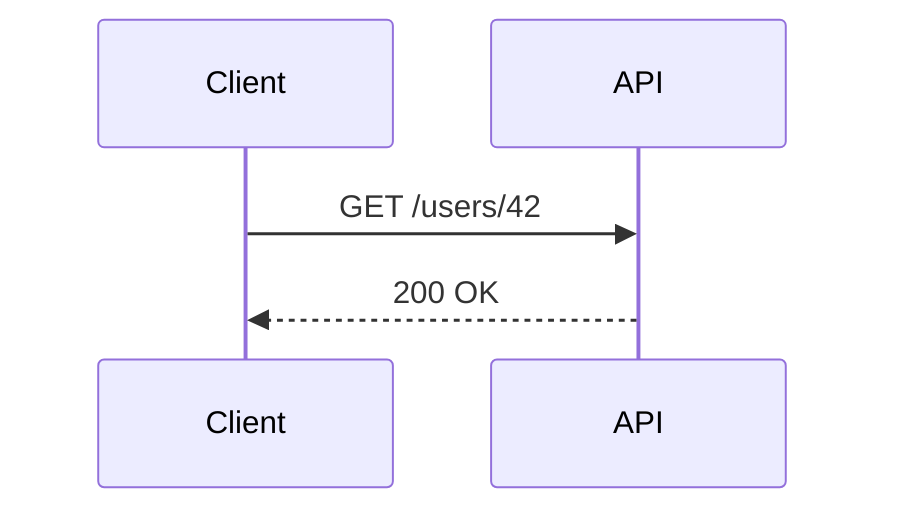

# Bostu — Sổ tay kỹ thuật / Tech Notebook ⌘

> 🇻🇳 Blog kỹ thuật cá nhân, song ngữ Việt–Anh: thiết kế hệ thống, cấu trúc dữ liệu & giải thuật, thiết kế database, CI/CD và hệ thống doanh nghiệp. Ô SQL chạy ngay trong bài, sơ đồ trực quan, kèm một bot tự tổng hợp công nghệ mới mỗi tuần.
> 🇺🇸 A personal, bilingual (VI/EN) engineering blog on system design, DSA, database design, CI/CD and enterprise systems — with runnable SQL inside articles, visual diagrams, and a bot that compiles new tech every week.

**Live (riêng tư, cần đăng nhập):** https://bostu.pages.dev/

    

---

## ✨ Tính năng / Features

| | Tính năng | Feature |
|---|---|---|
| 📰 | **Trang chủ kiểu tạp chí**: bài nổi bật, bài mới nhất, chuyên mục, series, thẻ phổ biến | **Magazine-style home**: featured post, latest posts, topics, series, popular tags |
| 🗂️ | **7 chuyên mục**: Thiết kế hệ thống · DSA · Thiết kế database · CI/CD · Hệ thống doanh nghiệp · Backend · Tech Radar | **7 topics**: System Design · DSA · Database Design · CI/CD · Enterprise · Backend · Tech Radar |
| 📚 | **Series** đọc theo thứ tự, có điều hướng giữa các phần | **Series** with part-to-part navigation |
| 🧾 | **Trang bài viết**: ảnh bìa, mục lục theo dõi vị trí đọc, thanh tiến độ, hộp ghi chú màu, nút copy code, phóng to ảnh, bài liên quan | **Article page**: cover, scroll-spy TOC, reading progress, callouts, copy-code, image zoom, related posts |
| 🧪 | **Ô SQL chạy được** ngay trong bài (SQLite/WebAssembly), có database mẫu `shop` và `payroll` | **Runnable SQL boxes** inside articles (SQLite/WebAssembly) with sample `shop` and `payroll` databases |
| 📊 | **Sơ đồ Mermaid** (sequence, flowchart, ERD) tự đổi màu theo giao diện, cùng hình SVG song ngữ | **Mermaid diagrams** (sequence, flowchart, ERD) that follow the theme, plus bilingual SVG figures |
| 🔍 | **Tìm kiếm** toàn văn ngay trên trình duyệt, không phân biệt dấu ("thiet ke" khớp "thiết kế") | **Full-text search** in the browser, diacritics-insensitive |
| 🔖 | **Đã lưu**: bookmark, ghi chú riêng cho từng bài, lịch sử đọc, sao lưu JSON | **Saved**: bookmarks, per-post private notes, reading history, JSON backup |
| 🗓️ | **Lưu trữ** theo tháng và **RSS** (`feed.vi.xml`, `feed.en.xml`) | **Archive** by month and **RSS** feeds |
| 📰 | **Bản tin công nghệ hằng ngày**: bot đọc Hacker News và các trang tin/blog kỹ thuật, Gemini tóm tắt song ngữ | **Daily tech news**: a bot reads HN plus news sites and engineering blogs; Gemini summarises in VI/EN |
| 📡 | **Tech Radar bot**: mỗi tuần quét GitHub, Hacker News, DEV, đọc nội dung từng link, viết bài song ngữ | **Tech Radar bot**: weekly scan of GitHub, HN, DEV; reads each link and writes a bilingual post |
| 🌗 | VI/EN chuyển tức thì, sáng/tối, responsive | Instant VI/EN, light/dark, responsive |

### Giao diện / Design

Phong cách **futuristic**: nền tối kiểu không gian, màu neon cyan–tím, thẻ kính mờ (glassmorphism), font Space Grotesk + Inter + JetBrains Mono (tự host qua `@fontsource-variable`, không gọi Google Fonts).

- **Mạng neuron động** (`src/app/shared/neural-bg.ts`, canvas 2D): các tế bào trôi chậm, nối với nhau bằng synapse; xung tín hiệu chạy dọc dây nối, làm tế bào đích "phát hỏa" và đôi khi lan tiếp thành chuỗi. Con trỏ chuột hoạt động như một neuron (kéo nhẹ các tế bào gần đó); bấm vào chỗ trống để phóng một loạt xung.
- Tự giảm số tế bào trên màn hình nhỏ, dừng khi tab bị ẩn, giới hạn DPR = 2; tắt mọi chuyển động khi hệ điều hành bật **Reduce motion**.
- Màu lấy từ biến CSS `--neuron-a`, `--neuron-b`, `--neuron-line`, nên đổi theme sáng/tối là mạng neuron đổi màu theo.
- **Chuyển động** (`src/app/core/motion.ts`, viết một lần bằng event delegation nên các trang không chứa code animation): chuyển trang bằng View Transitions API; tiêu đề "giải mã" từ ký tự ngẫu nhiên (`src/app/shared/decode-text.ts`, có `aria-label` cho trình đọc màn hình); thẻ bài nghiêng 3D và có đốm sáng theo chuột; các đoạn trong bài hiện dần khi cuộn tới (IntersectionObserver); quầng sáng đi theo con trỏ; bấm link phóng một chuỗi xung trong mạng neuron; viền bài nổi bật có tín hiệu chạy vòng quanh.
- Lớp giao diện nằm riêng trong `src/futuristic.scss` (nạp sau `styles.scss`): đổi màu, hiệu ứng glow, quét sáng trên navbar, chữ tiêu đề lấp lánh, thẻ bài nổi lên khi rê chuột.

### Nội dung hiện có / Current content

| Chuyên mục | Bài viết |
|---|---|
| 🏗️ Thiết kế hệ thống | Từ một server đến hàng triệu người dùng · Case study: dịch vụ rút gọn URL |
| 🧮 DSA | Big-O trong thực tế · Two Pointers & Sliding Window |
| 🗄️ Thiết kế database | Chuẩn hóa 1NF→3NF · Schema hệ thống quản lý lương · SQL thiết yếu · Index, Transaction & N+1 |
| 🚀 CI/CD & DevOps | CI/CD: từ commit đến production · Chiến lược triển khai |
| 🏢 Hệ thống doanh nghiệp | Bản đồ ERP/CRM/HRM & tích hợp · SSO: SAML, OIDC, LDAP |
| 🔌 Backend | HTTP · REST API · Session/JWT/OAuth · Caching với Redis |
| 📰 Tin công nghệ | Bản tin tự động mỗi ngày |
| 📡 Tech Radar | Bài tự động hằng tuần |

---

## 🚀 Chạy local / Run locally

Yêu cầu / Requires **Node.js 22+**

```bash
npm install
npm start             # http://localhost:4200  (tự build chỉ mục bài viết trước)
```

```bash
npm run content       # kiểm tra bài viết + tạo lại chỉ mục, tìm kiếm, RSS, ảnh bìa tự động
npm run build         # production build → dist/bostu/browser
npm run new-post -- --category=system-design --title="Rate limiter"   # tạo khung bài mới
```

> Đang chạy `npm start` mà thêm/sửa front matter của bài? Chạy `npm run content` để cập nhật danh sách bài (nội dung Markdown thì tải lại trang là thấy).

---

## ✍️ Viết bài / Writing posts

Mỗi bài là **hai file Markdown** (VI và EN) trong `public/content/posts/`:

```
public/content/
├── posts/<id>.vi.md, <id>.en.md   # bài viết (front matter + Markdown)
├── categories.json                 # chuyên mục: icon, màu, tên, mô tả
├── series.json                     # series
├── site.json                       # tên site, URL (dùng cho RSS)
├── sql/shop.sql, payroll.sql       # database mẫu cho ô SQL
├── covers/                         # ảnh bìa (auto/ được sinh tự động)
├── diagrams/<tên>.<vi|en>.svg      # hình minh họa song ngữ
└── generated/                      # ⚙️ sinh tự động khi build (không commit)
```

**Front matter:**

```yaml
---
title: "Rate limiter hoạt động thế nào"
summary: "Một câu tóm tắt, hiện trên thẻ bài và trong RSS."
date: 2026-11-20
category: system-design          # id trong categories.json
tags: [rate-limiting, redis]
type: article                    # article | note (ghi chép ngắn) | radar
series: system-design-foundations   # tùy chọn
seriesOrder: 3                      # tùy chọn
cover: content/covers/x.svg         # tùy chọn — bỏ trống thì tự sinh ảnh bìa theo chuyên mục
---
```

**Các khối đặc biệt trong Markdown:**

````markdown
> [!TIP]
> Hộp ghi chú màu. Có: NOTE, TIP, IMPORTANT, WARNING, CAUTION.




```sql-run
-- db: payroll
SELECT full_name FROM employees;
```

```sql-run
-- db: none
CREATE TABLE t (id INTEGER PRIMARY KEY, name TEXT);
INSERT INTO t VALUES (1, 'a');
-- ---
SELECT * FROM t;
```
````

- Ô `sql-run` chạy trên database mới mỗi lần bấm. `-- db: <tên>` nạp `content/sql/<tên>.sql` (mặc định `shop`); phần phía trên dòng `-- ---` là dữ liệu chuẩn bị (ẩn, xem được qua nút "Dữ liệu mẫu"), phần dưới là câu lệnh người đọc sửa được.
- `##` / `###` tự vào mục lục. `npm run content` báo lỗi nếu thiếu tiêu đề, sai ngày, chuyên mục/series không tồn tại, ảnh hoặc database SQL không có.

---

## 🔒 Deploy (riêng tư) — Cloudflare Pages + Cloudflare Access

Trang được host trên **Cloudflare Pages** và đặt sau **Cloudflare Access**: chỉ email được cho phép mới mở được trang (đăng nhập bằng mã OTP gửi qua email). Việc kiểm tra diễn ra ở máy chủ Cloudflare, nên cả HTML lẫn file bài viết (`content/posts/*.md`, `posts.json`) đều không tải được nếu chưa đăng nhập. Repo GitHub để **private**.

> Vì sao không dùng GitHub Pages? Với tài khoản cá nhân, trang GitHub Pages luôn công khai; chỉ GitHub Enterprise Cloud mới giới hạn được người xem.

**Thiết lập một lần:**

1. **Tạo tài khoản Cloudflare** (miễn phí) tại dash.cloudflare.com.
2. **Lấy Account ID:** trang **Workers & Pages** → cột phải có *Account ID*.
3. **Tạo API token:** *My Profile → API Tokens → Create Token → Create Custom Token*, quyền **Account → Cloudflare Pages → Edit**.
4. **Thêm secrets vào GitHub:** repo → **Settings → Secrets and variables → Actions → Secrets**:
   - `CLOUDFLARE_API_TOKEN` = token ở bước 3
   - `CLOUDFLARE_ACCOUNT_ID` = Account ID ở bước 2
   - (Tùy chọn) **Variable** `CF_PAGES_PROJECT` nếu muốn tên project khác `bostu`.
5. **Deploy lần đầu:** tab **Actions → Deploy to Cloudflare Pages → Run workflow**. Workflow tự tạo project `bostu` rồi đưa trang lên `https://bostu.pages.dev` (nếu tên đã có người dùng, Cloudflare sẽ cấp địa chỉ khác, xem trong log hoặc trang project).
6. **Khóa trang bằng Cloudflare Access** (theo hướng dẫn *Enable Access on your `*.pages.dev` domain* của Cloudflare):
   1. **Workers & Pages** → chọn project `bostu` → **Settings** → **Enable access policy**.
   2. Bấm **Manage** ở policy vừa tạo (mặc định chỉ bảo vệ bản preview).
   3. Trong **Access → Applications**, chọn ứng dụng của project → **Configure**.
   4. Ở **Public hostname**, ô **Subdomain**: xóa dấu `*` rồi lưu (đổi *Application name* nếu báo trùng). Bước này để bảo vệ chính `bostu.pages.dev`.
   5. Quay lại project → **Settings → General**, bấm **Enable access policy** lần nữa để bảo vệ lại các bản preview.
   6. Kiểm tra có **hai** application: một cho `bostu.pages.dev`, một cho `*.bostu.pages.dev`. Trong policy của cả hai, quy tắc **Include → Emails** chỉ chứa email của bạn.
7. **Tắt GitHub Pages cũ và chuyển repo sang private:**
   - repo → **Settings → Pages** → **Unpublish site** (hoặc đặt Source về *None*).
   - **Settings → General → Danger Zone → Change visibility → Private**.
8. Mở `https://bostu.pages.dev` trong cửa sổ ẩn danh: phải thấy trang đăng nhập của Cloudflare Access. Nhập email → nhận mã → vào được trang.

**Chi phí:** Cloudflare Pages và Zero Trust (Access) đều có gói miễn phí; Zero Trust miễn phí cho dưới 50 người dùng. Repo private dùng hạn mức GitHub Actions của gói Free (2.000 phút/tháng); bot tin tức + Tech Radar + deploy mỗi ngày dùng khoảng vài trăm phút.

> RSS (`feed.vi.xml`, `feed.en.xml`) cũng nằm sau Access, nên trình đọc RSS bên ngoài sẽ không đọc được trong thời gian trang bị khóa.

**Mở lại công khai sau này:** xóa hai Access application trong Zero Trust (trang Cloudflare thành công khai), hoặc chuyển repo về public và khôi phục workflow GitHub Pages cũ từ lịch sử git.

---

## 📰 Bản tin công nghệ hằng ngày

Bot nằm trong `scripts/tech-news/`, chạy mỗi ngày lúc 11:07 UTC (khoảng 3 giờ sáng giờ California; GitHub đôi khi chạy lịch trễ vài tiếng nên đặt sớm) qua `.github/workflows/tech-news.yml`:

1. **Thu thập** tin trong 30 giờ qua từ Hacker News (bài trên 100 điểm) và các RSS/Atom feed: Ars Technica, The Verge, TechCrunch, The Register, BleepingComputer, InfoQ, GitHub Blog, Cloudflare Blog, AWS News Blog, VnExpress Số hóa, MIT Technology Review, Wired, Lobsters, Hugging Face Blog, Simon Willison, Krebs on Security, The Hacker News, Netflix TechBlog, Meta Engineering, Google Cloud Blog, Microsoft DevBlogs, cùng các nguồn data engineering: Databricks Engineering, dbt Labs, Snowflake Builders Blog, Data Engineering Weekly (tổng cộng 25 feed). Feed nào lỗi thì bỏ qua và ghi chú cuối bài.
2. **Lọc**: bỏ tin khuyến mãi, giải trí, bài tài trợ; gộp tin trùng (cùng link, hoặc nhiều trang cùng đưa một sự kiện; số trang đưa tin được tính là tín hiệu quan trọng).
3. **Xếp hạng và chọn** 22 tin: điểm = độ tin cậy nguồn + độ mới + điểm HN + số trang cùng đưa tin. Tối đa 3 tin mỗi nguồn, 5 tin mỗi mục (AI, Bảo mật, Dữ liệu & data engineering, Cloud, Phát triển phần mềm, Thiết bị & chip, Doanh nghiệp & chính sách).
4. **Đọc nội dung** từng bài (dùng chung bộ crawl của Tech Radar: tôn trọng robots.txt, chỉ dùng văn bản để tóm tắt).
5. **Gemini** dịch tiêu đề và viết tóm tắt 1–2 câu song ngữ, giọng trung tính; 4 tin tiêu điểm có thêm vài ý chính. Không có key thì giữ nguyên tiêu đề và mô tả gốc.
6. **Đăng** `public/content/posts/tech-news-<ngày>.{vi,en}.md` (chuyên mục `tech-news`, ảnh bìa tự sinh), ghi các link đã đăng vào `seen.json` để hôm sau không lặp lại. Dưới 4 tin mới thì hôm đó không đăng.

```bash
npm run news:dry                          # xem trước tin được chọn, không ghi file
npm run news                              # tạo bài hôm nay
node scripts/tech-news/index.mjs --hours=48 --ignore-seen    # viết lại bài hôm nay, nhìn xa hơn
```

- Chạy tay: **Actions → Daily tech news → Run workflow** (có thể chọn ngày, số giờ, và **ignore_seen** để viết lại).
- Đổi nguồn, từ khóa từng mục, giới hạn số tin trong `scripts/tech-news/config.mjs`.
- Mặc định "hôm nay" tính theo giờ `America/Los_Angeles`; đổi bằng **Variable** `NEWS_TIMEZONE` (ví dụ `Asia/Ho_Chi_Minh`).
- Mỗi ngày chỉ có **một** bản tin: nếu bài hôm nay đã có (ví dụ bạn đã chạy tay), lần chạy theo lịch sẽ bỏ qua. Muốn viết lại thì chạy tay với **ignore_seen**.
- Gemini được gọi theo từng nhóm 6 tin song song (mức suy nghĩ `low`, đổi bằng biến `GEMINI_THINKING_LEVEL`); nhóm nào lỗi hoặc quá thời gian thì chỉ các tin đó giữ tiêu đề gốc, các tin khác vẫn có tóm tắt. Quá thời gian cũng tự chuyển sang model dự phòng.
- Bot tin tức và Tech Radar dùng chung `concurrency: content-bots`, nên không bao giờ push cùng lúc.

---

## 📡 Tech Radar bot

Bot nằm trong `scripts/tech-radar/` (Node.js 22; bộ crawl dùng `@mozilla/readability` + `linkedom`, cài sẵn qua `npm install`). Mỗi thứ Hai, workflow `.github/workflows/tech-radar.yml` sẽ:

1. **Thu thập** dữ liệu từ 4 nguồn:
   - GitHub: repo mới tạo trong 30 ngày, đang tăng sao nhanh, thuộc các topic backend
   - GitHub Releases: bản phát hành mới của FastAPI, Django, uv, Redis/Valkey, Kafka, Docker Compose, k6, Airflow, dbt, Spark, Polars…
   - Hacker News: bài trên 120 điểm
   - DEV Community: bài top tuần theo tag
2. **Lọc và chấm điểm**: bỏ repo spam (nhiều repo cùng chủ, mô tả rỗng, ít sao), bỏ chủ đề lạc đề (crypto, game, mobile…). Một từ thông dụng như "test" hay "security" đứng một mình không đủ để coi là tin công nghệ: cần thêm một từ khóa khác, hoặc một thuật ngữ cụ thể như `postgres`, `xss`, `kubernetes` (danh sách `AMBIGUOUS_KEYWORDS`). Mỗi mục được xếp theo chủ đề và liên kết tới chuyên mục tương ứng của blog. Điểm = độ phổ biến (thang log) + mức liên quan.
3. **Đọc nội dung bên trong từng link** (`crawl.mjs`):
   - Repo GitHub → đọc README; bản phát hành → đọc release notes; bài DEV → lấy qua DEV API; bài viết khác → tải trang và trích phần nội dung chính bằng `@mozilla/readability`.
   - Lấy ra: trích đoạn ngắn, các mục lớn (outline), các ý chính (gạch đầu dòng), ảnh xem trước (og:image) và thời gian đọc.
   - Lịch sự với website: tôn trọng `robots.txt`, giới hạn 4 request song song, timeout 15 giây, tối đa 2 MB mỗi trang.
   - Tôn trọng bản quyền: chỉ đăng trích đoạn ≤ 280 ký tự và ý chính ngắn kèm link gốc. Toàn văn chỉ dùng trong bộ nhớ để Gemini tóm tắt.
   - Khi có Gemini, mỗi mục nổi bật có thêm 2–3 **điểm chính** do Gemini diễn đạt lại từ nội dung thật của bài.
   - Bỏ qua bước này bằng cờ `--no-crawl`.
4. **Viết bài** song ngữ `public/content/posts/tech-radar-<ngày>.{vi,en}.md` (có front matter, chuyên mục `tech-radar`), gồm: biểu đồ tròn Mermaid, top nổi bật kèm "vì sao nên quan tâm", bảng bản phát hành, danh sách theo chủ đề và checklist việc nên làm. Bot cũng **vẽ ảnh bìa radar** dạng SVG.
5. **Ghi nhớ** các link đã đăng trong `seen.json`, để tuần sau chỉ hiện thứ mới.
6. **Ghi trạng thái** mỗi lần chạy vào `public/content/radar-status.json` (mỗi nguồn lấy được bao nhiêu mục, có lỗi gì không, có đăng bài không). Trang **Tech Radar** hiển thị ô **"Lần quét gần nhất"** từ file này. Trong tab Actions, mỗi lần chạy cũng có bảng tóm tắt ở trang **Summary**.
7. **Commit và deploy** lại trang.

```bash
npm run radar:dry          # xem trước kết quả, không ghi file
npm run radar              # tạo bài thật
node scripts/tech-radar/index.mjs --days=14 --save-fixture=radar.json   # lưu dữ liệu thô
node scripts/tech-radar/index.mjs --fixture=radar.json                  # chạy offline từ dữ liệu đã lưu
```

**Cấu hình trên GitHub:**

- **Settings → Actions → General → Workflow permissions** → chọn **Read and write permissions**, để bot commit được bài mới.
- (Tùy chọn) Lấy API key miễn phí tại [Google AI Studio](https://aistudio.google.com/apikey), rồi vào **Settings → Secrets and variables → Actions → Secrets** thêm `GEMINI_API_KEY`. Khi có key, **Gemini** sẽ viết tóm tắt tiếng Việt/Anh cho từng mục và đoạn mở đầu tổng quan (trả về JSON theo schema cố định). Không có key thì bot giữ nguyên mô tả gốc tiếng Anh.
- Khi Gemini báo quá tải (429/503), bot tự thử lại sau 5 giây và 15 giây, rồi chuyển sang model dự phòng (`GEMINI_FALLBACK_MODELS`, mặc định `gemini-flash-lite-latest`). Kết quả gọi Gemini hiện ở ô "Lần quét gần nhất".
- (Tùy chọn) Mặc định bot dùng alias `gemini-flash-latest`, luôn trỏ tới model Flash mới nhất. Muốn cố định một model thì thêm **Variable** `GEMINI_MODEL` (ví dụ một model id trong [danh sách model](https://ai.google.dev/gemini-api/docs/models)).
- Chạy local có AI: `GEMINI_API_KEY=... npm run radar` (PowerShell: `$env:GEMINI_API_KEY="..."; npm run radar`).
- Chạy tay bất cứ lúc nào: tab **Actions → Tech Radar bot → Run workflow**. Tick **ignore_seen** nếu muốn bot viết lại bài của ngày hôm nay, cho phép dùng lại cả những link đã đăng (hữu ích sau khi nâng cấp bot).
- Tùy chỉnh nguồn, từ khóa, chủ đề, ngưỡng sao trong `scripts/tech-radar/config.mjs`.

> Chạy local sau proxy công ty? Node 22 cần `NODE_USE_ENV_PROXY=1` để `fetch` đi qua `HTTPS_PROXY`.

---

## 🏗️ Kiến trúc / Architecture

```
src/app/
├── core/
│   ├── content.service.ts  # tải chỉ mục bài, chuyên mục, series; Markdown theo ngôn ngữ (có fallback)
│   ├── markdown.ts         # marked + highlight.js: mục lục, figure, callout, ```mermaid, ```sql-run
│   ├── sql-runner.ts       # ô SQL nhúng (DOM thuần) chạy trên sql.js
│   ├── sql-engine.ts       # nạp SQLite WASM lười, chạy trên DB mới
│   ├── store.service.ts    # signal state: ngôn ngữ, giao diện, đã đọc, bookmark, ghi chú (localStorage)
│   └── i18n.ts             # từ điển UI + định dạng ngày theo ngôn ngữ
├── pages/                  # home, post, category, tag, series, archive, search, saved (lazy-loaded)
├── shared/                 # post-card, radar-status
└── app.ts                  # navbar (dropdown chuyên mục), footer

scripts/
├── build-content.mjs       # front matter → posts.json, search.<lang>.json, RSS, ảnh bìa tự động; kiểm tra lỗi
├── new-post.mjs            # tạo khung bài song ngữ
├── lib/                    # frontmatter parser, cover generator
├── tech-news/              # bot bản tin hằng ngày: feeds, rank, summarize, render
└── tech-radar/             # bot hằng tuần: sources, classify, crawl, ai (Gemini), render, cover
```

**Quyết định thiết kế / Key decisions**

- **Nội dung là file tĩnh, chỉ mục sinh lúc build:** viết bài chỉ cần thêm Markdown; danh sách bài, tìm kiếm và RSS tự cập nhật, không cần backend.
- **Angular 22 zoneless + signals**, mọi trang lazy-load. Mermaid và SQLite chỉ tải khi bài viết cần.
- **i18n tự viết dựa trên signal:** đổi ngôn ngữ tức thì, mỗi bài có bản VI/EN riêng và tự rơi về bản còn lại nếu thiếu.
- **Dữ liệu người đọc ở trình duyệt:** bookmark, ghi chú, lịch sử đọc nằm trong localStorage, có xuất/nhập JSON.

---

## 💼 Gợi ý trình bày trong portfolio

**Mô tả ngắn (CV / LinkedIn):**

> *Built Bostu, a bilingual (VI/EN) engineering blog in Angular 22 (zoneless, signals) with a build-time content pipeline (front matter → index, full-text search, RSS, generated covers), in-browser runnable SQL via SQLite/WebAssembly, Mermaid diagrams, and a scheduled GitHub Actions bot that aggregates GitHub, Hacker News and DEV, crawls each article (robots.txt-aware), summarizes with Gemini, and publishes a daily tech-news digest plus a weekly Tech Radar to a private Cloudflare Pages site behind Cloudflare Access.*

**Điểm nên nhấn mạnh khi phỏng vấn:**

1. **Content pipeline:** Markdown + front matter → chỉ mục, tìm kiếm, RSS; CI chặn deploy khi nội dung sai.
2. **Ô SQL nhúng:** fenced block `sql-run` được biến thành editor chạy SQLite trong trình duyệt, mỗi lần chạy trên database mới.
3. **Hai bot nội dung** (tin tức hằng ngày, Tech Radar hằng tuần): nguồn độc lập (một nguồn lỗi không làm hỏng cả lần chạy), chấm điểm thang log, bộ lọc chống spam/lạc đề, crawl có tôn trọng robots.txt và bản quyền, Gemini có retry + model dự phòng, ghi trạng thái để quan sát.
4. **CI/CD & bảo mật:** workflow tái sử dụng (`workflow_call` + `secrets: inherit`), quyền tối thiểu, concurrency, truyền input qua env để tránh script injection; deploy lên Cloudflare Pages và khóa bằng Cloudflare Access (zero trust) thay vì mật khẩu phía client.
5. **Song ngữ khi chạy** bằng signal, không phải build riêng từng ngôn ngữ.

**Ảnh chụp nên có:** trang chủ (sáng và tối) kèm một GIF ngắn quay mạng neuron đang chạy, một bài có sơ đồ Mermaid + mục lục, một ô SQL đang hiển thị kết quả, trang tìm kiếm, và giao diện mobile.

---

## 📄 License

MIT
