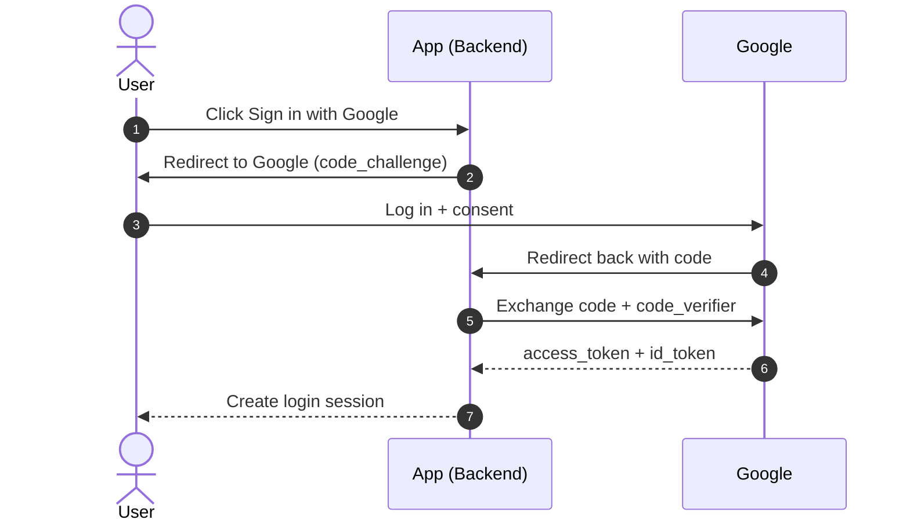

# Sessions, JWT & OAuth 2.0

> [!NOTE]
> **Goal:** separate authentication from authorization, choose between sessions and JWTs, store passwords safely, and understand the "Sign in with Google" flow.

## 1. Two different questions

- **Authentication:** *Who are you?* For example: password, OTP, Google login.
- **Authorization:** *What may you do?* For example: only admins delete users, and users may only edit their own orders.

The #1 API security bug (OWASP API #1, BOLA) is a missing authorization check:

```python
# ❌ Any logged-in user can read anyone's order
@app.get("/orders/{order_id}")
def get_order(order_id: int, user=Depends(current_user)):
    return db.get(Order, order_id)

# ✅ Check ownership
@app.get("/orders/{order_id}")
def get_order(order_id: int, user=Depends(current_user)):
    order = db.get(Order, order_id)
    if not order or order.customer_id != user.id:
        raise HTTPException(404)   # 404 avoids revealing that the record exists
    return order
```

## 2. Storing passwords

> [!CAUTION]
> A leaked database with MD5-hashed passwords is a leaked password list: GPUs try billions of guesses per second.

- **Never** store plaintext or bare MD5/SHA-256 (too fast, easy to brute-force).
- Use a slow, salted hash: **Argon2id** (recommended), bcrypt, or scrypt.

```python
from argon2 import PasswordHasher
ph = PasswordHasher()
hashed = ph.hash("s3cret!")       # store this string
ph.verify(hashed, "s3cret!")      # returns True or raises
```

## 3. Sessions (stateful)

1. The user logs in. The server creates a random `session_id` and stores `{session_id: user_id}` in the DB or Redis.
2. The server responds with `Set-Cookie: sid=...; HttpOnly; Secure; SameSite=Lax`.
3. On later requests, the browser sends the cookie automatically and the server looks up the session.

✅ Instant revocation (delete the session). ✅ HttpOnly cookies are invisible to JavaScript.
❌ Multiple servers need a shared session store. ❌ You must defend against CSRF.

## 4. JWT (stateless)

```
eyJhbGciOiJIUzI1NiJ9 . eyJzdWIiOiI0MiIsInJvbGUiOiJ1c2VyIiwiZXhwIjoxNzY0MDAwMDAwfQ . kX9...
      header                              payload (claims)                          signature
```


- The server **signs** the token. Later it only checks the signature and `exp`, with no DB lookup.
- ⚠️ The payload is Base64-**encoded**, not **encrypted**: never put secrets in it.
- ❌ Hard to revoke before expiry. The usual answer:
  - A short-lived **access token** (5–15 min).
  - A long-lived, server-side, revocable **refresh token** that is **rotated** on every use.

### Which one?

| Situation | Suggestion |
|---|---|
| Classic same-domain web app | Session + cookie |
| Mobile apps, service-to-service APIs | JWT access token + refresh token |
| SPA | HttpOnly cookie (holding a session or a JWT); avoid `localStorage` tokens |

## 5. OAuth 2.0 and OpenID Connect

"Sign in with Google" uses the **Authorization Code Flow + PKCE**:




1. The app redirects the user to Google with a `code_challenge`.
2. The user logs in and consents. Google redirects back to the app with a `code`.
3. The backend exchanges the `code` (plus the `code_verifier`) for an `access_token` and an `id_token`.
4. The `id_token` (a JWT, per OIDC) says who the user is.

- **OAuth 2.0** handles *delegated authorization* (accessing resources on the user's behalf).
- **OIDC** adds *authentication* (who the user is) on top of OAuth 2.0.

## 6. Role-based access control (RBAC)

```python
def require_role(*roles):
    def checker(user=Depends(current_user)):
        if user.role not in roles:
            raise HTTPException(403)
        return user
    return checker

@app.delete("/users/{uid}", dependencies=[Depends(require_role("admin"))])
def delete_user(uid: int): ...
```

## ✅ Self-check

1. Why avoid storing JWTs in `localStorage`?
2. A user is banned, but their access token is valid for 10 more minutes. What are your options?
3. How does OAuth 2.0 differ from OpenID Connect?
