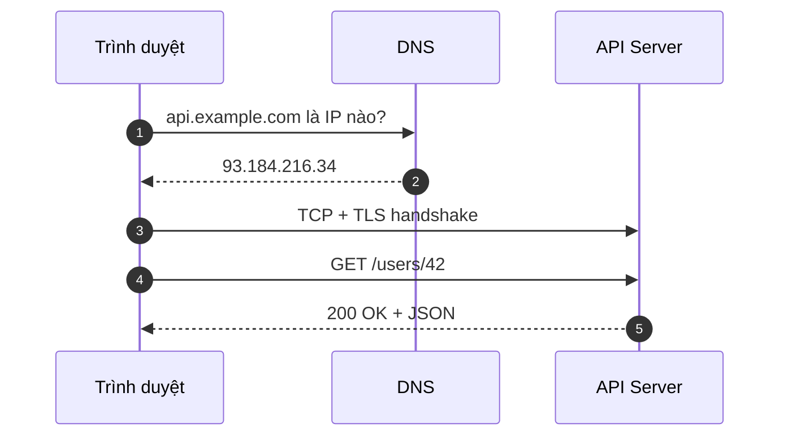

# HTTP từ A đến Z

> [!NOTE]
> **Mục tiêu:** hiểu chuyện gì xảy ra khi client gọi API, đọc được request/response thô, và chọn đúng method và status code.

## 1. Vòng đời của một request

Khi bạn gõ `https://api.example.com/users/42`:

1. **DNS** đổi tên miền `api.example.com` thành địa chỉ IP.
2. **TCP** mở kết nối tới server (cổng 443).
3. **TLS handshake** thiết lập kênh mã hóa (HTTPS).
4. Client gửi **HTTP request**, server xử lý rồi trả về **HTTP response**.
5. Kết nối có thể được giữ lại (keep-alive) để dùng cho request kế tiếp.


## 2. Hình dạng một request/response

```http
GET /users/42 HTTP/1.1
Host: api.example.com
Accept: application/json
Authorization: Bearer eyJhbGciOi...
```

```http
HTTP/1.1 200 OK
Content-Type: application/json
Cache-Control: max-age=60

{"id": 42, "name": "An"}
```




Một request gồm **dòng đầu** (method + path + version), **header**, một dòng trống, rồi **body** (không bắt buộc).

## 3. Method

| Method | Dùng để | Safe | Idempotent |
|---|---|---|---|
| GET | Đọc dữ liệu | ✅ | ✅ |
| POST | Tạo mới / hành động | ❌ | ❌ |
| PUT | Thay thế toàn bộ | ❌ | ✅ |
| PATCH | Sửa một phần | ❌ | ❌ |
| DELETE | Xóa | ❌ | ✅ |

- **Safe:** không làm thay đổi dữ liệu.
- **Idempotent:** gọi 1 lần hay 10 lần thì trạng thái server vẫn như nhau. Tính chất này cực kỳ quan trọng khi client **retry** do mạng chập chờn.

## 4. Status code cần thuộc

- `200 OK`, `201 Created`, `204 No Content`
- `301/308` chuyển hướng vĩnh viễn, `304 Not Modified` (cache)
- `400 Bad Request`, `401 Unauthorized`, `403 Forbidden`, `404 Not Found`, `409 Conflict`, `422 Unprocessable Content`, `429 Too Many Requests`
- `500 Internal Server Error`, `502 Bad Gateway`, `503 Service Unavailable`, `504 Gateway Timeout`

> [!TIP]
> **Mẹo nhớ:** 4xx là "lỗi của bạn" (client), 5xx là "lỗi của tôi" (server).


## 5. Header quan trọng

- `Content-Type`: định dạng của body (`application/json`).
- `Accept`: định dạng client muốn nhận.
- `Authorization`: thông tin xác thực (`Bearer <token>`).
- `Cache-Control`, `ETag`: điều khiển cache.
- `Set-Cookie` / `Cookie`: phiên đăng nhập.

## 6. CORS trong một đoạn

Trình duyệt **chặn** JavaScript ở `https://app.com` đọc response từ `https://api.com`, trừ khi server trả về `Access-Control-Allow-Origin: https://app.com`. Với request "không đơn giản" (ví dụ có header `Authorization`), trình duyệt gửi trước một request **preflight** bằng method `OPTIONS`.

CORS là cơ chế bảo vệ **của trình duyệt**. `curl` hay Postman không bị CORS chặn.

## 7. Thực hành

```bash
# Xem toàn bộ header của request/response
curl -v https://httpbin.org/get

# Gửi JSON bằng POST
curl -X POST https://httpbin.org/post \
  -H "Content-Type: application/json" \
  -d '{"name":"An"}'
```

## ✅ Tự kiểm tra

1. Vì sao `PUT` là idempotent còn `POST` thì không?
2. Người dùng đã đăng nhập nhưng truy cập trang admin: nên trả 401 hay 403?
3. Tại sao gọi API bằng Postman thì chạy, còn từ frontend lại báo lỗi CORS?
