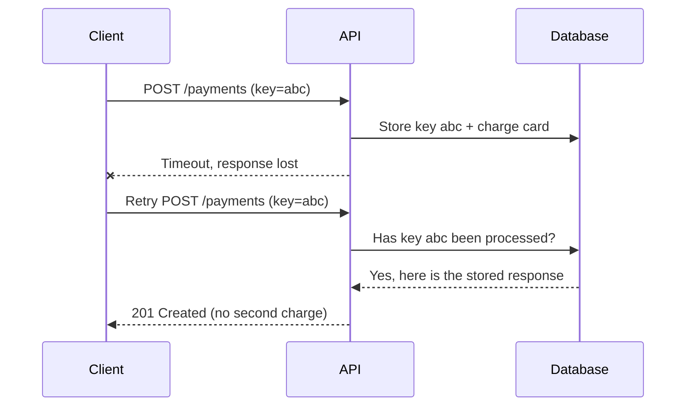

# Designing a clean REST API

> [!NOTE]
> **Goal:** design APIs whose usage people can guess, and that can evolve without breaking clients.

## 1. Resources are nouns, methods are verbs

| ❌ Avoid | ✅ Prefer |
|---|---|
| `POST /createUser` | `POST /users` |
| `GET /getOrdersByUser?id=42` | `GET /users/42/orders` |
| `POST /deleteOrder/7` | `DELETE /orders/7` |


Conventions:

- Use **plural nouns** in lowercase kebab-case: `/order-items`.
- Nest at most 1–2 levels. Beyond that, use queries: `/orders?customer_id=42`.
- Actions that don't fit CRUD can be sub-resources: `POST /orders/7/cancel`.

## 2. Picking the right status code

| Situation | Status |
|---|---|
| Successful read | `200` |
| Created | `201` + `Location: /orders/7` header |
| Deleted, no body | `204` |
| Malformed JSON | `400` |
| Semantically invalid (bad email format) | `422` |
| Duplicate (email already taken) | `409` |
| Too many requests | `429` + `Retry-After` |

## 3. Consistent error format

Use one error shape across the whole API, for example RFC 9457 (Problem Details):

```json
{
  "type": "https://api.example.com/errors/validation",
  "title": "Validation failed",
  "status": 422,
  "errors": [{ "field": "email", "message": "must be a valid email" }]
}
```

## 4. Pagination, filtering, sorting

```http
GET /products?category=audio&sort=-price&limit=20&cursor=eyJpZCI6MTIwfQ
```

- **Offset** (`?page=3&limit=20`): simple, but slow for large offsets and it shifts when data changes.
- **Cursor** (`?cursor=...`): stable and fast. Ideal for feeds and large lists.

Return metadata alongside the data:

```json
{ "data": [...], "next_cursor": "eyJpZCI6MTQwfQ", "has_more": true }
```

## 5. Idempotency for critical operations

A payment times out and the client retries. Without care, the customer gets charged twice. The fix: the client sends `Idempotency-Key: <uuid>`. The server stores the key with its response, and when it sees the same key again it returns the stored response instead of processing the payment again.




## 6. Versioning

- `/v1/...` in the URL: explicit and easy to debug. This is the most common approach.
- **Non-breaking changes** (adding a field) don't need a new version.
- **Breaking changes** (renaming or removing a field, changing a type) need a new version and a deprecation period.

## 7. Minimal FastAPI example

```python
from fastapi import FastAPI, HTTPException, Response, status
from pydantic import BaseModel, EmailStr

app = FastAPI()
users: dict[int, dict] = {}

class UserIn(BaseModel):
    name: str
    email: EmailStr

@app.post("/v1/users", status_code=status.HTTP_201_CREATED)
def create_user(body: UserIn, response: Response):
    if any(u["email"] == body.email for u in users.values()):
        raise HTTPException(status_code=409, detail="Email already exists")
    uid = len(users) + 1
    users[uid] = {"id": uid, **body.model_dump()}
    response.headers["Location"] = f"/v1/users/{uid}"
    return users[uid]

@app.get("/v1/users/{uid}")
def get_user(uid: int):
    if uid not in users:
        raise HTTPException(status_code=404, detail="User not found")
    return users[uid]
```

FastAPI generates **OpenAPI** docs at `/docs`. They are the contract between backend and frontend.

## ✅ Self-check

1. Design an endpoint to "mark all of user 42's notifications as read".
2. When do you return `409` and when `422`?
3. Why doesn't cursor pagination skip or repeat rows when new data is inserted?
