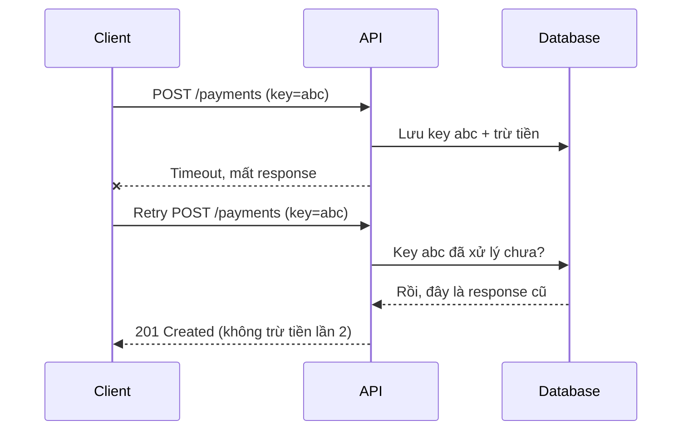

# Thiết kế REST API chuẩn

> [!NOTE]
> **Mục tiêu:** thiết kế API mà người khác đọc là đoán được cách dùng, và có thể mở rộng mà không phá vỡ client.

## 1. Resource là danh từ, method là động từ

| ❌ Không nên | ✅ Nên |
|---|---|
| `POST /createUser` | `POST /users` |
| `GET /getOrdersByUser?id=42` | `GET /users/42/orders` |
| `POST /deleteOrder/7` | `DELETE /orders/7` |


Quy ước:

- Dùng **danh từ số nhiều**, chữ thường, nối bằng gạch ngang: `/order-items`.
- Lồng nhau tối đa 1–2 cấp. Sâu hơn thì dùng query: `/orders?customer_id=42`.
- Hành động không khớp CRUD có thể dùng sub-resource: `POST /orders/7/cancel`.

## 2. Chọn status code đúng

| Tình huống | Status |
|---|---|
| Đọc thành công | `200` |
| Tạo thành công | `201` + header `Location: /orders/7` |
| Xóa thành công, không có body | `204` |
| JSON hỏng | `400` |
| Dữ liệu sai nghiệp vụ (email sai định dạng) | `422` |
| Trùng (email đã tồn tại) | `409` |
| Gọi quá nhiều | `429` + `Retry-After` |

## 3. Định dạng lỗi nhất quán

Hãy dùng một cấu trúc lỗi duy nhất cho toàn bộ API, ví dụ theo chuẩn RFC 9457 (Problem Details):

```json
{
  "type": "https://api.example.com/errors/validation",
  "title": "Validation failed",
  "status": 422,
  "errors": [{ "field": "email", "message": "must be a valid email" }]
}
```

## 4. Phân trang, lọc, sắp xếp

```http
GET /products?category=audio&sort=-price&limit=20&cursor=eyJpZCI6MTIwfQ
```

- **Offset** (`?page=3&limit=20`): đơn giản, nhưng chậm với offset lớn và dễ lệch khi dữ liệu thay đổi.
- **Cursor** (`?cursor=...`): ổn định và nhanh. Phù hợp với feed và danh sách lớn.

Nên trả kèm metadata:

```json
{ "data": [...], "next_cursor": "eyJpZCI6MTQwfQ", "has_more": true }
```

## 5. Idempotency cho thao tác quan trọng

Thanh toán bị timeout thì client sẽ retry. Nếu không cẩn thận, khách bị trừ tiền 2 lần. Cách xử lý: client gửi header `Idempotency-Key: <uuid>`. Server lưu key cùng response; nếu nhận lại key cũ thì trả lại response cũ thay vì xử lý lần nữa.




## 6. Versioning

- `/v1/...` trong URL: rõ ràng và dễ debug. Đây là cách phổ biến nhất.
- **Thay đổi không phá vỡ** (thêm field mới) thì không cần lên version.
- **Thay đổi phá vỡ** (đổi tên hoặc xóa field, đổi kiểu dữ liệu) thì cần version mới và thời gian chuyển đổi (deprecation).

## 7. Ví dụ tối giản với FastAPI

```python
from fastapi import FastAPI, HTTPException, Response, status
from pydantic import BaseModel, EmailStr

app = FastAPI()
users: dict[int, dict] = {}

class UserIn(BaseModel):
    name: str
    email: EmailStr

@app.post("/v1/users", status_code=status.HTTP_201_CREATED)
def create_user(body: UserIn, response: Response):
    if any(u["email"] == body.email for u in users.values()):
        raise HTTPException(status_code=409, detail="Email already exists")
    uid = len(users) + 1
    users[uid] = {"id": uid, **body.model_dump()}
    response.headers["Location"] = f"/v1/users/{uid}"
    return users[uid]

@app.get("/v1/users/{uid}")
def get_user(uid: int):
    if uid not in users:
        raise HTTPException(status_code=404, detail="User not found")
    return users[uid]
```

FastAPI tự sinh tài liệu **OpenAPI** tại `/docs`. Đây là "hợp đồng" giữa backend và frontend.

## ✅ Tự kiểm tra

1. Thiết kế endpoint để "đánh dấu tất cả thông báo của user 42 là đã đọc".
2. Khi nào trả `409`, khi nào trả `422`?
3. Vì sao cursor pagination không bị lặp hoặc bỏ sót bản ghi khi có dữ liệu mới chèn vào?
