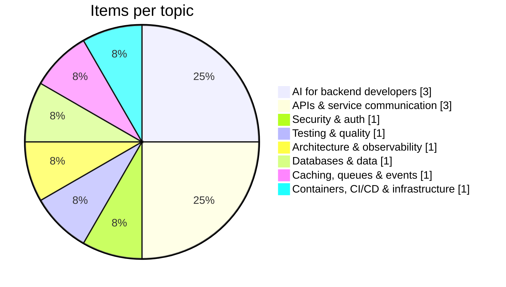

# Tech Radar week 47/2026

> [!NOTE]
> 🤖 This post was compiled automatically by **Tech Radar Bot** on November 18, 2026 from GitHub (4), GitHub Releases (8). Each item is mapped to a topic linked to the skills on your [roadmap](#/roadmap).

> [!WARNING]
> This run could not fetch data from: Hacker News, DEV Community. The bot will retry on the next run.

## 📊 This week at a glance

| Topic | Items | Related skill |
|---|---:|---|
| 🤖 AI for backend developers | 3 | Bonus topic |
| 🔌 APIs & service communication | 3 | [REST API design](#/roadmap) |
| 🛡️ Security & auth | 1 | [Web security](#/roadmap) |
| 🧪 Testing & quality | 1 | [Testing](#/roadmap) |
| 🔭 Architecture & observability | 1 | [System design](#/roadmap) |
| 🗄️ Databases & data | 1 | [Database design](#/roadmap) |
| ⚡ Caching, queues & events | 1 | [Caching & Redis](#/roadmap) |
| 🐳 Containers, CI/CD & infrastructure | 1 | [Docker & CI/CD](#/roadmap) |

## 🔥 Top 3 highlights

### 1. agentes-chat/agentes-chat

**GitHub** · ⭐ 1.7k · TypeScript · new repo · 🤖 AI for backend developers · 📅 2026-11-09

Open-source, self-hosted Slack alternative where your team and AI agents work together in channels and DMs. Agents run on Claude, ChatGPT/Codex, Gemini or Grok, with MCP tools, their own computer and browser, routines,…

> [!TIP]
> **Why it matters:** Modern backends increasingly integrate LLMs, vector search and agents — a skill in high demand.

[Read more →](https://github.com/agentes-chat/agentes-chat)

### 2. yjid/kensaku

**GitHub** · ⭐ 1.8k · Rust · new repo · 🤖 AI for backend developers · 📅 2026-10-24

Search inside documents, code, and even screenshots - instantly and locally. A free, open-source file launcher with OCR, semantic search, and MCP agent access.

> [!TIP]
> **Why it matters:** Modern backends increasingly integrate LLMs, vector search and agents — a skill in high demand.

[Read more →](https://github.com/yjid/kensaku)

### 3. AbhiKamane/ai-app-builder-open

**GitHub** · ⭐ 384 · HTML · new repo · 🛡️ Security & auth · 📅 2026-11-06

Open-source AI app builder for full-stack Next.js apps with hosting and auth

> [!TIP]
> **Why it matters:** One vulnerability can undo everything — security knowledge needs regular refreshing.

[Read more →](https://github.com/AbhiKamane/ai-app-builder-open)

## 🚀 New releases of tools you know

| Tool | Version | Date | Notes |
|---|---|---|---|
| [astral-sh/ruff](https://github.com/astral-sh/ruff/releases/tag/0.17.5) | `0.17.5` | 2026-11-12 | Release Notes Released on 2026-11-12. Preview features - Redirect renamed rules ( 30081) - \\\[ flake8-async \\\] Implem |
| [grafana/k6](https://github.com/grafana/k6/releases/tag/v2.4.0) | `v2.4.0` | 2026-11-12 | k6 v2.4.0 is here 🎉! This release includes: - Experimental tracing of test runs, scenarios, VUs, and iterations. - Ed25 |
| [fastapi/fastapi](https://github.com/fastapi/fastapi/releases/tag/0.165.0) | `0.165.0` | 2026-11-18 | FastAPI includes an official skill that helps coding agents use new features and recommended patterns for your installed |
| [sqlalchemy/sqlalchemy](https://github.com/sqlalchemy/sqlalchemy/releases/tag/rel_2_1_9) | `rel_2_1_9` | 2026-11-16 | 2.1.9 |
| [nestjs/nest](https://github.com/nestjs/nest/releases/tag/v12.5.1) | `v12.5.1` | 2026-11-16 | v12.5.1 (2026-11-16) Features core 18523 feat(core): accept module metadata as the root module (@kamilmysliwiec) Bug fix |
| [honojs/hono](https://github.com/honojs/hono/releases/tag/v4.13.19) | `v4.13.19` | 2026-11-16 | What's Changed fix(jsx): render an async component that returns null, a boolean, or a number in fix(jsx/dom): align useA |
| [valkey-io/valkey](https://github.com/valkey-io/valkey/releases/tag/9.1.4) | `9.1.4` | 2026-11-18 | Valkey 9.1.4 - Released Wed 18 November 2026 ---------------------------------------------- Upgrade urgency SECURITY: Th |
| [docker/compose](https://github.com/docker/compose/releases/tag/v5.8.0) | `v5.8.0` | 2026-11-17 | What's Changed ℹ️ Scheduled jobs are now supported. A job is a one-shot unit of work declared in the top-level jobs: ele |

## 🧭 By topic

### 🤖 AI for backend developers

- **[emanuele-em/kanzo](https://github.com/emanuele-em/kanzo)** — Self-hosted, sharable kanban for humans and agents. One 4.7 MB binary, 5 MB of RAM, 10 to 60 tokens per agent reply, starts in 3 ms, zero setup. _(GitHub · ⭐ 1.2k · Rust · new repo)_

## ✅ To-do this week

- [ ] 🤖 Try it with **agentes-chat/agentes-chat**: Add a semantic-search endpoint (pgvector) or a small MCP server to a project.
- [ ] 🛡️ Try it with **AbhiKamane/ai-app-builder-open**: Review your project against the OWASP checklist and try one technique from this post.
- [ ] 🃏 Review your [flashcards](#/cards) and solve one more [SQL Lab](#/sql) exercise.

## ⚙️ About this bot

The bot runs every Monday via GitHub Actions (`.github/workflows/tech-radar.yml`), pulls data from GitHub, Hacker News and DEV, scores items by popularity and backend relevance, and publishes this post. Change sources, keywords and topics in `scripts/tech-radar/config.mjs`.
