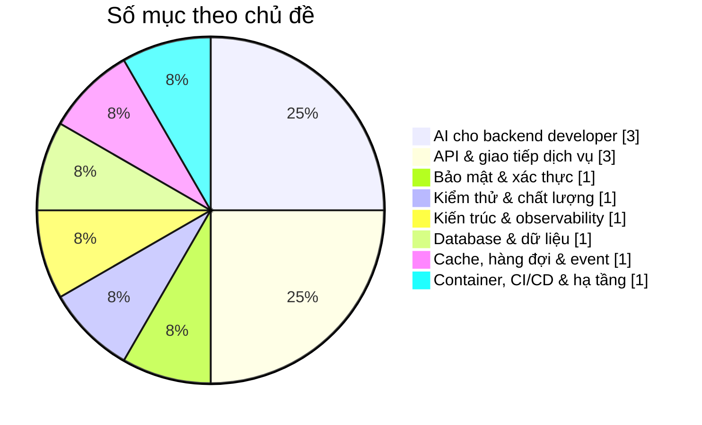

# Tech Radar tuần 47/2026

> [!NOTE]
> 🤖 Bài viết được **Tech Radar Bot** tổng hợp tự động ngày 18/11/2026 từ GitHub (4), GitHub Releases (8). Mỗi mục được xếp vào một chủ đề gắn với kỹ năng trên [lộ trình](#/roadmap) của bạn.
>
> Mô tả của repo/bài viết được giữ nguyên tiếng Anh — đây cũng là cách luyện đọc tài liệu kỹ thuật!

> [!WARNING]
> Lần chạy này không lấy được dữ liệu từ: Hacker News, DEV Community. Bot sẽ thử lại ở lần chạy sau.

## 📊 Toàn cảnh tuần này

| Chủ đề | Số mục | Kỹ năng liên quan |
|---|---:|---|
| 🤖 AI cho backend developer | 3 | Chủ đề mở rộng |
| 🔌 API & giao tiếp dịch vụ | 3 | [Thiết kế REST API](#/roadmap) |
| 🛡️ Bảo mật & xác thực | 1 | [Bảo mật Web](#/roadmap) |
| 🧪 Kiểm thử & chất lượng | 1 | [Kiểm thử](#/roadmap) |
| 🔭 Kiến trúc & observability | 1 | [System design](#/roadmap) |
| 🗄️ Database & dữ liệu | 1 | [Thiết kế CSDL](#/roadmap) |
| ⚡ Cache, hàng đợi & event | 1 | [Caching & Redis](#/roadmap) |
| 🐳 Container, CI/CD & hạ tầng | 1 | [Docker & CI/CD](#/roadmap) |

## 🔥 Top 3 đáng chú ý

### 1. agentes-chat/agentes-chat

**GitHub** · ⭐ 1.7k · TypeScript · repo mới · 🤖 AI cho backend developer · 📅 2026-11-09

Open-source, self-hosted Slack alternative where your team and AI agents work together in channels and DMs. Agents run on Claude, ChatGPT/Codex, Gemini or Grok, with MCP tools, their own computer and browser, routines,…

> [!TIP]
> **Vì sao nên quan tâm:** Backend hiện đại ngày càng phải tích hợp LLM, vector search và agent — đây là kỹ năng đang được tuyển nhiều.

[Xem chi tiết →](https://github.com/agentes-chat/agentes-chat)

### 2. yjid/kensaku

**GitHub** · ⭐ 1.8k · Rust · repo mới · 🤖 AI cho backend developer · 📅 2026-10-24

Search inside documents, code, and even screenshots - instantly and locally. A free, open-source file launcher with OCR, semantic search, and MCP agent access.

> [!TIP]
> **Vì sao nên quan tâm:** Backend hiện đại ngày càng phải tích hợp LLM, vector search và agent — đây là kỹ năng đang được tuyển nhiều.

[Xem chi tiết →](https://github.com/yjid/kensaku)

### 3. AbhiKamane/ai-app-builder-open

**GitHub** · ⭐ 384 · HTML · repo mới · 🛡️ Bảo mật & xác thực · 📅 2026-11-06

Open-source AI app builder for full-stack Next.js apps with hosting and auth

> [!TIP]
> **Vì sao nên quan tâm:** Một lỗ hổng có thể xóa sạch mọi công sức — cập nhật kiến thức bảo mật là việc phải làm định kỳ.

[Xem chi tiết →](https://github.com/AbhiKamane/ai-app-builder-open)

## 🚀 Bản phát hành mới của công cụ quen thuộc

| Công cụ | Phiên bản | Ngày | Ghi chú |
|---|---|---|---|
| [astral-sh/ruff](https://github.com/astral-sh/ruff/releases/tag/0.17.5) | `0.17.5` | 2026-11-12 | Release Notes Released on 2026-11-12. Preview features - Redirect renamed rules ( 30081) - \\\[ flake8-async \\\] Implem |
| [grafana/k6](https://github.com/grafana/k6/releases/tag/v2.4.0) | `v2.4.0` | 2026-11-12 | k6 v2.4.0 is here 🎉! This release includes: - Experimental tracing of test runs, scenarios, VUs, and iterations. - Ed25 |
| [fastapi/fastapi](https://github.com/fastapi/fastapi/releases/tag/0.165.0) | `0.165.0` | 2026-11-18 | FastAPI includes an official skill that helps coding agents use new features and recommended patterns for your installed |
| [sqlalchemy/sqlalchemy](https://github.com/sqlalchemy/sqlalchemy/releases/tag/rel_2_1_9) | `rel_2_1_9` | 2026-11-16 | 2.1.9 |
| [nestjs/nest](https://github.com/nestjs/nest/releases/tag/v12.5.1) | `v12.5.1` | 2026-11-16 | v12.5.1 (2026-11-16) Features core 18523 feat(core): accept module metadata as the root module (@kamilmysliwiec) Bug fix |
| [honojs/hono](https://github.com/honojs/hono/releases/tag/v4.13.19) | `v4.13.19` | 2026-11-16 | What's Changed fix(jsx): render an async component that returns null, a boolean, or a number in fix(jsx/dom): align useA |
| [valkey-io/valkey](https://github.com/valkey-io/valkey/releases/tag/9.1.4) | `9.1.4` | 2026-11-18 | Valkey 9.1.4 - Released Wed 18 November 2026 ---------------------------------------------- Upgrade urgency SECURITY: Th |
| [docker/compose](https://github.com/docker/compose/releases/tag/v5.8.0) | `v5.8.0` | 2026-11-17 | What's Changed ℹ️ Scheduled jobs are now supported. A job is a one-shot unit of work declared in the top-level jobs: ele |

## 🧭 Theo chủ đề

### 🤖 AI cho backend developer

- **[emanuele-em/kanzo](https://github.com/emanuele-em/kanzo)** — Self-hosted, sharable kanban for humans and agents. One 4.7 MB binary, 5 MB of RAM, 10 to 60 tokens per agent reply, starts in 3 ms, zero setup. _(GitHub · ⭐ 1.2k · Rust · repo mới)_

## ✅ Việc nên làm tuần này

- [ ] 🤖 Thử với **agentes-chat/agentes-chat**: Thêm một endpoint tìm kiếm ngữ nghĩa (pgvector) hoặc một MCP server nhỏ vào project.
- [ ] 🛡️ Thử với **AbhiKamane/ai-app-builder-open**: Rà lại project của bạn theo checklist OWASP và thử áp dụng một kỹ thuật trong bài.
- [ ] 🃏 Ôn lại [flashcard](#/cards) và luyện thêm một bài trong [SQL Lab](#/sql).

## ⚙️ Về bot này

Bot chạy tự động mỗi thứ Hai qua GitHub Actions (`.github/workflows/tech-radar.yml`), lấy dữ liệu từ GitHub, Hacker News và DEV, chấm điểm theo độ phổ biến và mức liên quan tới backend, rồi xuất bản thành bài blog này. Bạn có thể đổi nguồn, từ khóa và chủ đề trong `scripts/tech-radar/config.mjs`.
