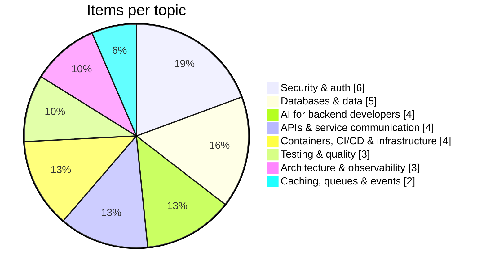

# Tech Radar week 47/2026

> [!NOTE]
> 🤖 This post was compiled automatically by **Tech Radar Bot** on November 19, 2026 from Hacker News (15), DEV Community (16). Each item is mapped to a topic linked to the skills on your [roadmap](#/roadmap).

## 📊 This week at a glance

| Topic | Items | Related skill |
|---|---:|---|
| 🛡️ Security & auth | 6 | [Web security](#/roadmap) |
| 🗄️ Databases & data | 5 | [Database design](#/roadmap) |
| 🤖 AI for backend developers | 4 | Bonus topic |
| 🔌 APIs & service communication | 4 | [REST API design](#/roadmap) |
| 🐳 Containers, CI/CD & infrastructure | 4 | [Docker & CI/CD](#/roadmap) |
| 🧪 Testing & quality | 3 | [Testing](#/roadmap) |
| 🔭 Architecture & observability | 3 | [System design](#/roadmap) |
| ⚡ Caching, queues & events | 2 | [Caching & Redis](#/roadmap) |

## 🔥 Top 5 highlights

### 1. New Evidence Shows School Phone Bans Are Gradually Improving Test Scores

**Hacker News** · ▲ 1.3k points · 💬 642 comments · 🧪 Testing & quality · 📅 2026-11-17

> [!TIP]
> **Why it matters:** Good testing tools let you refactor and deploy without fear.

[Read more →](https://www.nytimes.com/2026/11/17/upshot/school-phone-bans-study-scores.html) · [HN discussion](https://news.ycombinator.com/item?id=50530163)

### 2. Highly classified US national security communications network goes down

**Hacker News** · ▲ 664 points · 💬 746 comments · 🛡️ Security & auth · 📅 2026-11-17

> [!TIP]
> **Why it matters:** One vulnerability can undo everything — security knowledge needs regular refreshing.

[Read more →](https://www.cnn.com/2026/11/17/politics/highly-classified-national-security-communications-network-goes-down) · [HN discussion](https://news.ycombinator.com/item?id=50532849)

### 3. Universal XSS in uBlock Origin from website-driven element picker

**Hacker News** · ▲ 616 points · 💬 181 comments · 🛡️ Security & auth · 📅 2026-11-16

> [!TIP]
> **Why it matters:** One vulnerability can undo everything — security knowledge needs regular refreshing.

[Read more →](https://iter.ca/post/ubo-uxss/) · [HN discussion](https://news.ycombinator.com/item?id=50513160)

### 4. Gemini 4 Neon

**Hacker News** · ▲ 393 points · 💬 368 comments · 🗄️ Databases & data · 📅 2026-11-18

> [!TIP]
> **Why it matters:** Most performance problems live in the data layer — knowing new tools helps you pick the right store for each job.

[Read more →](https://blog.google/innovation-and-ai/models-and-research/gemini-models/introducing-gemini-4-neon/) · [HN discussion](https://news.ycombinator.com/item?id=50552424)

### 5. Energy-Based Reasoners: 385x more efficient inference

**Hacker News** · ▲ 300 points · 💬 52 comments · 🤖 AI for backend developers · 📅 2026-11-18

> [!TIP]
> **Why it matters:** Modern backends increasingly integrate LLMs, vector search and agents — a skill in high demand.

[Read more →](https://energy-based-reasoners.github.io/) · [HN discussion](https://news.ycombinator.com/item?id=50543989)

## 🧭 By topic

### 🔌 APIs & service communication

- **[Brave Search API now accepts agentic payments via the x402 protocol](https://brave.com/blog/search-api-agentic-payments/)** _(Hacker News · ▲ 262 points · 💬 150 comments)_
- **[Three copies of the same HTTP code, and how one Go engine fixed it](https://dev.to/kunalgoesbyken/three-copies-of-the-same-http-code-and-how-one-go-engine-fixed-it-i61)** — A free API client for REST, GraphQL, gRPC and WebSocket, and what building it taught me about SSRF,... _(DEV · ❤️ 7 reactions)_
- **[My Agent Scrubbed a Leaked API Key by Force-Pushing main. It Made Everything Worse.](https://dev.to/debashish_ghosal/my-agent-scrubbed-a-leaked-api-key-by-force-pushing-main-it-made-everything-worse-57a)** — My Agent Scrubbed a Leaked API Key by Force-Pushing main. It Made Everything Worse. An API... _(DEV · ❤️ 25 reactions)_
- **[One model gateway across clouds: LiteLLM on Cloud Run and Azure with zero API keys](https://dev.to/gde/one-model-gateway-across-clouds-litellm-on-cloud-run-and-azure-with-zero-api-keys-3ma7)** — One LiteLLM per cloud, on Cloud Run and Azure Container Apps. Agents reach Gemini and Azure OpenAI with their own identity: no API keys, no virtual keys, no database password. _(DEV · ❤️ 24 reactions)_

### 🗄️ Databases & data

- **[Turning a 22-year-old Postgres type-confusion primitive into RCE](https://mehmetince.net/part-3-6-how-i-ended-up-turning-a-22-year-old-postgresql-type-confusion-primitive-into-rce-cve-2026-6460/)** _(Hacker News · ▲ 232 points · 💬 41 comments)_
- **[Live-migration support in FreeBSD and bhyve coming](https://gyptazy.com/blog/freebsd-bhyve-live-migration-support-rfc/)** _(Hacker News · ▲ 140 points · 💬 51 comments)_
- **[PostgreSQL 19's pg\_plan\_advice turned a 28ms query into 264ms under load](https://dev.to/alexgeorgiev17/postgresql-19s-pgplanadvice-turned-a-28ms-query-into-264ms-under-load-46o5)** — I tested PostgreSQL 19 RC2's new planner-hint extension, pg plan advice: forcing the wrong plan made throughput 9x worse under ten clients, and a pinned plan that went stale after a data shift cost less than I expected. _(DEV · ❤️ 19 reactions)_
- **[The Hidden Cost of PostgreSQL JSONB Columns Under High Write Load](https://dev.to/johnnylemonny/the-hidden-cost-of-postgresql-jsonb-columns-under-high-write-load-2fil)** — Updating a single key inside a PostgreSQL JSONB column rewrites the entire blob, triggers TOAST churn, and bloats WAL. Here is the benchmark and the hybrid schema fix. _(DEV · ❤️ 27 reactions)_

### ⚡ Caching, queues & events

- **[Deploying new Temporal workflow code while workflows are running](https://dev.to/remdore/deploying-new-temporal-workflow-code-while-workflows-are-running-4150)** — A Temporal workflow can run for minutes, days or months, and the code behind it will change while it... _(DEV · ❤️ 10 reactions)_
- **[Your automation ran twice. Here's how to make n8n and Make workflows safe to retry](https://dev.to/manoj7ar/your-automation-ran-twice-heres-how-to-make-n8n-and-make-workflows-safe-to-retry-3np7)** — Every automation builder meets this bug eventually. A form submission comes in, the workflow creates... _(DEV · ❤️ 7 reactions)_

### 🐳 Containers, CI/CD & infrastructure

- **[Kubernetes Under the Hood: What Actually Happens When You Run kubectl apply](https://dev.to/smtahosin/kubernetes-under-the-hood-what-actually-happens-when-you-run-kubectl-apply-5cog)** — A visual, 10-minute deep dive into Kubernetes control plane internals. Learn how kube-apiserver processes admission webhooks, how etcd maintains Raft quorum, how controllers reconcile state with Informers, how… _(DEV · ❤️ 16 reactions)_
- **[Day 83: Two Files and Four Parts](https://dev.to/ndcodes/day-83-two-files-and-four-parts-40hc)** — Day 83 of DevOps, Day 33 of Azure. Both tasks today were made of parts that are each correct on their... _(DEV · ❤️ 20 reactions)_
- **[Day 85: A Task That Always Changes and Two Halves](https://dev.to/ndcodes/day-85-one-direction-and-two-halves-5cic)** — Day 85 of DevOps, Day 35 of Azure. Both tasks today reported a state that is a word rather than a... _(DEV · ❤️ 16 reactions)_
- **[Day 86: A Per-Host Variable and an Account-Wide Rule](https://dev.to/ndcodes/day-86-a-per-host-variable-and-an-account-wide-rule-538c)** — Day 86 of DevOps, Day 36 of Azure. Both tasks today were about a setting whose scope is not where you... _(DEV · ❤️ 12 reactions)_

### 🔭 Architecture & observability

- **[Two rejected series stalled all my metrics](https://dev.to/slima4/two-rejected-series-stalled-all-my-metrics-2523)** — Three alerts fired while production was fine. A rate limiter put client addresses in metric labels, and a retry on 429 turned two rejected series into a stall. _(DEV · ❤️ 8 reactions)_
- **[Why Architecture is the True Security Boundary](https://dev.to/aws-builders/why-architecture-is-the-true-security-boundary-38fi)** — For decades, organizations have tried to define a single security boundary to separate what is... _(DEV · ❤️ 16 reactions)_
- **[A health check should check what this server owns](https://dev.to/robertpaschal/when-your-health-check-takes-the-system-down-17e9)** — A couple of days ago I wrote that a health check should check something real: open a connection to... _(DEV · ❤️ 3 reactions)_

### 🛡️ Security & auth

- **["Humble Bundle just killed most of their security through vibecoding"](https://forums.spacebattles.com/threads/humble-bundle-just-completely-killed-most-of-their-security-through-vibecoding.1346295/)** _(Hacker News · ▲ 415 points · 💬 237 comments)_
- **[Critical RCE Vulnerability in Apache HTTP Server](https://www.wiz.io/blog/cve-2026-119618-rce-apache-http-server-vulnerability)** _(Hacker News · ▲ 372 points · 💬 200 comments)_
- **[Java4Shell: pre-auth RCE flaw in Java 17 puts servers at risk (CVE-2026-114938)](https://www.aikido.dev/blog/java-17-rce-vulnerability-cve-2026-114938)** _(Hacker News · ▲ 150 points · 💬 30 comments)_
- **[The Secret ThinkPad Powerbutton Code to Bring Dead Laptops Back to Life (2007)](https://masnick.com/posts/the-secret-thinkpad-powerbutton-code-to-bring-dead-laptops-back-to-life/)** _(Hacker News · ▲ 322 points · 💬 129 comments)_

### 🧪 Testing & quality

- **[Do House members' stock trades beat the market? A test of 8,900 trades](https://arkanumdata.com/research/house-trades)** _(Hacker News · ▲ 127 points · 💬 134 comments)_
- **[Evaluate the Decision, Not the Prose: Building an Eval Harness for an LLM Backend](https://dev.to/paulmurithi/evaluate-the-decision-not-the-prose-building-an-eval-harness-for-an-llm-backend-22gd)** — SokoFlow AI Build Log, Week 5 of 6: building an eval harness, getting rate-limited by my own test,... _(DEV · ❤️ 2 reactions)_

### 🤖 AI for backend developers

- **[Understanding Positional Embeddings in Modern LLMs](https://magazine.sebastianraschka.com/p/understanding-positional-embeddings)** _(Hacker News · ▲ 246 points · 💬 27 comments)_
- **[Not Everything Needs an LLM](https://newsletter.posthog.com/p/decision-models)** _(Hacker News · ▲ 179 points · 💬 74 comments)_
- **[I Pointed 3 Static Scanners at an MCP Server That Fails 8 Auth Tests. They Found 0, Including Mine](https://dev.to/kielltampubolon/i-pointed-3-static-scanners-at-an-mcp-server-that-fails-8-auth-tests-they-found-0-including-mine-2fha)** — mcpscan, Semgrep (200 rules) and Bandit gave a broken MCP server and its fixed twin the same report. Five custom Semgrep rules caught 3 of 8 auth bugs. _(DEV · ❤️ 4 reactions)_

## ✅ To-do this week

- [ ] 🧪 Try it with **New Evidence Shows School Phone Bans Are Gradually Improving Test Scores**: Write three tests for an important endpoint with it.
- [ ] 🛡️ Try it with **Highly classified US national security communications network goes down**: Review your project against the OWASP checklist and try one technique from this post.
- [ ] 🗄️ Try it with **Gemini 4 Neon**: Load the SQL Lab sample data into it and re-run three JOIN/GROUP BY exercises.
- [ ] 🤖 Try it with **Energy-Based Reasoners: 385x more efficient inference**: Add a semantic-search endpoint (pgvector) or a small MCP server to a project.
- [ ] 🃏 Review your [flashcards](#/cards) and solve one more [SQL Lab](#/sql) exercise.

## ⚙️ About this bot

The bot runs every Monday via GitHub Actions (`.github/workflows/tech-radar.yml`), pulls data from GitHub, Hacker News and DEV, scores items by popularity and backend relevance, and publishes this post. Change sources, keywords and topics in `scripts/tech-radar/config.mjs`.
