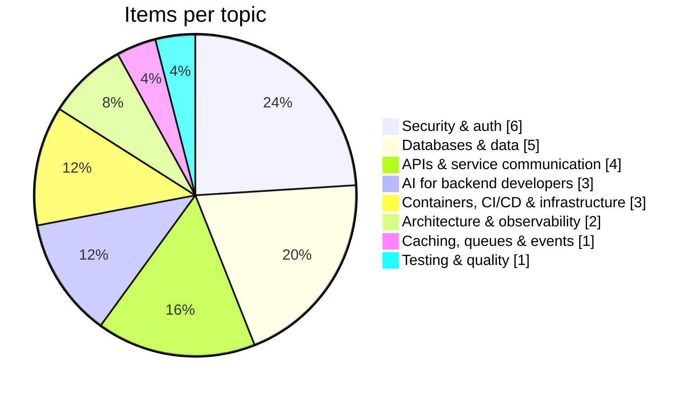

# Tech Radar Nov 19 · week 47/2026

> [!NOTE]
> 🤖 This post was compiled automatically by **Tech Radar Bot** on November 19, 2026 from Hacker News (8), DEV Community (17). Each item is mapped to a topic linked to the skills on your [roadmap](#/roadmap).

## 📊 This week at a glance

| Topic | Items | Related skill |
|---|---:|---|
| 🛡️ Security & auth | 6 | [Web security](#/roadmap) |
| 🗄️ Databases & data | 5 | [Database design](#/roadmap) |
| 🔌 APIs & service communication | 4 | [REST API design](#/roadmap) |
| 🤖 AI for backend developers | 3 | Bonus topic |
| 🐳 Containers, CI/CD & infrastructure | 3 | [Docker & CI/CD](#/roadmap) |
| 🔭 Architecture & observability | 2 | [System design](#/roadmap) |
| ⚡ Caching, queues & events | 1 | [Caching & Redis](#/roadmap) |
| 🧪 Testing & quality | 1 | [Testing](#/roadmap) |

## 🔥 Top 5 highlights

### 1. Java4Shell: RCE in OpenJDK when processing Base64

**Hacker News** · ▲ 1.2k points · 💬 321 comments · 🛡️ Security & auth · 📅 2026-11-17

> [!TIP]
> **Why it matters:** One vulnerability can undo everything — security knowledge needs regular refreshing.

[Read more →](https://calif.io/java4shell/) · [HN discussion](https://news.ycombinator.com/item?id=50538240)

### 2. Critical RCE Vulnerability in Apache HTTP Server

**Hacker News** · ▲ 372 points · 💬 200 comments · 🛡️ Security & auth · 📅 2026-11-12

> [!TIP]
> **Why it matters:** One vulnerability can undo everything — security knowledge needs regular refreshing.

[Read more →](https://www.wiz.io/blog/cve-2026-119618-rce-apache-http-server-vulnerability) · [HN discussion](https://news.ycombinator.com/item?id=50462177)

### 3. Understanding Positional Embeddings in Modern LLMs

**Hacker News** · ▲ 246 points · 💬 27 comments · 🤖 AI for backend developers · 📅 2026-11-15

> [!TIP]
> **Why it matters:** Modern backends increasingly integrate LLMs, vector search and agents — a skill in high demand.

[Read more →](https://magazine.sebastianraschka.com/p/understanding-positional-embeddings) · [HN discussion](https://news.ycombinator.com/item?id=50506376)

### 4. Turning a 22-year-old Postgres type-confusion primitive into RCE

**Hacker News** · ▲ 232 points · 💬 41 comments · 🗄️ Databases & data · 📅 2026-11-12

> [!TIP]
> **Why it matters:** Most performance problems live in the data layer — knowing new tools helps you pick the right store for each job.

[Read more →](https://mehmetince.net/part-3-6-how-i-ended-up-turning-a-22-year-old-postgresql-type-confusion-primitive-into-rce-cve-2026-6460/) · [HN discussion](https://news.ycombinator.com/item?id=50471761)

### 5. Not Everything Needs an LLM

**Hacker News** · ▲ 180 points · 💬 74 comments · 🤖 AI for backend developers · 📅 2026-11-17

> [!TIP]
> **Why it matters:** Modern backends increasingly integrate LLMs, vector search and agents — a skill in high demand.

[Read more →](https://newsletter.posthog.com/p/decision-models) · [HN discussion](https://news.ycombinator.com/item?id=50535740)

## 🧭 By topic

### 🔌 APIs & service communication

- **[Three copies of the same HTTP code, and how one Go engine fixed it](https://dev.to/kunalgoesbyken/three-copies-of-the-same-http-code-and-how-one-go-engine-fixed-it-i61)** — A free API client for REST, GraphQL, gRPC and WebSocket, and what building it taught me about SSRF,... _(DEV · ❤️ 7 reactions)_
- **[FastAPI 0.163's new dependency concurrency limit deadlocked two of my routes](https://dev.to/alexgeorgiev17/fastapi-0163s-new-dependency-concurrency-limit-deadlocked-two-of-my-routes-33k6)** — FastAPI 0.163.0's Depends(max concurrency=...) cut 20 concurrent calls to a peak of 5, but applies per Depends() object and per worker process, and two yield dependencies acquired in opposite order hung forever. _(DEV · ❤️ 10 reactions)_
- **[nginx 1.31's json\_set directive rejects a bad webhook payload about 13 times faster than forwarding it](https://dev.to/alexgeorgiev17/nginx-131s-jsonset-directive-rejects-a-bad-webhook-payload-about-13-times-faster-than-forwarding-3b00)** — I measured nginx 1.31's new native JSON parser against a Python backend doing the same validation: roughly 13x faster per-request rejection at low concurrency, half a backend's request count removed outright in a 50/50… _(DEV · ❤️ 8 reactions)_
- **[Longer Timeouts Won't Fix Your Webhook Duplicates. Claiming the Work Once Will](https://dev.to/aheadkit/longer-timeouts-wont-fix-your-webhook-duplicates-claiming-the-work-once-will-d90)** — The receiver was not down. That is the part I keep coming back to. It was answering every single... _(DEV · ❤️ 3 reactions)_

### 🗄️ Databases & data

- **[The Hidden Cost of PostgreSQL JSONB Columns Under High Write Load](https://dev.to/johnnylemonny/the-hidden-cost-of-postgresql-jsonb-columns-under-high-write-load-2fil)** — Updating a single key inside a PostgreSQL JSONB column rewrites the entire blob, triggers TOAST churn, and bloats WAL. Here is the benchmark and the hybrid schema fix. _(DEV · ❤️ 27 reactions)_
- **[PostgreSQL 19's pg\_plan\_advice turned a 28ms query into 264ms under load](https://dev.to/alexgeorgiev17/postgresql-19s-pgplanadvice-turned-a-28ms-query-into-264ms-under-load-46o5)** — I tested PostgreSQL 19 RC2's new planner-hint extension, pg plan advice: forcing the wrong plan made throughput 9x worse under ten clients, and a pinned plan that went stale after a data shift cost less than I expected. _(DEV · ❤️ 19 reactions)_
- **[4 SQL statements and a segfault: inside PostgreSQL's 22-year-old type confusion, CVE-2026-6460](https://dev.to/slabb/4-sql-statements-and-a-segfault-inside-postgresqls-22-year-old-type-confusion-cve-2026-6460-1ggm)** — A composite type, a PREPARE, an ALTER TYPE, an EXECUTE: as the lowest-privileged login role, that is a server segfault on every PostgreSQL since 2004, and Mehmet Ince's writeup turns it into full RCE via a fake methods… _(DEV · ❤️ 10 reactions)_
- **[ClickHouse 26.10's string filter during scan cuts a selective LIKE query's memory 25-fold](https://dev.to/alexgeorgiev17/clickhouse-2610s-string-filter-during-scan-cuts-a-selective-like-querys-memory-25-fold-228j)** — I benchmarked ClickHouse 26.10's new apply string filters during scan setting against 26.9: a selective LIKE query's peak memory dropped from 37.6MB to 1.5MB, but a plain WHERE equality got none of it until I rewrote… _(DEV · ❤️ 13 reactions)_

### ⚡ Caching, queues & events

- **[Deploying new Temporal workflow code while workflows are running](https://dev.to/remdore/deploying-new-temporal-workflow-code-while-workflows-are-running-4150)** — A Temporal workflow can run for minutes, days or months, and the code behind it will change while it... _(DEV · ❤️ 10 reactions)_

### 🐳 Containers, CI/CD & infrastructure

- **[Kubernetes Under the Hood: What Actually Happens When You Run kubectl apply](https://dev.to/smtahosin/kubernetes-under-the-hood-what-actually-happens-when-you-run-kubectl-apply-5cog)** — A visual, 10-minute deep dive into Kubernetes control plane internals. Learn how kube-apiserver processes admission webhooks, how etcd maintains Raft quorum, how controllers reconcile state with Informers, how… _(DEV · ❤️ 16 reactions)_
- **[The Kubernetes Upgrade Trap: A Practical Roadmap to Escape Deprecated APIs, Broken Add-ons, and Endless Delays](https://dev.to/varunvarde/the-kubernetes-upgrade-trap-a-practical-roadmap-to-escape-deprecated-apis-broken-add-ons-and-3kfa)** — Every Kubernetes platform team knows the situation. A new Kubernetes release becomes available,... _(DEV · ❤️ 5 reactions)_
- **[AWS Extended Support: what it costs and how to find everything you're about to pay for](https://dev.to/expiryradar/aws-extended-support-what-it-costs-and-how-to-find-everything-youre-about-to-pay-for-6i)** — Disclosure: I build Expiry Radar, a tool that tracks dates like these. Nothing below needs it: the... _(DEV · ❤️ 5 reactions)_

### 🔭 Architecture & observability

- **[Two rejected series stalled all my metrics](https://dev.to/slima4/two-rejected-series-stalled-all-my-metrics-2523)** — Three alerts fired while production was fine. A rate limiter put client addresses in metric labels, and a retry on 429 turned two rejected series into a stall. _(DEV · ❤️ 8 reactions)_
- **[A health check should check what this server owns](https://dev.to/robertpaschal/when-your-health-check-takes-the-system-down-17e9)** — A couple of days ago I wrote that a health check should check something real: open a connection to... _(DEV · ❤️ 3 reactions)_

### 🛡️ Security & auth

- **[Java4Shell: pre-auth RCE flaw in Java 17 puts servers at risk (CVE-2026-114938)](https://www.aikido.dev/blog/java-17-rce-vulnerability-cve-2026-114938)** _(Hacker News · ▲ 150 points · 💬 30 comments)_
- **[Universal XSS in uBlock Origin from website-driven element picker](https://iter.ca/post/ubo-uxss/)** _(Hacker News · ▲ 616 points · 💬 181 comments)_
- **[KVM: x86: Unconditionally reset MMU context when emulating INIT (CVE-2026-99312)](https://www.cve.org/CVERecord?id=CVE-2026-99312)** _(Hacker News · ▲ 174 points · 💬 115 comments)_
- **[Enterprise SSO for B2B SaaS: How to Prepare Before Your First Big Customer Asks](https://dev.to/hadil/enterprise-sso-for-b2b-saas-how-to-prepare-before-your-first-big-customer-asks-50p6)** — Enterprise SSO for B2B SaaS often becomes a requirement as your product attracts larger customers. A... _(DEV · ❤️ 75 reactions)_

### 🧪 Testing & quality

- **[Evaluate the Decision, Not the Prose: Building an Eval Harness for an LLM Backend](https://dev.to/paulmurithi/evaluate-the-decision-not-the-prose-building-an-eval-harness-for-an-llm-backend-22gd)** — SokoFlow AI Build Log, Week 5 of 6: building an eval harness, getting rate-limited by my own test,... _(DEV · ❤️ 2 reactions)_

### 🤖 AI for backend developers

- **[I Pointed 3 Static Scanners at an MCP Server That Fails 8 Auth Tests. They Found 0, Including Mine](https://dev.to/kielltampubolon/i-pointed-3-static-scanners-at-an-mcp-server-that-fails-8-auth-tests-they-found-0-including-mine-2fha)** — mcpscan, Semgrep (200 rules) and Bandit gave a broken MCP server and its fixed twin the same report. Five custom Semgrep rules caught 3 of 8 auth bugs. _(DEV · ❤️ 4 reactions)_

## ✅ To-do this week

- [ ] 🛡️ Try it with **Java4Shell: RCE in OpenJDK when processing Base64**: Review your project against the OWASP checklist and try one technique from this post.
- [ ] 🤖 Try it with **Understanding Positional Embeddings in Modern LLMs**: Add a semantic-search endpoint (pgvector) or a small MCP server to a project.
- [ ] 🗄️ Try it with **Turning a 22-year-old Postgres type-confusion primitive into RCE**: Load the SQL Lab sample data into it and re-run three JOIN/GROUP BY exercises.
- [ ] 🃏 Review your [flashcards](#/cards) and solve one more [SQL Lab](#/sql) exercise.

## ⚙️ About this bot

The bot runs every Monday via GitHub Actions (`.github/workflows/tech-radar.yml`), pulls data from GitHub, Hacker News and DEV, scores items by popularity and backend relevance, and publishes this post. Change sources, keywords and topics in `scripts/tech-radar/config.mjs`.
