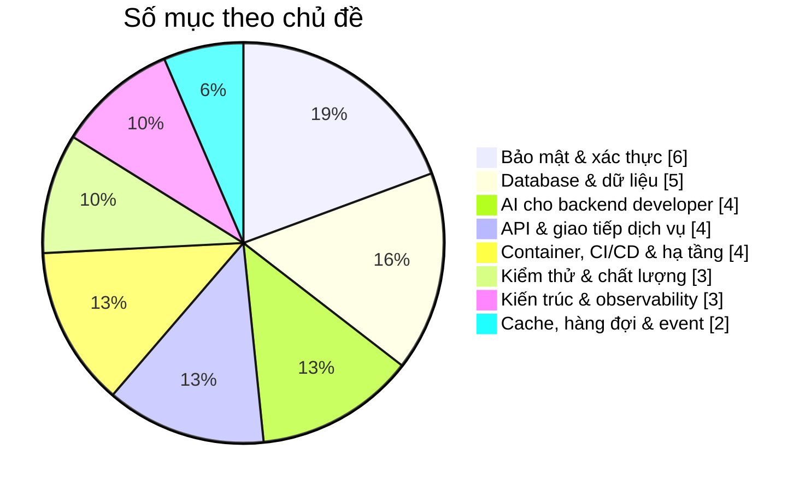

# Tech Radar tuần 47/2026

> [!NOTE]
> 🤖 Bài viết được **Tech Radar Bot** tổng hợp tự động ngày 19/11/2026 từ Hacker News (15), DEV Community (16). Mỗi mục được xếp vào một chủ đề gắn với kỹ năng trên [lộ trình](#/roadmap) của bạn.
>
> Mô tả của repo/bài viết được giữ nguyên tiếng Anh — đây cũng là cách luyện đọc tài liệu kỹ thuật!

## 📊 Toàn cảnh tuần này

| Chủ đề | Số mục | Kỹ năng liên quan |
|---|---:|---|
| 🛡️ Bảo mật & xác thực | 6 | [Bảo mật Web](#/roadmap) |
| 🗄️ Database & dữ liệu | 5 | [Thiết kế CSDL](#/roadmap) |
| 🤖 AI cho backend developer | 4 | Chủ đề mở rộng |
| 🔌 API & giao tiếp dịch vụ | 4 | [Thiết kế REST API](#/roadmap) |
| 🐳 Container, CI/CD & hạ tầng | 4 | [Docker & CI/CD](#/roadmap) |
| 🧪 Kiểm thử & chất lượng | 3 | [Kiểm thử](#/roadmap) |
| 🔭 Kiến trúc & observability | 3 | [System design](#/roadmap) |
| ⚡ Cache, hàng đợi & event | 2 | [Caching & Redis](#/roadmap) |

## 🔥 Top 5 đáng chú ý

### 1. New Evidence Shows School Phone Bans Are Gradually Improving Test Scores

**Hacker News** · ▲ 1.3k điểm · 💬 642 bình luận · 🧪 Kiểm thử & chất lượng · 📅 2026-11-17

> [!TIP]
> **Vì sao nên quan tâm:** Công cụ kiểm thử tốt giúp bạn refactor và deploy mà không sợ làm hỏng hệ thống.

[Xem chi tiết →](https://www.nytimes.com/2026/11/17/upshot/school-phone-bans-study-scores.html) · [Thảo luận trên HN](https://news.ycombinator.com/item?id=50530163)

### 2. Highly classified US national security communications network goes down

**Hacker News** · ▲ 664 điểm · 💬 746 bình luận · 🛡️ Bảo mật & xác thực · 📅 2026-11-17

> [!TIP]
> **Vì sao nên quan tâm:** Một lỗ hổng có thể xóa sạch mọi công sức — cập nhật kiến thức bảo mật là việc phải làm định kỳ.

[Xem chi tiết →](https://www.cnn.com/2026/11/17/politics/highly-classified-national-security-communications-network-goes-down) · [Thảo luận trên HN](https://news.ycombinator.com/item?id=50532849)

### 3. Universal XSS in uBlock Origin from website-driven element picker

**Hacker News** · ▲ 616 điểm · 💬 181 bình luận · 🛡️ Bảo mật & xác thực · 📅 2026-11-16

> [!TIP]
> **Vì sao nên quan tâm:** Một lỗ hổng có thể xóa sạch mọi công sức — cập nhật kiến thức bảo mật là việc phải làm định kỳ.

[Xem chi tiết →](https://iter.ca/post/ubo-uxss/) · [Thảo luận trên HN](https://news.ycombinator.com/item?id=50513160)

### 4. Gemini 4 Neon

**Hacker News** · ▲ 393 điểm · 💬 368 bình luận · 🗄️ Database & dữ liệu · 📅 2026-11-18

> [!TIP]
> **Vì sao nên quan tâm:** Phần lớn sự cố hiệu năng nằm ở tầng dữ liệu — hiểu công cụ mới giúp bạn chọn đúng kho lưu trữ cho từng bài toán.

[Xem chi tiết →](https://blog.google/innovation-and-ai/models-and-research/gemini-models/introducing-gemini-4-neon/) · [Thảo luận trên HN](https://news.ycombinator.com/item?id=50552424)

### 5. Energy-Based Reasoners: 385x more efficient inference

**Hacker News** · ▲ 300 điểm · 💬 52 bình luận · 🤖 AI cho backend developer · 📅 2026-11-18

> [!TIP]
> **Vì sao nên quan tâm:** Backend hiện đại ngày càng phải tích hợp LLM, vector search và agent — đây là kỹ năng đang được tuyển nhiều.

[Xem chi tiết →](https://energy-based-reasoners.github.io/) · [Thảo luận trên HN](https://news.ycombinator.com/item?id=50543989)

## 🧭 Theo chủ đề

### 🔌 API & giao tiếp dịch vụ

- **[Brave Search API now accepts agentic payments via the x402 protocol](https://brave.com/blog/search-api-agentic-payments/)** _(Hacker News · ▲ 262 điểm · 💬 150 bình luận)_
- **[Three copies of the same HTTP code, and how one Go engine fixed it](https://dev.to/kunalgoesbyken/three-copies-of-the-same-http-code-and-how-one-go-engine-fixed-it-i61)** — A free API client for REST, GraphQL, gRPC and WebSocket, and what building it taught me about SSRF,... _(DEV · ❤️ 7 lượt thích)_
- **[My Agent Scrubbed a Leaked API Key by Force-Pushing main. It Made Everything Worse.](https://dev.to/debashish_ghosal/my-agent-scrubbed-a-leaked-api-key-by-force-pushing-main-it-made-everything-worse-57a)** — My Agent Scrubbed a Leaked API Key by Force-Pushing main. It Made Everything Worse. An API... _(DEV · ❤️ 25 lượt thích)_
- **[One model gateway across clouds: LiteLLM on Cloud Run and Azure with zero API keys](https://dev.to/gde/one-model-gateway-across-clouds-litellm-on-cloud-run-and-azure-with-zero-api-keys-3ma7)** — One LiteLLM per cloud, on Cloud Run and Azure Container Apps. Agents reach Gemini and Azure OpenAI with their own identity: no API keys, no virtual keys, no database password. _(DEV · ❤️ 24 lượt thích)_

### 🗄️ Database & dữ liệu

- **[Turning a 22-year-old Postgres type-confusion primitive into RCE](https://mehmetince.net/part-3-6-how-i-ended-up-turning-a-22-year-old-postgresql-type-confusion-primitive-into-rce-cve-2026-6460/)** _(Hacker News · ▲ 232 điểm · 💬 41 bình luận)_
- **[Live-migration support in FreeBSD and bhyve coming](https://gyptazy.com/blog/freebsd-bhyve-live-migration-support-rfc/)** _(Hacker News · ▲ 140 điểm · 💬 51 bình luận)_
- **[PostgreSQL 19's pg\_plan\_advice turned a 28ms query into 264ms under load](https://dev.to/alexgeorgiev17/postgresql-19s-pgplanadvice-turned-a-28ms-query-into-264ms-under-load-46o5)** — I tested PostgreSQL 19 RC2's new planner-hint extension, pg plan advice: forcing the wrong plan made throughput 9x worse under ten clients, and a pinned plan that went stale after a data shift cost less than I expected. _(DEV · ❤️ 19 lượt thích)_
- **[The Hidden Cost of PostgreSQL JSONB Columns Under High Write Load](https://dev.to/johnnylemonny/the-hidden-cost-of-postgresql-jsonb-columns-under-high-write-load-2fil)** — Updating a single key inside a PostgreSQL JSONB column rewrites the entire blob, triggers TOAST churn, and bloats WAL. Here is the benchmark and the hybrid schema fix. _(DEV · ❤️ 27 lượt thích)_

### ⚡ Cache, hàng đợi & event

- **[Deploying new Temporal workflow code while workflows are running](https://dev.to/remdore/deploying-new-temporal-workflow-code-while-workflows-are-running-4150)** — A Temporal workflow can run for minutes, days or months, and the code behind it will change while it... _(DEV · ❤️ 10 lượt thích)_
- **[Your automation ran twice. Here's how to make n8n and Make workflows safe to retry](https://dev.to/manoj7ar/your-automation-ran-twice-heres-how-to-make-n8n-and-make-workflows-safe-to-retry-3np7)** — Every automation builder meets this bug eventually. A form submission comes in, the workflow creates... _(DEV · ❤️ 7 lượt thích)_

### 🐳 Container, CI/CD & hạ tầng

- **[Kubernetes Under the Hood: What Actually Happens When You Run kubectl apply](https://dev.to/smtahosin/kubernetes-under-the-hood-what-actually-happens-when-you-run-kubectl-apply-5cog)** — A visual, 10-minute deep dive into Kubernetes control plane internals. Learn how kube-apiserver processes admission webhooks, how etcd maintains Raft quorum, how controllers reconcile state with Informers, how… _(DEV · ❤️ 16 lượt thích)_
- **[Day 83: Two Files and Four Parts](https://dev.to/ndcodes/day-83-two-files-and-four-parts-40hc)** — Day 83 of DevOps, Day 33 of Azure. Both tasks today were made of parts that are each correct on their... _(DEV · ❤️ 20 lượt thích)_
- **[Day 85: A Task That Always Changes and Two Halves](https://dev.to/ndcodes/day-85-one-direction-and-two-halves-5cic)** — Day 85 of DevOps, Day 35 of Azure. Both tasks today reported a state that is a word rather than a... _(DEV · ❤️ 16 lượt thích)_
- **[Day 86: A Per-Host Variable and an Account-Wide Rule](https://dev.to/ndcodes/day-86-a-per-host-variable-and-an-account-wide-rule-538c)** — Day 86 of DevOps, Day 36 of Azure. Both tasks today were about a setting whose scope is not where you... _(DEV · ❤️ 12 lượt thích)_

### 🔭 Kiến trúc & observability

- **[Two rejected series stalled all my metrics](https://dev.to/slima4/two-rejected-series-stalled-all-my-metrics-2523)** — Three alerts fired while production was fine. A rate limiter put client addresses in metric labels, and a retry on 429 turned two rejected series into a stall. _(DEV · ❤️ 8 lượt thích)_
- **[Why Architecture is the True Security Boundary](https://dev.to/aws-builders/why-architecture-is-the-true-security-boundary-38fi)** — For decades, organizations have tried to define a single security boundary to separate what is... _(DEV · ❤️ 16 lượt thích)_
- **[A health check should check what this server owns](https://dev.to/robertpaschal/when-your-health-check-takes-the-system-down-17e9)** — A couple of days ago I wrote that a health check should check something real: open a connection to... _(DEV · ❤️ 3 lượt thích)_

### 🛡️ Bảo mật & xác thực

- **["Humble Bundle just killed most of their security through vibecoding"](https://forums.spacebattles.com/threads/humble-bundle-just-completely-killed-most-of-their-security-through-vibecoding.1346295/)** _(Hacker News · ▲ 415 điểm · 💬 237 bình luận)_
- **[Critical RCE Vulnerability in Apache HTTP Server](https://www.wiz.io/blog/cve-2026-119618-rce-apache-http-server-vulnerability)** _(Hacker News · ▲ 372 điểm · 💬 200 bình luận)_
- **[Java4Shell: pre-auth RCE flaw in Java 17 puts servers at risk (CVE-2026-114938)](https://www.aikido.dev/blog/java-17-rce-vulnerability-cve-2026-114938)** _(Hacker News · ▲ 150 điểm · 💬 30 bình luận)_
- **[The Secret ThinkPad Powerbutton Code to Bring Dead Laptops Back to Life (2007)](https://masnick.com/posts/the-secret-thinkpad-powerbutton-code-to-bring-dead-laptops-back-to-life/)** _(Hacker News · ▲ 322 điểm · 💬 129 bình luận)_

### 🧪 Kiểm thử & chất lượng

- **[Do House members' stock trades beat the market? A test of 8,900 trades](https://arkanumdata.com/research/house-trades)** _(Hacker News · ▲ 127 điểm · 💬 134 bình luận)_
- **[Evaluate the Decision, Not the Prose: Building an Eval Harness for an LLM Backend](https://dev.to/paulmurithi/evaluate-the-decision-not-the-prose-building-an-eval-harness-for-an-llm-backend-22gd)** — SokoFlow AI Build Log, Week 5 of 6: building an eval harness, getting rate-limited by my own test,... _(DEV · ❤️ 2 lượt thích)_

### 🤖 AI cho backend developer

- **[Understanding Positional Embeddings in Modern LLMs](https://magazine.sebastianraschka.com/p/understanding-positional-embeddings)** _(Hacker News · ▲ 246 điểm · 💬 27 bình luận)_
- **[Not Everything Needs an LLM](https://newsletter.posthog.com/p/decision-models)** _(Hacker News · ▲ 179 điểm · 💬 74 bình luận)_
- **[I Pointed 3 Static Scanners at an MCP Server That Fails 8 Auth Tests. They Found 0, Including Mine](https://dev.to/kielltampubolon/i-pointed-3-static-scanners-at-an-mcp-server-that-fails-8-auth-tests-they-found-0-including-mine-2fha)** — mcpscan, Semgrep (200 rules) and Bandit gave a broken MCP server and its fixed twin the same report. Five custom Semgrep rules caught 3 of 8 auth bugs. _(DEV · ❤️ 4 lượt thích)_

## ✅ Việc nên làm tuần này

- [ ] 🧪 Thử với **New Evidence Shows School Phone Bans Are Gradually Improving Test Scores**: Viết 3 test cho một endpoint quan trọng bằng công cụ này.
- [ ] 🛡️ Thử với **Highly classified US national security communications network goes down**: Rà lại project của bạn theo checklist OWASP và thử áp dụng một kỹ thuật trong bài.
- [ ] 🗄️ Thử với **Gemini 4 Neon**: Nạp bộ dữ liệu mẫu trong SQL Lab vào công cụ này và chạy lại 3 bài tập JOIN/GROUP BY.
- [ ] 🤖 Thử với **Energy-Based Reasoners: 385x more efficient inference**: Thêm một endpoint tìm kiếm ngữ nghĩa (pgvector) hoặc một MCP server nhỏ vào project.
- [ ] 🃏 Ôn lại [flashcard](#/cards) và luyện thêm một bài trong [SQL Lab](#/sql).

## ⚙️ Về bot này

Bot chạy tự động mỗi thứ Hai qua GitHub Actions (`.github/workflows/tech-radar.yml`), lấy dữ liệu từ GitHub, Hacker News và DEV, chấm điểm theo độ phổ biến và mức liên quan tới backend, rồi xuất bản thành bài blog này. Bạn có thể đổi nguồn, từ khóa và chủ đề trong `scripts/tech-radar/config.mjs`.
