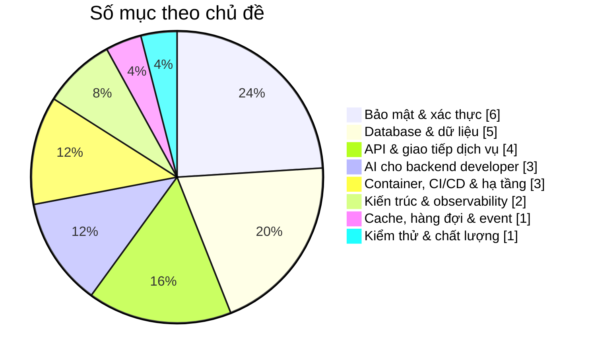

# Tech Radar 19/11 · tuần 47/2026

> [!NOTE]
> 🤖 Bài viết được **Tech Radar Bot** tổng hợp tự động ngày 19/11/2026 từ Hacker News (8), DEV Community (17). Mỗi mục được xếp vào một chủ đề gắn với kỹ năng trên [lộ trình](#/roadmap) của bạn.
>
> Mô tả của repo/bài viết được giữ nguyên tiếng Anh — đây cũng là cách luyện đọc tài liệu kỹ thuật!

## 📊 Toàn cảnh tuần này

| Chủ đề | Số mục | Kỹ năng liên quan |
|---|---:|---|
| 🛡️ Bảo mật & xác thực | 6 | [Bảo mật Web](#/roadmap) |
| 🗄️ Database & dữ liệu | 5 | [Thiết kế CSDL](#/roadmap) |
| 🔌 API & giao tiếp dịch vụ | 4 | [Thiết kế REST API](#/roadmap) |
| 🤖 AI cho backend developer | 3 | Chủ đề mở rộng |
| 🐳 Container, CI/CD & hạ tầng | 3 | [Docker & CI/CD](#/roadmap) |
| 🔭 Kiến trúc & observability | 2 | [System design](#/roadmap) |
| ⚡ Cache, hàng đợi & event | 1 | [Caching & Redis](#/roadmap) |
| 🧪 Kiểm thử & chất lượng | 1 | [Kiểm thử](#/roadmap) |

## 🔥 Top 5 đáng chú ý

### 1. Java4Shell: RCE in OpenJDK when processing Base64

**Hacker News** · ▲ 1.2k điểm · 💬 321 bình luận · 🛡️ Bảo mật & xác thực · 📅 2026-11-17

> [!TIP]
> **Vì sao nên quan tâm:** Một lỗ hổng có thể xóa sạch mọi công sức — cập nhật kiến thức bảo mật là việc phải làm định kỳ.

[Xem chi tiết →](https://calif.io/java4shell/) · [Thảo luận trên HN](https://news.ycombinator.com/item?id=50538240)

### 2. Critical RCE Vulnerability in Apache HTTP Server

**Hacker News** · ▲ 372 điểm · 💬 200 bình luận · 🛡️ Bảo mật & xác thực · 📅 2026-11-12

> [!TIP]
> **Vì sao nên quan tâm:** Một lỗ hổng có thể xóa sạch mọi công sức — cập nhật kiến thức bảo mật là việc phải làm định kỳ.

[Xem chi tiết →](https://www.wiz.io/blog/cve-2026-119618-rce-apache-http-server-vulnerability) · [Thảo luận trên HN](https://news.ycombinator.com/item?id=50462177)

### 3. Understanding Positional Embeddings in Modern LLMs

**Hacker News** · ▲ 246 điểm · 💬 27 bình luận · 🤖 AI cho backend developer · 📅 2026-11-15

> [!TIP]
> **Vì sao nên quan tâm:** Backend hiện đại ngày càng phải tích hợp LLM, vector search và agent — đây là kỹ năng đang được tuyển nhiều.

[Xem chi tiết →](https://magazine.sebastianraschka.com/p/understanding-positional-embeddings) · [Thảo luận trên HN](https://news.ycombinator.com/item?id=50506376)

### 4. Turning a 22-year-old Postgres type-confusion primitive into RCE

**Hacker News** · ▲ 232 điểm · 💬 41 bình luận · 🗄️ Database & dữ liệu · 📅 2026-11-12

> [!TIP]
> **Vì sao nên quan tâm:** Phần lớn sự cố hiệu năng nằm ở tầng dữ liệu — hiểu công cụ mới giúp bạn chọn đúng kho lưu trữ cho từng bài toán.

[Xem chi tiết →](https://mehmetince.net/part-3-6-how-i-ended-up-turning-a-22-year-old-postgresql-type-confusion-primitive-into-rce-cve-2026-6460/) · [Thảo luận trên HN](https://news.ycombinator.com/item?id=50471761)

### 5. Not Everything Needs an LLM

**Hacker News** · ▲ 180 điểm · 💬 74 bình luận · 🤖 AI cho backend developer · 📅 2026-11-17

> [!TIP]
> **Vì sao nên quan tâm:** Backend hiện đại ngày càng phải tích hợp LLM, vector search và agent — đây là kỹ năng đang được tuyển nhiều.

[Xem chi tiết →](https://newsletter.posthog.com/p/decision-models) · [Thảo luận trên HN](https://news.ycombinator.com/item?id=50535740)

## 🧭 Theo chủ đề

### 🔌 API & giao tiếp dịch vụ

- **[Three copies of the same HTTP code, and how one Go engine fixed it](https://dev.to/kunalgoesbyken/three-copies-of-the-same-http-code-and-how-one-go-engine-fixed-it-i61)** — A free API client for REST, GraphQL, gRPC and WebSocket, and what building it taught me about SSRF,... _(DEV · ❤️ 7 lượt thích)_
- **[FastAPI 0.163's new dependency concurrency limit deadlocked two of my routes](https://dev.to/alexgeorgiev17/fastapi-0163s-new-dependency-concurrency-limit-deadlocked-two-of-my-routes-33k6)** — FastAPI 0.163.0's Depends(max concurrency=...) cut 20 concurrent calls to a peak of 5, but applies per Depends() object and per worker process, and two yield dependencies acquired in opposite order hung forever. _(DEV · ❤️ 10 lượt thích)_
- **[nginx 1.31's json\_set directive rejects a bad webhook payload about 13 times faster than forwarding it](https://dev.to/alexgeorgiev17/nginx-131s-jsonset-directive-rejects-a-bad-webhook-payload-about-13-times-faster-than-forwarding-3b00)** — I measured nginx 1.31's new native JSON parser against a Python backend doing the same validation: roughly 13x faster per-request rejection at low concurrency, half a backend's request count removed outright in a 50/50… _(DEV · ❤️ 8 lượt thích)_
- **[Longer Timeouts Won't Fix Your Webhook Duplicates. Claiming the Work Once Will](https://dev.to/aheadkit/longer-timeouts-wont-fix-your-webhook-duplicates-claiming-the-work-once-will-d90)** — The receiver was not down. That is the part I keep coming back to. It was answering every single... _(DEV · ❤️ 3 lượt thích)_

### 🗄️ Database & dữ liệu

- **[The Hidden Cost of PostgreSQL JSONB Columns Under High Write Load](https://dev.to/johnnylemonny/the-hidden-cost-of-postgresql-jsonb-columns-under-high-write-load-2fil)** — Updating a single key inside a PostgreSQL JSONB column rewrites the entire blob, triggers TOAST churn, and bloats WAL. Here is the benchmark and the hybrid schema fix. _(DEV · ❤️ 27 lượt thích)_
- **[PostgreSQL 19's pg\_plan\_advice turned a 28ms query into 264ms under load](https://dev.to/alexgeorgiev17/postgresql-19s-pgplanadvice-turned-a-28ms-query-into-264ms-under-load-46o5)** — I tested PostgreSQL 19 RC2's new planner-hint extension, pg plan advice: forcing the wrong plan made throughput 9x worse under ten clients, and a pinned plan that went stale after a data shift cost less than I expected. _(DEV · ❤️ 19 lượt thích)_
- **[4 SQL statements and a segfault: inside PostgreSQL's 22-year-old type confusion, CVE-2026-6460](https://dev.to/slabb/4-sql-statements-and-a-segfault-inside-postgresqls-22-year-old-type-confusion-cve-2026-6460-1ggm)** — A composite type, a PREPARE, an ALTER TYPE, an EXECUTE: as the lowest-privileged login role, that is a server segfault on every PostgreSQL since 2004, and Mehmet Ince's writeup turns it into full RCE via a fake methods… _(DEV · ❤️ 10 lượt thích)_
- **[ClickHouse 26.10's string filter during scan cuts a selective LIKE query's memory 25-fold](https://dev.to/alexgeorgiev17/clickhouse-2610s-string-filter-during-scan-cuts-a-selective-like-querys-memory-25-fold-228j)** — I benchmarked ClickHouse 26.10's new apply string filters during scan setting against 26.9: a selective LIKE query's peak memory dropped from 37.6MB to 1.5MB, but a plain WHERE equality got none of it until I rewrote… _(DEV · ❤️ 13 lượt thích)_

### ⚡ Cache, hàng đợi & event

- **[Deploying new Temporal workflow code while workflows are running](https://dev.to/remdore/deploying-new-temporal-workflow-code-while-workflows-are-running-4150)** — A Temporal workflow can run for minutes, days or months, and the code behind it will change while it... _(DEV · ❤️ 10 lượt thích)_

### 🐳 Container, CI/CD & hạ tầng

- **[Kubernetes Under the Hood: What Actually Happens When You Run kubectl apply](https://dev.to/smtahosin/kubernetes-under-the-hood-what-actually-happens-when-you-run-kubectl-apply-5cog)** — A visual, 10-minute deep dive into Kubernetes control plane internals. Learn how kube-apiserver processes admission webhooks, how etcd maintains Raft quorum, how controllers reconcile state with Informers, how… _(DEV · ❤️ 16 lượt thích)_
- **[The Kubernetes Upgrade Trap: A Practical Roadmap to Escape Deprecated APIs, Broken Add-ons, and Endless Delays](https://dev.to/varunvarde/the-kubernetes-upgrade-trap-a-practical-roadmap-to-escape-deprecated-apis-broken-add-ons-and-3kfa)** — Every Kubernetes platform team knows the situation. A new Kubernetes release becomes available,... _(DEV · ❤️ 5 lượt thích)_
- **[AWS Extended Support: what it costs and how to find everything you're about to pay for](https://dev.to/expiryradar/aws-extended-support-what-it-costs-and-how-to-find-everything-youre-about-to-pay-for-6i)** — Disclosure: I build Expiry Radar, a tool that tracks dates like these. Nothing below needs it: the... _(DEV · ❤️ 5 lượt thích)_

### 🔭 Kiến trúc & observability

- **[Two rejected series stalled all my metrics](https://dev.to/slima4/two-rejected-series-stalled-all-my-metrics-2523)** — Three alerts fired while production was fine. A rate limiter put client addresses in metric labels, and a retry on 429 turned two rejected series into a stall. _(DEV · ❤️ 8 lượt thích)_
- **[A health check should check what this server owns](https://dev.to/robertpaschal/when-your-health-check-takes-the-system-down-17e9)** — A couple of days ago I wrote that a health check should check something real: open a connection to... _(DEV · ❤️ 3 lượt thích)_

### 🛡️ Bảo mật & xác thực

- **[Java4Shell: pre-auth RCE flaw in Java 17 puts servers at risk (CVE-2026-114938)](https://www.aikido.dev/blog/java-17-rce-vulnerability-cve-2026-114938)** _(Hacker News · ▲ 150 điểm · 💬 30 bình luận)_
- **[Universal XSS in uBlock Origin from website-driven element picker](https://iter.ca/post/ubo-uxss/)** _(Hacker News · ▲ 616 điểm · 💬 181 bình luận)_
- **[KVM: x86: Unconditionally reset MMU context when emulating INIT (CVE-2026-99312)](https://www.cve.org/CVERecord?id=CVE-2026-99312)** _(Hacker News · ▲ 174 điểm · 💬 115 bình luận)_
- **[Enterprise SSO for B2B SaaS: How to Prepare Before Your First Big Customer Asks](https://dev.to/hadil/enterprise-sso-for-b2b-saas-how-to-prepare-before-your-first-big-customer-asks-50p6)** — Enterprise SSO for B2B SaaS often becomes a requirement as your product attracts larger customers. A... _(DEV · ❤️ 75 lượt thích)_

### 🧪 Kiểm thử & chất lượng

- **[Evaluate the Decision, Not the Prose: Building an Eval Harness for an LLM Backend](https://dev.to/paulmurithi/evaluate-the-decision-not-the-prose-building-an-eval-harness-for-an-llm-backend-22gd)** — SokoFlow AI Build Log, Week 5 of 6: building an eval harness, getting rate-limited by my own test,... _(DEV · ❤️ 2 lượt thích)_

### 🤖 AI cho backend developer

- **[I Pointed 3 Static Scanners at an MCP Server That Fails 8 Auth Tests. They Found 0, Including Mine](https://dev.to/kielltampubolon/i-pointed-3-static-scanners-at-an-mcp-server-that-fails-8-auth-tests-they-found-0-including-mine-2fha)** — mcpscan, Semgrep (200 rules) and Bandit gave a broken MCP server and its fixed twin the same report. Five custom Semgrep rules caught 3 of 8 auth bugs. _(DEV · ❤️ 4 lượt thích)_

## ✅ Việc nên làm tuần này

- [ ] 🛡️ Thử với **Java4Shell: RCE in OpenJDK when processing Base64**: Rà lại project của bạn theo checklist OWASP và thử áp dụng một kỹ thuật trong bài.
- [ ] 🤖 Thử với **Understanding Positional Embeddings in Modern LLMs**: Thêm một endpoint tìm kiếm ngữ nghĩa (pgvector) hoặc một MCP server nhỏ vào project.
- [ ] 🗄️ Thử với **Turning a 22-year-old Postgres type-confusion primitive into RCE**: Nạp bộ dữ liệu mẫu trong SQL Lab vào công cụ này và chạy lại 3 bài tập JOIN/GROUP BY.
- [ ] 🃏 Ôn lại [flashcard](#/cards) và luyện thêm một bài trong [SQL Lab](#/sql).

## ⚙️ Về bot này

Bot chạy tự động mỗi thứ Hai qua GitHub Actions (`.github/workflows/tech-radar.yml`), lấy dữ liệu từ GitHub, Hacker News và DEV, chấm điểm theo độ phổ biến và mức liên quan tới backend, rồi xuất bản thành bài blog này. Bạn có thể đổi nguồn, từ khóa và chủ đề trong `scripts/tech-radar/config.mjs`.
