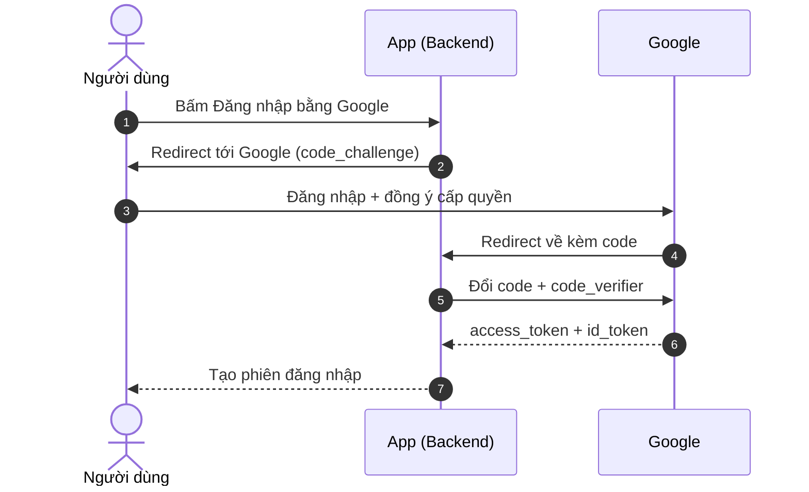

> [!NOTE]
> **Mục tiêu:** phân biệt xác thực và phân quyền, chọn đúng giữa session và JWT, lưu mật khẩu an toàn, và hiểu luồng "Đăng nhập bằng Google".

## 1. Hai câu hỏi khác nhau

- **Authentication (xác thực):** *Bạn là ai?* Ví dụ: đăng nhập bằng mật khẩu, OTP, Google.
- **Authorization (phân quyền):** *Bạn được làm gì?* Ví dụ: chỉ admin mới được xóa user, user chỉ được sửa đơn của chính mình.

Lỗi bảo mật API phổ biến nhất (OWASP API #1, BOLA) là quên kiểm tra phân quyền:

```python
# ❌ Ai đã đăng nhập cũng xem được đơn của người khác
@app.get("/orders/{order_id}")
def get_order(order_id: int, user=Depends(current_user)):
    return db.get(Order, order_id)

# ✅ Kiểm tra quyền sở hữu
@app.get("/orders/{order_id}")
def get_order(order_id: int, user=Depends(current_user)):
    order = db.get(Order, order_id)
    if not order or order.customer_id != user.id:
        raise HTTPException(404)   # trả 404 để không lộ việc bản ghi có tồn tại
    return order
```

## 2. Lưu mật khẩu

> [!CAUTION]
> Lộ database mà mật khẩu băm bằng MD5 thì coi như lộ mật khẩu: GPU có thể thử hàng tỷ chuỗi mỗi giây.

- **Không bao giờ** lưu mật khẩu dạng plaintext, và không dùng MD5/SHA-256 trần (quá nhanh, dễ bị brute-force).
- Dùng hàm băm chậm, có salt: **Argon2id** (khuyến nghị), bcrypt, hoặc scrypt.

```python
from argon2 import PasswordHasher
ph = PasswordHasher()
hashed = ph.hash("s3cret!")       # lưu chuỗi này vào DB
ph.verify(hashed, "s3cret!")      # đúng thì trả True, sai thì raise lỗi
```

## 3. Session (stateful)

1. Người dùng đăng nhập. Server tạo `session_id` ngẫu nhiên và lưu `{session_id: user_id}` vào DB hoặc Redis.
2. Server trả `Set-Cookie: sid=...; HttpOnly; Secure; SameSite=Lax`.
3. Ở các request sau, trình duyệt tự gửi cookie, server tra cứu session.

✅ Thu hồi ngay lập tức (xóa session là xong). ✅ Cookie HttpOnly nên JavaScript không đọc được.
❌ Cần kho lưu session dùng chung khi có nhiều server. ❌ Phải chống CSRF.

## 4. JWT (stateless)

```
eyJhbGciOiJIUzI1NiJ9 . eyJzdWIiOiI0MiIsInJvbGUiOiJ1c2VyIiwiZXhwIjoxNzY0MDAwMDAwfQ . kX9...
      header                              payload (claims)                          signature
```


- Server **ký** token. Khi nhận lại, server chỉ cần kiểm tra chữ ký và `exp`, không cần tra DB.
- ⚠️ Payload chỉ được **mã hóa Base64**, không được **mật mã hóa**: không bao giờ đặt dữ liệu nhạy cảm trong đó.
- ❌ Khó thu hồi trước khi hết hạn. Giải pháp thường dùng:
  - **Access token** ngắn hạn (5–15 phút).
  - **Refresh token** dài hạn, lưu ở server (có thể thu hồi) và **xoay vòng** mỗi lần dùng.

### Chọn cái nào?

| Tình huống | Gợi ý |
|---|---|
| Web app truyền thống, cùng domain | Session + cookie |
| Mobile app, gọi API từ nhiều service | JWT access token + refresh token |
| SPA | Cookie HttpOnly (session hoặc JWT nằm trong cookie), tránh lưu token ở `localStorage` |

## 5. OAuth 2.0 và OpenID Connect

"Đăng nhập bằng Google" dùng **Authorization Code Flow + PKCE**:




1. App chuyển hướng người dùng tới Google, kèm `code_challenge`.
2. Người dùng đăng nhập và đồng ý cấp quyền. Google chuyển hướng về app kèm `code`.
3. Backend đổi `code` (cùng `code_verifier`) lấy `access_token` và `id_token`.
4. `id_token` (là một JWT, theo chuẩn OIDC) cho biết người dùng là ai.

- **OAuth 2.0** dùng để *ủy quyền* (truy cập tài nguyên thay mặt người dùng).
- **OIDC** thêm lớp *xác thực* (biết người dùng là ai) lên trên OAuth 2.0.

## 6. Phân quyền theo vai trò (RBAC)

```python
def require_role(*roles):
    def checker(user=Depends(current_user)):
        if user.role not in roles:
            raise HTTPException(403)
        return user
    return checker

@app.delete("/users/{uid}", dependencies=[Depends(require_role("admin"))])
def delete_user(uid: int): ...
```

## ✅ Tự kiểm tra

1. Vì sao không nên lưu JWT trong `localStorage`?
2. User bị khóa tài khoản nhưng access token còn hạn 10 phút. Có những cách xử lý nào?
3. OAuth 2.0 khác OpenID Connect ở điểm nào?
