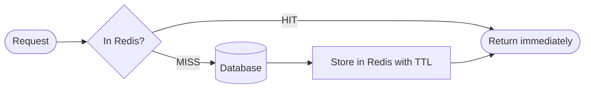

> [!NOTE]
> **Goal:** know when to cache, where to cache, how to keep cached data fresh, and how to avoid the classic failure modes.

## 1. Where can you cache?

```
Browser → CDN → Reverse proxy → App (in-memory) → Redis → Database
```


The closer a cache sits to the user, the faster it is, and the harder it is to invalidate. Good candidates are data that is **read-heavy, write-light**, and **fine being a few seconds or minutes stale**.

## 2. Cache-aside (lazy loading)

This is the most common pattern:



```python
import json, redis
r = redis.Redis()

def get_product(pid: int) -> dict:
    key = f"product:{pid}"
    if (cached := r.get(key)) is not None:      # 1. ask the cache first
        return json.loads(cached)
    product = db.fetch_product(pid)              # 2. on a miss, read the DB
    r.set(key, json.dumps(product), ex=300)      # 3. store with a 5-minute TTL
    return product

def update_product(pid: int, data: dict):
    db.update_product(pid, data)                 # write the DB first
    r.delete(f"product:{pid}")                   # then DELETE the key (don't overwrite)
```

> [!TIP]
> Why **delete** instead of **update** the cache? With two concurrent writers, overwriting can leave a stale value behind. After a delete, the next read fetches fresh data from the DB.

Other patterns:

- **Write-through:** write to the cache and the DB together.
- **Write-behind:** write to the cache now and flush to the DB later. Fast, but data can be lost.

## 3. TTL and invalidation

- Always set a **TTL**. It's your safety net when you forget to invalidate somewhere.
- Add **jitter** (randomized TTLs, e.g. 300 ± 30 s) so keys don't all expire at once.
- Use structured, versioned key names: `v2:product:42`. When the schema changes, bump the version.

## 4. Classic failure modes

| Problem | What happens | Defense |
|---|---|---|
| **Cache stampede** | A hot key expires and thousands of requests hit the DB | Locking / single-flight, early refresh, TTL jitter |
| **Cache penetration** | Constant lookups for ids that don't exist | Cache empty results (short TTL), Bloom filter |
| **Cache avalanche** | Many keys expire together, or Redis goes down | Jitter, Redis HA (replicas/sentinel), circuit breakers |

## 5. HTTP caching (it's free!)

```http
Cache-Control: public, max-age=60
ETag: "a1b2c3"
```

The client sends back `If-None-Match: "a1b2c3"`. If nothing changed, the server replies `304 Not Modified` with no body, which saves bandwidth.

## 6. Rate limiting with Redis

```python
def allow(user_id: str, limit: int = 100) -> bool:
    key = f"rl:{user_id}:{int(time.time() // 60)}"   # 1-minute window
    count = r.incr(key)
    if count == 1:
        r.expire(key, 60)
    return count <= limit      # False means respond 429 Too Many Requests
```

For more precision, use a **sliding window** (sorted set) or a **token bucket**.

## ✅ Self-check

1. The home page shows "top 10 best sellers". How would you cache it, and with what TTL?
2. Why delete the cache key instead of updating it after a DB write?
3. What is the difference between a cache stampede and cache penetration?
