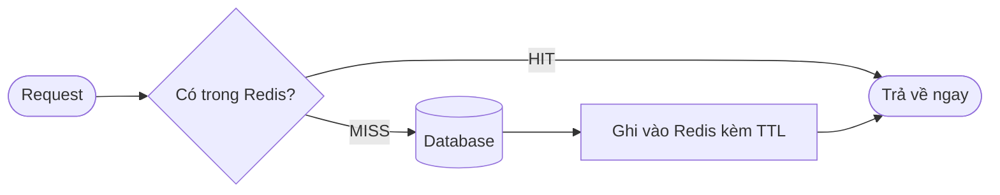

> [!NOTE]
> **Mục tiêu:** biết khi nào nên cache, cache ở đâu, làm sao giữ dữ liệu cache không bị cũ, và tránh các sự cố kinh điển.

## 1. Cache ở những tầng nào?

```
Trình duyệt → CDN → Reverse proxy → App (in-memory) → Redis → Database
```


Càng gần người dùng thì càng nhanh, nhưng càng khó làm mất hiệu lực (invalidate). Dữ liệu phù hợp để cache là dữ liệu **đọc nhiều, ghi ít**, và **chấp nhận được việc cũ đi vài giây hoặc vài phút**.

## 2. Cache-aside (lazy loading)

Đây là mẫu phổ biến nhất:



```python
import json, redis
r = redis.Redis()

def get_product(pid: int) -> dict:
    key = f"product:{pid}"
    if (cached := r.get(key)) is not None:      # 1. hỏi cache trước
        return json.loads(cached)
    product = db.fetch_product(pid)              # 2. cache miss thì đọc DB
    r.set(key, json.dumps(product), ex=300)      # 3. ghi vào cache, TTL 5 phút
    return product

def update_product(pid: int, data: dict):
    db.update_product(pid, data)                 # cập nhật DB trước
    r.delete(f"product:{pid}")                   # rồi XÓA cache (không phải ghi đè)
```

> [!TIP]
> Vì sao **xóa** mà không **cập nhật** cache? Vì nếu hai request ghi chạy song song, việc ghi đè cache có thể để lại giá trị cũ. Xóa đi thì lần đọc tiếp theo sẽ lấy giá trị mới từ DB.

Các mẫu khác:

- **Write-through:** ghi vào cache và DB cùng lúc.
- **Write-behind:** ghi vào cache trước, đẩy xuống DB sau. Nhanh, nhưng có thể mất dữ liệu.

## 3. TTL và invalidation

- Luôn đặt **TTL**. Đây là lưới an toàn khi bạn quên invalidate ở đâu đó.
- Thêm **jitter** (TTL ngẫu nhiên, ví dụ 300 ± 30 giây) để các key không cùng hết hạn một lúc.
- Đặt tên key có cấu trúc và kèm version: `v2:product:42`. Khi đổi schema, chỉ cần tăng version.

## 4. Các sự cố kinh điển

| Sự cố | Mô tả | Cách chống |
|---|---|---|
| **Cache stampede** | Key nóng hết hạn, hàng nghìn request cùng đập vào DB | Lock / single-flight, làm mới sớm, TTL có jitter |
| **Cache penetration** | Truy vấn liên tục các id không tồn tại | Cache cả kết quả rỗng (TTL ngắn), Bloom filter |
| **Cache avalanche** | Hàng loạt key cùng hết hạn, hoặc Redis sập | Jitter, Redis HA (replica/sentinel), circuit breaker |

## 5. HTTP caching (miễn phí!)

```http
Cache-Control: public, max-age=60
ETag: "a1b2c3"
```

Client gửi lại `If-None-Match: "a1b2c3"`. Nếu dữ liệu chưa đổi, server trả `304 Not Modified` và không có body, nên tiết kiệm được băng thông.

## 6. Rate limiting bằng Redis

```python
def allow(user_id: str, limit: int = 100) -> bool:
    key = f"rl:{user_id}:{int(time.time() // 60)}"   # cửa sổ 1 phút
    count = r.incr(key)
    if count == 1:
        r.expire(key, 60)
    return count <= limit      # False thì trả về 429 Too Many Requests
```

Muốn chính xác hơn thì dùng **sliding window** (sorted set) hoặc **token bucket**.

## ✅ Tự kiểm tra

1. Trang chủ hiển thị "top 10 sản phẩm bán chạy". Bạn sẽ cache thế nào, TTL bao lâu?
2. Vì sao nên xóa cache thay vì cập nhật cache sau khi ghi DB?
3. Phân biệt cache stampede và cache penetration.
