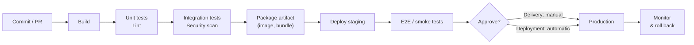

> [!NOTE]
> CI/CD is a set of practices for getting changes from a developer's machine to production **frequently, safely and repeatably**. When every check is automated, people stop being the bottleneck — and stop being a source of manual mistakes.

## Three often-confused terms

| Term | Meaning | End result |
|---|---|---|
| **Continuous Integration (CI)** | Changes are merged into the main branch many times a day, each time automatically built and tested | The main branch always builds |
| **Continuous Delivery** | Every commit that passes the pipeline is **ready** to release; going to production needs an approval step | Releasing is a button press, any time |
| **Continuous Deployment** | Every commit that passes the pipeline goes to production **automatically**, no approval | Every merge is a release |

Continuous Deployment requires tests and monitoring trustworthy enough to fully replace the manual approval.

## Pipeline stages



The general rule: **fail early, fail cheap**. Fast, cheap checks (lint, unit tests) run first. Slow ones (integration, end-to-end) run later, once code has passed the first gate.

## Principle: build once, deploy many

An artifact (Docker image, archive, bundle) is **built once** and promoted through staging and then production. Don't rebuild per environment — otherwise what runs in production may differ from what was tested.

- Version artifacts by commit SHA or semver, e.g. `api:1.4.2` or `api:9f3c2ab`.
- Whatever differs between environments (database URLs, API keys) comes in through **environment variables** and **secrets**, never baked into the artifact.
- Artifacts are **immutable**: to change something, build a new one.

## Branching strategy

- **Trunk-based development:** everyone merges into `main` often via short-lived branches (hours to days). Unfinished features hide behind feature flags. This fits CI/CD best.
- **GitFlow:** uses `develop`, `release/*` and `hotfix/*` branches. It suits versioned products (installed software, mobile apps), but long-lived branches tend to cause painful merges.

Whatever the model, protect the main branch: require pull requests, require a green pipeline, and require at least one reviewer.

## A real example: this blog's deploy workflow

The blog you are reading is deployed by GitHub Actions. Here is `.github/workflows/deploy.yml`, trimmed:

```yaml
name: Deploy to GitHub Pages

on:
  push:
    branches: [main]       # every push to main
  workflow_dispatch:       # manual runs from the Actions tab
  workflow_call:           # reused by another workflow (the Tech Radar bot)

permissions:               # least privilege for the workflow token
  contents: read
  pages: write
  id-token: write

concurrency:               # only one deployment at a time
  group: pages
  cancel-in-progress: true

jobs:
  build:
    runs-on: ubuntu-latest
    steps:
      - uses: actions/checkout@v4
      - uses: actions/setup-node@v4
        with:
          node-version: 22
          cache: npm                # cache dependencies between runs
      - run: npm ci                 # exact versions from package-lock.json
      - name: Validate posts and build the index
        run: npm run content        # stop the pipeline if a post is malformed
      - run: npm run build
      - uses: actions/upload-pages-artifact@v3
        with:
          path: dist/bostu/browser  # the artifact, built once

  deploy:
    needs: build                    # only runs if build succeeded
    runs-on: ubuntu-latest
    environment: github-pages
    steps:
      - uses: actions/deploy-pages@v4
```

Good practices in this file:

- **`npm ci` instead of `npm install`:** installs exactly what the lockfile pins, so builds are reproducible.
- **Content validation before the build:** a post with a missing title, bad date or broken image stops the pipeline early, before it reaches the site.
- **Separate `build` and `deploy` jobs:** only a finished artifact gets promoted to the `github-pages` environment.
- **Minimal `permissions`:** the workflow token gets only what it needs.
- **`concurrency`:** prevents overlapping deployments.
- **`workflow_call`:** the Tech Radar bot reuses this workflow after committing a new post instead of duplicating the deploy steps.

## Keeping pipelines fast

Slow pipelines make developers wait — or worse, find ways around them. Ways to speed things up:

- **Cache** dependencies and build outputs (`actions/setup-node` with `cache: npm`, Docker layer caching).
- **Run independent jobs in parallel**: lint, unit tests, security checks.
- **Test pyramid:** many fast unit tests, few slow end-to-end tests.
- **Only run what changed** in a monorepo (filter by changed paths).

## Measuring with the DORA metrics

The four metrics from the DORA research program are widely used to assess software delivery performance:

| Metric | What it measures |
|---|---|
| **Deployment frequency** | How often you deploy to production |
| **Lead time for changes** | Time from commit to running in production |
| **Change failure rate** | Share of deployments that cause an incident |
| **Time to restore service** | How long it takes to recover from an incident |

The first two measure **speed**, the last two **stability**. DORA's research found that strong teams tend to excel at both at once rather than trading one for the other.

## Summary

- CI keeps the main branch buildable; Continuous Delivery keeps every commit releasable; Continuous Deployment releases every commit automatically.
- Pipelines put cheap, fast checks first so failures surface early.
- Build artifacts once and promote them through environments with configuration and secrets — never rebuild.
- A good pipeline is both fast and trustworthy, and the DORA metrics measure both.
