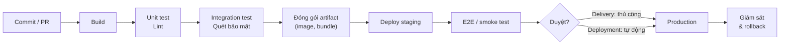

> [!NOTE]
> CI/CD là tập hợp các thực hành giúp đưa thay đổi từ máy lập trình viên lên production **thường xuyên, an toàn và lặp lại được**. Mỗi bước kiểm tra được tự động hóa thì con người không còn là nút cổ chai, cũng không còn là nguồn lỗi do thao tác tay.

## Ba khái niệm hay bị nhầm lẫn

| Khái niệm | Ý nghĩa | Kết quả cuối cùng |
|---|---|---|
| **Continuous Integration (CI)** | Mọi thay đổi được tích hợp vào nhánh chính nhiều lần mỗi ngày, mỗi lần đều tự động build và chạy test | Nhánh chính luôn ở trạng thái build được |
| **Continuous Delivery** | Mọi commit qua được pipeline đều **sẵn sàng** để phát hành; việc đưa lên production cần một bước duyệt | Có thể phát hành bất kỳ lúc nào chỉ bằng một nút bấm |
| **Continuous Deployment** | Mọi commit qua được pipeline được **tự động** đưa lên production, không cần người duyệt | Mỗi lần merge là một lần phát hành |

Continuous Deployment đòi hỏi bộ test và cơ chế giám sát đủ tin cậy để thay thế hoàn toàn bước duyệt thủ công.

## Các giai đoạn của một pipeline



Nguyên tắc chung: **thất bại càng sớm càng rẻ**. Các bước nhanh và rẻ (lint, unit test) chạy trước. Các bước chậm (integration, end-to-end) chạy sau, khi code đã qua được vòng kiểm tra đầu tiên.

## Nguyên tắc: build một lần, deploy nhiều nơi

Artifact (Docker image, file nén, bundle) chỉ được **build một lần** rồi đưa qua lần lượt staging và production. Không build lại cho từng môi trường, vì như vậy thứ chạy trên production có thể khác thứ đã được test.

- Gắn phiên bản artifact theo commit SHA hoặc semver, ví dụ `api:1.4.2` hay `api:9f3c2ab`.
- Phần khác nhau giữa các môi trường (URL database, API key) đưa vào qua **biến môi trường** và **secret**, không nằm trong artifact.
- Artifact là **bất biến**: muốn sửa thì build bản mới.

## Chiến lược nhánh

- **Trunk-based development:** mọi người merge vào `main` thường xuyên qua các nhánh ngắn ngày (vài giờ đến vài ngày). Tính năng chưa xong được ẩn sau feature flag. Đây là mô hình phù hợp nhất với CI/CD.
- **GitFlow:** dùng nhánh `develop`, `release/*`, `hotfix/*`. Mô hình này hợp với sản phẩm phát hành theo phiên bản (phần mềm cài đặt, ứng dụng di động), nhưng nhánh sống lâu dễ gây xung đột khi merge.

Bất kể mô hình nào, nhánh chính nên được bảo vệ: bắt buộc pull request, bắt buộc pipeline xanh, có ít nhất một người review.

## Ví dụ thật: workflow deploy của blog này

Blog bạn đang đọc được deploy bằng GitHub Actions. Đây là file `.github/workflows/deploy.yml`, rút gọn:

```yaml
name: Deploy to GitHub Pages

on:
  push:
    branches: [main]       # mỗi lần push lên main
  workflow_dispatch:       # chạy tay từ tab Actions
  workflow_call:           # được workflow khác gọi lại (bot Tech Radar)

permissions:               # quyền tối thiểu cho token của workflow
  contents: read
  pages: write
  id-token: write

concurrency:               # chỉ một lần deploy chạy tại một thời điểm
  group: pages
  cancel-in-progress: true

jobs:
  build:
    runs-on: ubuntu-latest
    steps:
      - uses: actions/checkout@v4
      - uses: actions/setup-node@v4
        with:
          node-version: 22
          cache: npm                # cache thư viện giữa các lần chạy
      - run: npm ci                 # cài đúng phiên bản trong package-lock.json
      - name: Validate posts and build the index
        run: npm run content        # dừng pipeline nếu bài viết sai định dạng
      - run: npm run build
      - uses: actions/upload-pages-artifact@v3
        with:
          path: dist/bostu/browser  # artifact được build một lần

  deploy:
    needs: build                    # chỉ chạy khi build thành công
    runs-on: ubuntu-latest
    environment: github-pages
    steps:
      - uses: actions/deploy-pages@v4
```

Những thực hành tốt có trong file này:

- **`npm ci` thay vì `npm install`:** cài đúng phiên bản đã khóa trong lockfile, nên build lặp lại được.
- **Bước kiểm tra nội dung chạy trước build:** bài viết thiếu tiêu đề, sai ngày hay ảnh hỏng sẽ làm pipeline dừng sớm, trước khi lỗi lên tới trang web.
- **Tách job `build` và `deploy`:** artifact build xong mới được đưa lên môi trường `github-pages`.
- **`permissions` tối thiểu:** token của workflow chỉ có đúng các quyền cần dùng.
- **`concurrency`:** tránh hai lần deploy chạy chồng lên nhau.
- **`workflow_call`:** bot Tech Radar gọi lại chính workflow này sau khi commit bài mới, thay vì sao chép các bước deploy.

## Giữ pipeline nhanh

Pipeline chậm khiến lập trình viên chờ đợi, hoặc tệ hơn là tìm cách bỏ qua nó. Một số cách tăng tốc:

- **Cache** thư viện và kết quả build (`actions/setup-node` với `cache: npm`, Docker layer cache).
- **Chạy song song** các job độc lập: lint, unit test, kiểm tra bảo mật.
- **Kim tự tháp test:** nhiều unit test nhanh, ít end-to-end test chậm.
- **Chỉ chạy phần bị ảnh hưởng** trong monorepo (lọc theo đường dẫn file thay đổi).

## Đo hiệu quả bằng chỉ số DORA

Bốn chỉ số của nhóm nghiên cứu DORA được dùng rộng rãi để đánh giá năng lực phát hành phần mềm:

| Chỉ số | Đo điều gì |
|---|---|
| **Deployment frequency** | Bao lâu deploy lên production một lần |
| **Lead time for changes** | Từ lúc commit đến lúc chạy trên production mất bao lâu |
| **Change failure rate** | Tỷ lệ lần deploy gây sự cố |
| **Time to restore service** | Mất bao lâu để khắc phục khi có sự cố |

Hai chỉ số đầu đo **tốc độ**, hai chỉ số sau đo **độ ổn định**. Theo nghiên cứu của DORA, các nhóm làm tốt thường mạnh ở cả hai mặt cùng lúc, chứ không phải đánh đổi mặt này lấy mặt kia.

## Tóm tắt

- CI giữ nhánh chính luôn build được. Continuous Delivery giữ mọi commit sẵn sàng phát hành. Continuous Deployment tự động phát hành mọi commit.
- Pipeline xếp các bước rẻ và nhanh lên trước để thất bại sớm.
- Build artifact một lần, đưa qua các môi trường bằng cấu hình và secret, không build lại.
- Pipeline tốt vừa nhanh vừa đáng tin. Chỉ số DORA giúp đo cả hai.
