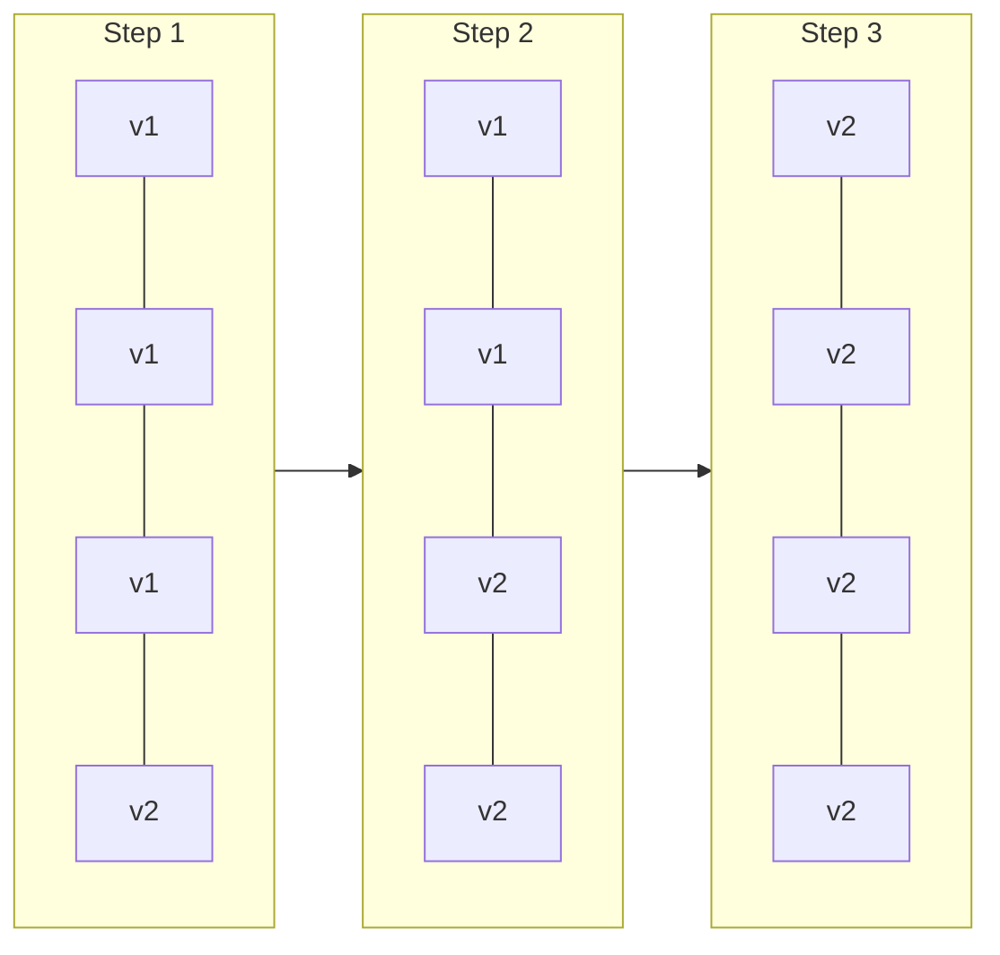
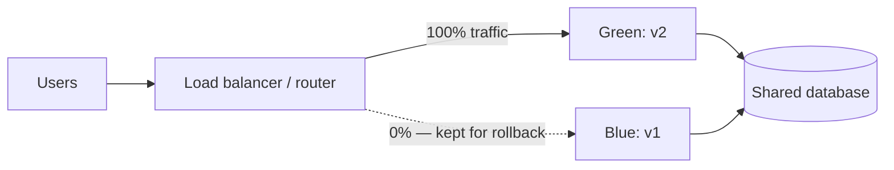
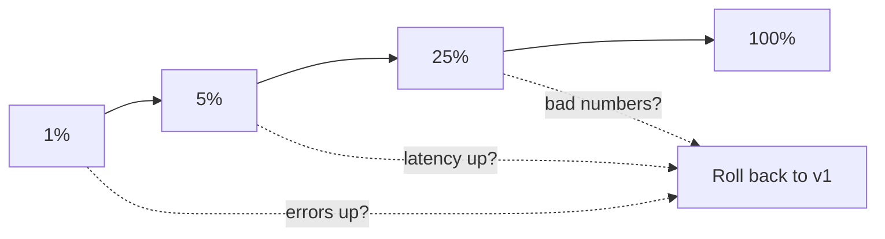
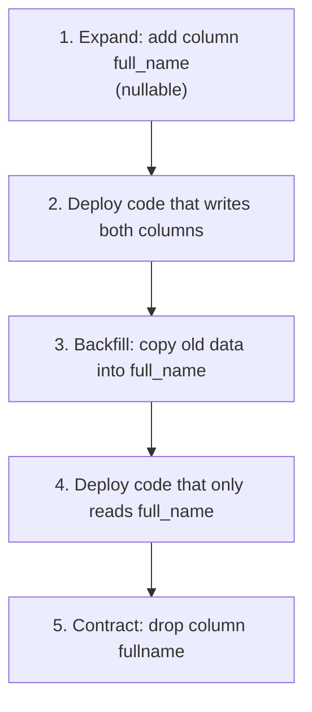

> [!NOTE]
> A deployment is where risk concentrates most in the software lifecycle: new code meets real data and real traffic. The deployment strategy decides **how many users are affected** when something breaks and **how fast you can get back** to the previous version.

## Recreate: stop everything, then start

The simplest approach: shut down every old instance, then start the new version. The system is **down** in between. Acceptable only for internal tools, test environments, or when two versions must never run at the same time.

## Rolling update: replace a few at a time

Instances are replaced one or a few at a time. This is the default for a Kubernetes Deployment.



```yaml
# Kubernetes: keep full serving capacity during the update
strategy:
  type: RollingUpdate
  rollingUpdate:
    maxSurge: 1          # create at most 1 extra new pod before removing an old one
    maxUnavailable: 0    # never drop below the desired number of serving pods
readinessProbe:          # a pod only receives traffic once it's ready
  httpGet: { path: /health/ready, port: 8080 }
```

- **Pros:** little extra capacity, no downtime.
- **Cons:** during the update **v1 and v2 run side by side**, so they must be compatible (APIs, database schema). Rolling back means running the whole process in reverse.

## Blue-green: two environments, one switch

Keep two identical environments. *Blue* serves users; *green* gets the new version and is tested thoroughly. When green is ready, the load balancer moves all traffic to green in one step.



- **Pros:** switching and **rolling back are near-instant** (point the router back to blue), and you can test in a production-like environment before users see it.
- **Cons:** double the infrastructure during the switch. The database is usually shared, so schema changes must still work with both versions.

## Canary: try it on a small group first

The new version gets only a slice of traffic (say 1%, then 5%, 25%, 100%). At each step, the canary's metrics are compared with the baseline before deciding to continue or pull back.



Typical signals: 5xx error rate, p95/p99 latency, CPU/RAM usage, and business metrics (checkout success rate). Tools such as Argo Rollouts or Flagger can automate the analysis and the rollback.

- **Pros:** bugs affect only a small share of users, and the new version is proven with real traffic.
- **Cons:** requires weighted routing and monitoring sensitive enough to detect small differences.

## Feature flags: separate "deploy" from "release"

Feature flags let you ship code to production with a feature **turned off**, then enable it gradually for groups of users — no redeploy needed.

```python
def checkout(user, cart):
    if flags.is_enabled("new-checkout", user=user, rollout_percent=10):
        return new_checkout_flow(user, cart)
    return legacy_checkout_flow(user, cart)
```

- Enable for internal staff first, then 10%, 50%, 100% of users.
- If the feature misbehaves, **turn it off instantly** with the flag instead of rolling back a deployment.
- Remove flags once a feature is stable. Old flags piling up are technical debt that make code harder to read and test.

## Quick comparison

| Strategy | Downtime | Infra cost | Rollback speed | Blast radius on failure |
|---|---|---|---|---|
| Recreate | Yes | Low | Slow (redeploy) | Everyone |
| Rolling | No | Low | Medium | Grows with progress |
| Blue-green | No | High (×2) | Very fast | Everyone, briefly |
| Canary | No | Medium | Fast | Small (by percentage) |
| Feature flag | No | Low | Instant (flip the flag) | Enabled cohort |

In practice strategies are combined — for example, rolling updates to deploy code plus feature flags to release features.

## Safe database changes: the expand/contract pattern

Every zero-downtime strategy has a window where **old and new versions run against the same database**. Schema changes must therefore be split into steps that are each backward compatible. Example: renaming column `fullname` to `full_name`:



At every point, both the running version and the next one work with the current schema. Never rename or drop a column in the same deployment as the code that depends on it.

## What makes rollback actually work

- Accurate **health checks**: `readiness` (ready for traffic) is not the same as `liveness` (still alive).
- **Monitoring and alerts** broken down by version, so you know whether errors come from v1 or v2.
- The **previous artifact is still available** and can be redeployed immediately.
- **Reversible migrations**, or at least backward-compatible ones via expand/contract.
- **Rollback drills**, so the first rollback doesn't happen in the middle of a real incident.

## Summary

- Rolling updates are a sensible default; blue-green gives instant rollback; canary limits the blast radius using real traffic.
- Feature flags separate deploying code from releasing features.
- Every zero-downtime strategy needs the two versions to be compatible, especially at the database layer — expand/contract is the standard approach.
- Rollback is only trustworthy with health checks, per-version monitoring and practice.
