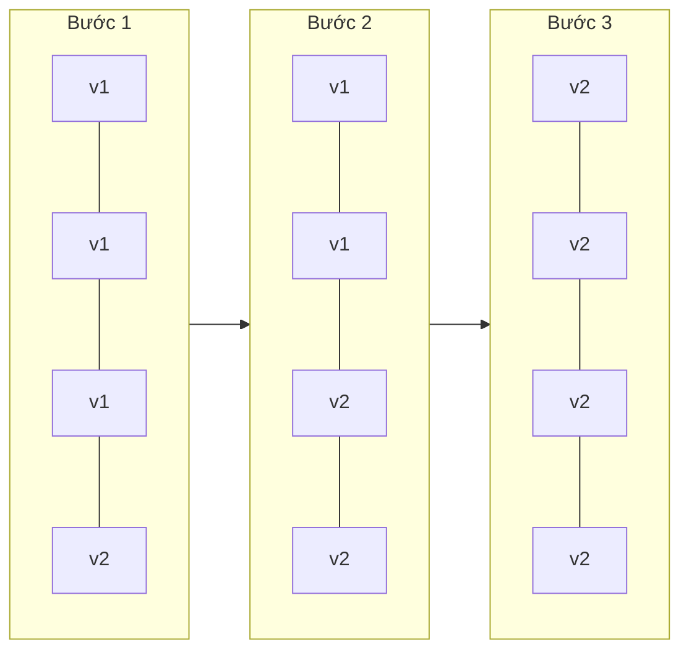
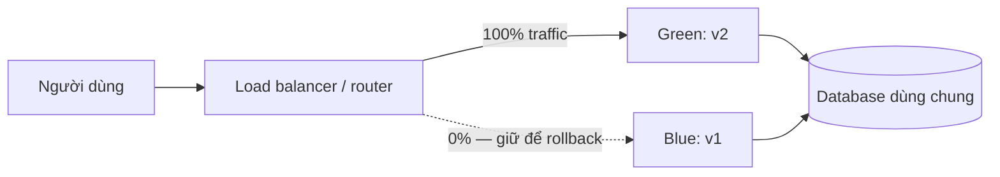
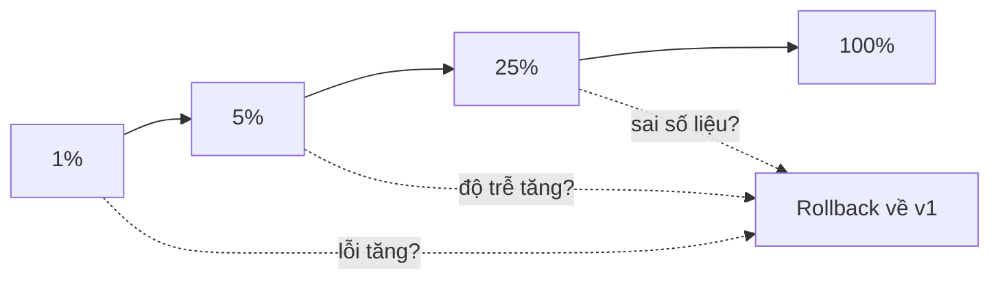
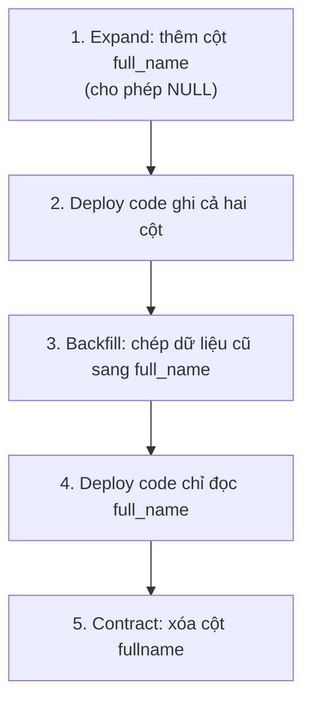

> [!NOTE]
> Deploy là lúc rủi ro tập trung cao nhất trong vòng đời phần mềm: code mới gặp dữ liệu thật và lưu lượng thật. Chiến lược triển khai quyết định khi có lỗi thì **bao nhiêu người dùng bị ảnh hưởng** và **quay lại phiên bản cũ nhanh đến đâu**.

## Recreate: dừng hết rồi chạy lại

Cách đơn giản nhất: tắt toàn bộ phiên bản cũ, rồi bật phiên bản mới. Hệ thống **ngừng hoạt động** trong khoảng giữa. Cách này chỉ chấp nhận được cho hệ thống nội bộ, môi trường thử nghiệm, hoặc khi hai phiên bản tuyệt đối không được chạy cùng lúc.

## Rolling update: thay dần từng phần

Các instance được thay lần lượt, mỗi lần một hoặc vài cái. Đây là cách mặc định của Kubernetes Deployment.



```yaml
# Kubernetes: luôn giữ đủ số pod phục vụ trong lúc cập nhật
strategy:
  type: RollingUpdate
  rollingUpdate:
    maxSurge: 1          # tạo thêm tối đa 1 pod mới trước khi tắt pod cũ
    maxUnavailable: 0    # không bao giờ giảm số pod đang phục vụ
readinessProbe:          # pod chỉ nhận traffic khi đã sẵn sàng
  httpGet: { path: /health/ready, port: 8080 }
```

- **Ưu điểm:** không tốn thêm nhiều tài nguyên, không gián đoạn dịch vụ.
- **Nhược điểm:** trong lúc cập nhật, **v1 và v2 chạy song song**, nên hai phiên bản phải tương thích với nhau (API, schema database). Rollback cũng phải chạy lại cả quá trình theo chiều ngược.

## Blue-green: hai môi trường, chuyển một lần

Duy trì hai môi trường giống hệt nhau. *Blue* đang phục vụ người dùng; *green* được cài phiên bản mới và kiểm tra kỹ. Khi green sẵn sàng, load balancer chuyển toàn bộ traffic sang green trong một bước.



- **Ưu điểm:** chuyển đổi và **rollback gần như tức thì** (chỉ cần trỏ router về blue), và kiểm tra được trên môi trường giống production trước khi mở cho người dùng.
- **Nhược điểm:** tốn gấp đôi hạ tầng trong lúc chuyển. Database thường dùng chung, nên thay đổi schema vẫn phải tương thích cả hai phiên bản.

## Canary: thử trên một nhóm nhỏ trước

Phiên bản mới chỉ nhận một phần nhỏ traffic (ví dụ 1%, rồi 5%, 25%, 100%). Ở mỗi bậc, hệ thống so sánh chỉ số của nhóm canary với nhóm cũ, rồi mới quyết định tăng tiếp hay rút lại.



Các chỉ số thường theo dõi: tỷ lệ lỗi 5xx, độ trễ p95/p99, mức dùng CPU/RAM, và chỉ số nghiệp vụ (tỷ lệ thanh toán thành công). Các công cụ như Argo Rollouts hay Flagger có thể tự động hóa việc phân tích và rollback.

- **Ưu điểm:** lỗi chỉ ảnh hưởng một phần nhỏ người dùng, và phiên bản mới được kiểm chứng bằng traffic thật.
- **Nhược điểm:** cần hạ tầng định tuyến theo tỷ lệ, cùng hệ thống giám sát đủ tốt để phát hiện khác biệt nhỏ.

## Feature flag: tách "deploy" khỏi "phát hành"

Feature flag cho phép đưa code lên production nhưng **tắt** tính năng, rồi bật dần cho từng nhóm người dùng mà không cần deploy lại.

```python
def checkout(user, cart):
    if flags.is_enabled("new-checkout", user=user, rollout_percent=10):
        return new_checkout_flow(user, cart)
    return legacy_checkout_flow(user, cart)
```

- Bật cho nhân viên nội bộ trước, rồi 10%, 50%, 100% người dùng.
- Tính năng gây lỗi thì **tắt ngay** bằng flag, không phải deploy rollback.
- Cần dọn flag sau khi tính năng đã ổn định. Flag cũ tích tụ là một dạng nợ kỹ thuật, làm code khó đọc và khó test.

## So sánh nhanh

| Chiến lược | Gián đoạn | Chi phí hạ tầng | Tốc độ rollback | Phạm vi ảnh hưởng khi lỗi |
|---|---|---|---|---|
| Recreate | Có | Thấp | Chậm (deploy lại) | Toàn bộ |
| Rolling | Không | Thấp | Trung bình | Tăng dần theo tiến độ |
| Blue-green | Không | Cao (×2) | Rất nhanh | Toàn bộ, trong thời gian ngắn |
| Canary | Không | Trung bình | Nhanh | Nhỏ (theo tỷ lệ) |
| Feature flag | Không | Thấp | Tức thì (tắt flag) | Theo nhóm được bật |

Trong thực tế các chiến lược thường được kết hợp, ví dụ rolling update để deploy code, cộng thêm feature flag để phát hành tính năng.

## Thay đổi database an toàn: mẫu expand/contract

Mọi chiến lược không gián đoạn đều có một khoảng thời gian **phiên bản cũ và mới cùng chạy trên một database**. Vì vậy thay đổi schema phải chia thành nhiều bước, sao cho mỗi bước đều tương thích ngược. Ví dụ đổi tên cột `fullname` thành `full_name`:



Ở mọi thời điểm, cả phiên bản đang chạy lẫn phiên bản chuẩn bị chạy đều làm việc được với schema hiện tại. Không bao giờ đổi tên hay xóa cột trong cùng một lần deploy với code phụ thuộc vào nó.

## Điều kiện để rollback thật sự hoạt động

- **Health check** chính xác: `readiness` (sẵn sàng nhận traffic) khác với `liveness` (còn sống).
- **Giám sát và cảnh báo** theo phiên bản, để biết lỗi đến từ v1 hay v2.
- **Artifact cũ vẫn còn** và có thể deploy lại ngay.
- **Migration có thể đảo ngược**, hoặc ít nhất tương thích ngược theo mẫu expand/contract.
- **Diễn tập rollback** định kỳ, để không phải làm lần đầu giữa một sự cố thật.

## Tóm tắt

- Rolling update là mặc định hợp lý; blue-green cho rollback tức thì; canary giới hạn phạm vi ảnh hưởng bằng traffic thật.
- Feature flag tách việc deploy code khỏi việc phát hành tính năng.
- Mọi chiến lược không gián đoạn đều đòi hỏi hai phiên bản tương thích nhau, nhất là ở tầng database. Expand/contract là cách làm chuẩn.
- Rollback chỉ đáng tin khi có health check, giám sát theo phiên bản và đã được diễn tập.
