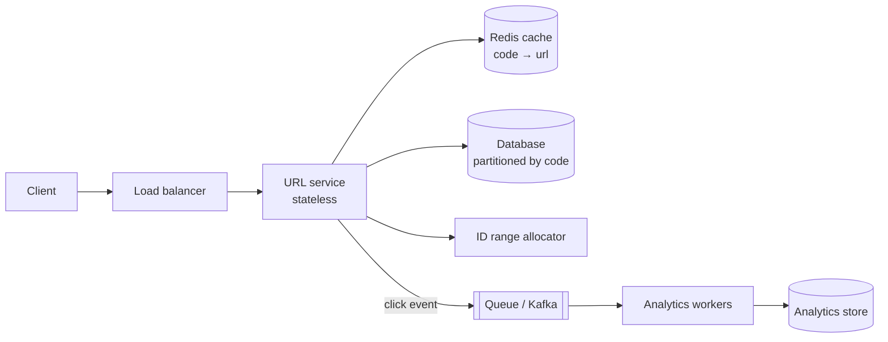
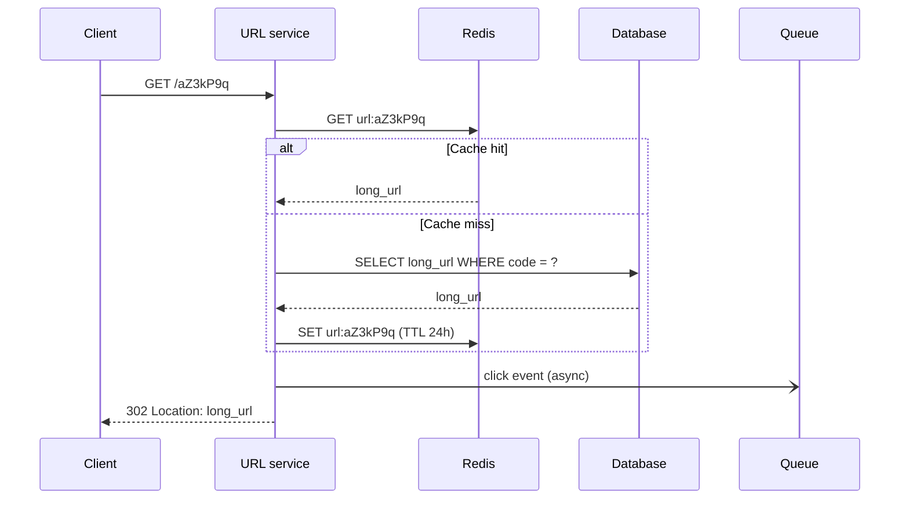

> [!NOTE]
> A URL shortener (think bit.ly) is a popular system design problem because it is small yet touches most key concepts: estimation, unique key generation, caching, skewed read/write ratios and asynchronous processing.

## 1. Clarify the requirements

**Functional requirements**

- Take a long URL and return a short one, e.g. `https://sho.rt/aZ3kP9q`.
- Visiting the short URL redirects to the original.
- Optional: custom aliases (`sho.rt/my-cv`), expiry, click statistics.

**Non-functional requirements**

- Redirects must be very fast (p99 latency under 50 ms) and highly available.
- Codes should not be guessable, so nobody can enumerate every link.
- Reads vastly outnumber writes.

## 2. Estimate the scale

Assume 100 million new URLs per month and a 100:1 read/write ratio.

| Quantity | Calculation | Result |
|---|---|---|
| Writes per second | 100M ÷ (30 × 86,400) | ≈ 40 |
| Reads per second | 40 × 100 | ≈ 4,000 (peak ~12,000) |
| URLs over 5 years | 100M × 12 × 5 | 6 billion |
| Storage | 6 billion × ~500 bytes | ≈ 3 TB |
| Cache for the hottest 20% per day | 4,000 × 86,400 × 20% × 500 bytes | ≈ 35 GB |

What the estimate tells us: writes are tiny, reads are large, and the hot set fits in the RAM of a Redis cluster. The design should optimize the read path.

## 3. API

```http
POST /api/v1/urls
Content-Type: application/json

{ "longUrl": "https://example.com/a/very/long/path", "customAlias": null, "expiresAt": null }
```

```http
HTTP/1.1 201 Created
Location: https://sho.rt/aZ3kP9q

{ "code": "aZ3kP9q", "shortUrl": "https://sho.rt/aZ3kP9q" }
```

```http
GET /aZ3kP9q

HTTP/1.1 302 Found
Location: https://example.com/a/very/long/path
```

**301 or 302?** `301 Moved Permanently` lets browsers cache the redirect and skip the server next time: less load, but you lose click data. `302 Found` sends every visit through the server, so clicks can be counted. Services with analytics usually choose 302.

## 4. Generating short codes

Codes use the **Base62** alphabet (`0-9`, `a-z`, `A-Z`). With 7 characters there are 62⁷ ≈ 3.5 trillion combinations — plenty for 6 billion URLs.

| Approach | How | Pros | Cons |
|---|---|---|---|
| Hash and truncate | `base62(md5(url))[:7]` | Same URL → same code | Collisions; must check and retry |
| Counter + Base62 | Auto-increment ID → Base62 | Never collides, simple | Sequential, guessable; counter is a bottleneck |
| Pre-allocated ranges | Each server gets a range (1–1M, 1M–2M…) | No coordination per write | Needs a range allocator |
| Key Generation Service | Pre-generate random codes into a pool | Fast, unguessable | One more component to run |

A balanced option is **range-based counters**, then scrambling the ID with a reversible transformation before Base62 encoding. Codes stay unique without being sequential.

```python
ALPHABET = "0123456789abcdefghijklmnopqrstuvwxyzABCDEFGHIJKLMNOPQRSTUVWXYZ"

def base62(n: int) -> str:
    if n == 0:
        return ALPHABET[0]
    out = []
    while n:
        n, r = divmod(n, 62)
        out.append(ALPHABET[r])
    return "".join(reversed(out))

base62(125)            # '21'
base62(3_500_000_000)  # '3ORDSU' — only 6 characters
```

## 5. Data model

| Column | Type | Notes |
|---|---|---|
| `code` | `VARCHAR(16)` | Primary key |
| `long_url` | `TEXT` | Original URL |
| `user_id` | `BIGINT NULL` | Owner (if signed in) |
| `created_at` | `TIMESTAMP` | |
| `expires_at` | `TIMESTAMP NULL` | Expired → `410 Gone` |

The main query is a key lookup (`code → long_url`) with no JOINs, so both a relational database and a key-value store (DynamoDB, Cassandra) fit. A key-value store is easier to partition by `code` once data grows to several TB.

## 6. Architecture



### Redirect flow



The click event goes to the queue **asynchronously**, so analytics never slows down the redirect. Workers batch events and write them to the analytics store.

## 7. Bottlenecks and fixes

- **Hot keys:** a viral link gets millions of hits. Cache at the CDN/edge, or keep a small in-memory cache on each server to relieve Redis.
- **Abuse:** rate-limit link creation per user/IP and check URLs against malware lists before saving.
- **Expired links:** no need to delete immediately. Return `410` when an expired code is read, and let a background job clean up periodically.
- **Custom alias collisions:** a `UNIQUE` constraint on `code`, returning `409 Conflict` to the user.

## Summary

- Early estimation shows a **read-heavy** system, so the design centers on caching and a fast read path.
- Codes use Base62; 7 characters cover trillions of URLs. The generation method decides uniqueness and guessability.
- Use `302` when you need analytics, and record clicks asynchronously through a queue.
- The data is key-value shaped, partitioned by `code`, and scales out easily.
