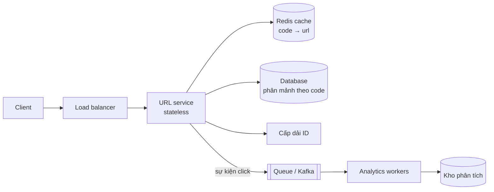
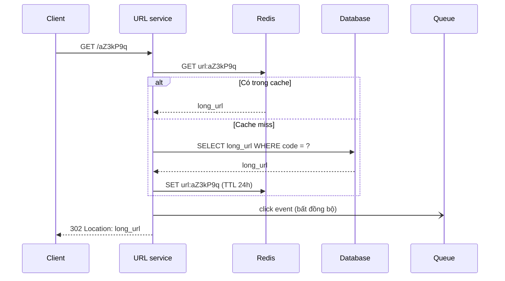

> [!NOTE]
> Dịch vụ rút gọn URL (kiểu bit.ly) là bài toán thiết kế hệ thống phổ biến vì nó nhỏ nhưng chạm tới hầu hết các khái niệm quan trọng: ước lượng, sinh khóa duy nhất, cache, tỷ lệ đọc/ghi lệch và xử lý bất đồng bộ.

## 1. Làm rõ yêu cầu

**Yêu cầu chức năng**

- Nhận một URL dài và trả về URL ngắn, ví dụ `https://sho.rt/aZ3kP9q`.
- Truy cập URL ngắn thì được chuyển hướng tới URL gốc.
- Tùy chọn: alias tự đặt (`sho.rt/my-cv`), thời hạn hết hiệu lực, thống kê lượt click.

**Yêu cầu phi chức năng**

- Chuyển hướng phải rất nhanh (độ trễ p99 dưới 50 ms) và luôn sẵn sàng.
- Mã ngắn không đoán trước được, để người khác không duyệt lần lượt toàn bộ link.
- Đọc nhiều hơn ghi rất nhiều.

## 2. Ước lượng quy mô

Giả định có 100 triệu URL mới mỗi tháng, và tỷ lệ đọc/ghi là 100:1.

| Đại lượng | Cách tính | Kết quả |
|---|---|---|
| Ghi mỗi giây | 100M ÷ (30 × 86.400) | ≈ 40 |
| Đọc mỗi giây | 40 × 100 | ≈ 4.000 (cao điểm ~12.000) |
| Số URL trong 5 năm | 100M × 12 × 5 | 6 tỷ |
| Dung lượng | 6 tỷ × ~500 byte | ≈ 3 TB |
| Cache cho 20% URL "nóng" mỗi ngày | 4.000 × 86.400 × 20% × 500 byte | ≈ 35 GB |

Kết luận từ ước lượng: lượng ghi nhỏ, lượng đọc lớn, và tập dữ liệu nóng vừa đủ nằm trong RAM của một cụm Redis. Thiết kế nên tối ưu cho đường đọc.

## 3. API

```http
POST /api/v1/urls
Content-Type: application/json

{ "longUrl": "https://example.com/a/very/long/path", "customAlias": null, "expiresAt": null }
```

```http
HTTP/1.1 201 Created
Location: https://sho.rt/aZ3kP9q

{ "code": "aZ3kP9q", "shortUrl": "https://sho.rt/aZ3kP9q" }
```

```http
GET /aZ3kP9q

HTTP/1.1 302 Found
Location: https://example.com/a/very/long/path
```

**301 hay 302?** `301 Moved Permanently` cho phép trình duyệt cache chuyển hướng, nên lần sau trình duyệt không gọi lại server: giảm tải nhưng mất số liệu click. `302 Found` buộc mỗi lần đều đi qua server, nên đếm được click. Các dịch vụ có thống kê thường chọn 302.

## 4. Sinh mã ngắn

Mã dùng bảng chữ **Base62** (`0-9`, `a-z`, `A-Z`). Với độ dài 7 ký tự có 62⁷ ≈ 3.500 tỷ tổ hợp, dư sức cho 6 tỷ URL.

| Cách làm | Mô tả | Ưu điểm | Nhược điểm |
|---|---|---|---|
| Hash rồi cắt | `base62(md5(url))[:7]` | Cùng URL cho cùng mã | Có thể trùng, phải kiểm tra và thử lại |
| Bộ đếm + Base62 | ID tự tăng → Base62 | Không bao giờ trùng, đơn giản | Mã tuần tự, dễ đoán; bộ đếm là điểm nghẽn |
| Dải ID cấp trước | Mỗi server nhận một dải (1–1M, 1M–2M…) | Không cần phối hợp mỗi lần ghi | Cần dịch vụ cấp dải |
| Key Generation Service | Sinh sẵn mã ngẫu nhiên, lưu trong kho | Nhanh, không đoán được | Thêm một thành phần phải vận hành |

Một lựa chọn cân bằng là dùng **bộ đếm theo dải**, rồi xáo trộn ID bằng một phép biến đổi khả nghịch trước khi mã hóa Base62. Mã vẫn duy nhất mà không còn tuần tự.

```python
ALPHABET = "0123456789abcdefghijklmnopqrstuvwxyzABCDEFGHIJKLMNOPQRSTUVWXYZ"

def base62(n: int) -> str:
    if n == 0:
        return ALPHABET[0]
    out = []
    while n:
        n, r = divmod(n, 62)
        out.append(ALPHABET[r])
    return "".join(reversed(out))

base62(125)            # '21'
base62(3_500_000_000)  # '3ORDSU' — chỉ 6 ký tự
```

## 5. Mô hình dữ liệu

| Cột | Kiểu | Ghi chú |
|---|---|---|
| `code` | `VARCHAR(16)` | Khóa chính |
| `long_url` | `TEXT` | URL gốc |
| `user_id` | `BIGINT NULL` | Chủ sở hữu (nếu đăng nhập) |
| `created_at` | `TIMESTAMP` | |
| `expires_at` | `TIMESTAMP NULL` | Hết hạn thì trả `410 Gone` |

Truy vấn chính chỉ là tra theo khóa (`code → long_url`), không cần JOIN, nên cả cơ sở dữ liệu quan hệ lẫn kho key-value (DynamoDB, Cassandra) đều phù hợp. Kho key-value dễ phân mảnh theo `code` hơn khi dữ liệu tăng lên vài TB.

## 6. Kiến trúc



### Luồng chuyển hướng



Sự kiện click được gửi vào queue **bất đồng bộ**, nên việc ghi thống kê không làm chậm chuyển hướng. Worker gom sự kiện theo lô rồi ghi vào kho phân tích.

## 7. Điểm nghẽn và cách xử lý

- **Key nóng:** một link viral nhận hàng triệu lượt truy cập. Cache tại tầng CDN/edge hoặc giữ cache cục bộ trong bộ nhớ của từng server để giảm áp lực lên Redis.
- **Lạm dụng:** giới hạn tốc độ tạo link theo người dùng/IP và kiểm tra URL độc hại trước khi lưu.
- **Dọn link hết hạn:** không cần xóa ngay. Khi đọc thấy hết hạn thì trả `410`; một job nền dọn dần định kỳ.
- **Alias tự đặt bị trùng:** ràng buộc `UNIQUE` trên `code` kèm trả `409 Conflict` cho người dùng.

## Tóm tắt

- Ước lượng sớm cho thấy hệ thống **đọc nhiều**, nên thiết kế xoay quanh cache và đường đọc nhanh.
- Mã ngắn dùng Base62; 7 ký tự đủ cho hàng nghìn tỷ URL. Cách sinh mã quyết định độ duy nhất và khả năng bị đoán.
- Chọn `302` khi cần thống kê; ghi thống kê bất đồng bộ qua queue.
- Dữ liệu dạng key-value, phân mảnh theo `code`, mở rộng ngang dễ dàng.
