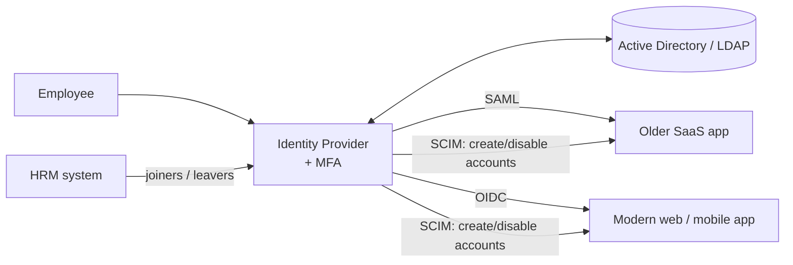
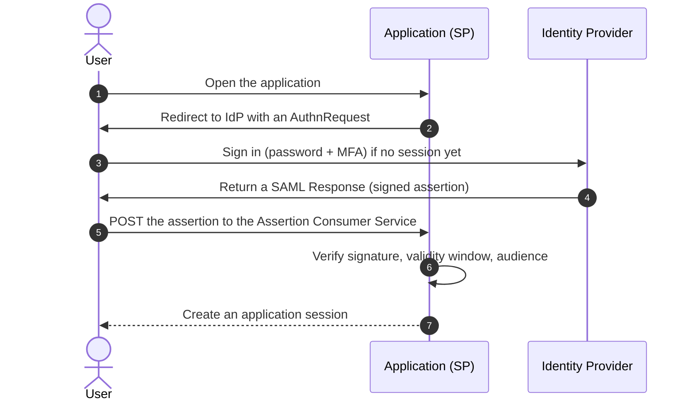
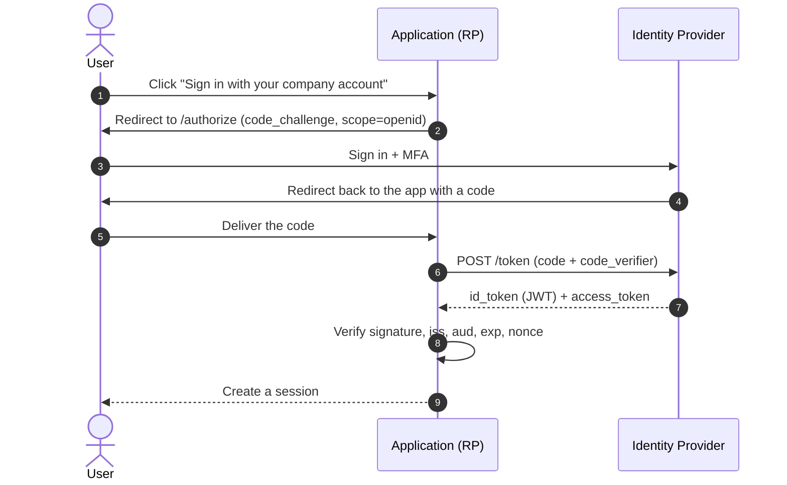

> [!NOTE]
> An office worker may use dozens of applications a day: email, chat, CRM, HR, internal tools. **Single Sign-On (SSO)** lets them sign in once, in one place, and use them all. For IT it is also the control point: enforce MFA, disable leavers' accounts, log access.

## The roles

| Term | Role | Examples |
|---|---|---|
| **Identity Provider (IdP)** | Authenticates users and issues identity "certificates" | Microsoft Entra ID, Okta, Google Workspace, Keycloak |
| **Service Provider (SP)** / **Relying Party (RP)** | The application that trusts the IdP | Salesforce, Slack, your internal app |
| **Directory** | Stores accounts, groups, departments | Active Directory, OpenLDAP |



## LDAP and Active Directory: the identity store

**LDAP** (Lightweight Directory Access Protocol) queries a tree-shaped directory where each entry has a distinguished name (DN) like `uid=an,ou=engineering,dc=example,dc=com`. Microsoft's **Active Directory** is the most common enterprise directory; it speaks LDAP and uses Kerberos for authentication on the internal network.

Older applications authenticate by **binding** directly to LDAP with the username and password. That means the password passes through the application, and there's no MFA or web single sign-on. Today LDAP/AD usually serves as the **account store behind the IdP**, while applications talk to the IdP via SAML or OIDC.

## SAML 2.0

SAML dates from 2005, uses XML, and carries data through the browser via redirects. It remains the most common standard for enterprise SaaS.



The assertion is an XML document **digitally signed** by the IdP, holding the user's identity and attributes:

```xml
<saml:Assertion ID="_a1b2c3" IssueInstant="2026-11-14T08:00:00Z">
  <saml:Issuer>https://idp.example.com</saml:Issuer>
  <saml:Subject>
    <saml:NameID Format="urn:oasis:names:tc:SAML:1.1:nameid-format:emailAddress">an@example.com</saml:NameID>
  </saml:Subject>
  <saml:Conditions NotBefore="2026-11-14T08:00:00Z" NotOnOrAfter="2026-11-14T08:05:00Z">
    <saml:AudienceRestriction><saml:Audience>https://crm.example.com</saml:Audience></saml:AudienceRestriction>
  </saml:Conditions>
  <saml:AttributeStatement>
    <saml:Attribute Name="department"><saml:AttributeValue>Engineering</saml:AttributeValue></saml:Attribute>
  </saml:AttributeStatement>
  <ds:Signature>…</ds:Signature>
</saml:Assertion>
```

## OpenID Connect (OIDC)

OIDC is an authentication layer on top of OAuth 2.0, using JSON and JWTs. It is easier to implement than SAML and fits modern web apps, mobile apps and SPAs. The recommended flow is **Authorization Code + PKCE**.



The `id_token` payload:

```json
{
  "iss": "https://login.example.com",
  "sub": "8f14e45f-ceea-467a-9575-1e0c6f5b2a10",
  "aud": "crm-web",
  "email": "an@example.com",
  "name": "Nguyen Van An",
  "groups": ["engineering", "crm-admins"],
  "iat": 1795161600,
  "exp": 1795165200,
  "nonce": "n-0S6_WzA2Mj"
}
```

## Comparison

| | LDAP | SAML 2.0 | OIDC |
|---|---|---|---|
| Main purpose | Directory queries, internal auth | SSO for web apps | SSO for web, mobile, APIs |
| Format | Binary (ASN.1) | XML | JSON / JWT |
| Password passes through the app? | **Yes** | No | No |
| Mobile apps / SPAs | Not suitable | Awkward | Good fit |
| Typically found in | Legacy internal systems | Enterprise SaaS | New apps, APIs |

## Provisioning: SCIM and JIT

SSO solves **signing in**, but each application still needs accounts to be created, updated and **disabled**:

- **JIT (just-in-time) provisioning:** the account is created automatically on first login from attributes in the assertion or token. Simple, but it can't disable accounts when someone leaves.
- **SCIM 2.0:** a standard REST protocol that lets the IdP actively create, update and deactivate users and groups in each application. When the HRM records a leaver, the IdP disables their accounts everywhere almost immediately.

> [!IMPORTANT]
> Revoking access when someone leaves is mandatory under most audit frameworks such as SOC 2 and ISO 27001. It's the strongest single reason to invest in SSO together with SCIM.

## Common mistakes

- **Incomplete validation:** always check the signature, `issuer`, `audience` and validity window — plus `nonce` for OIDC, and replay protection for SAML assertions.
- **Using email as a permanent identifier:** emails change and get reassigned. Use `sub` (OIDC) or an immutable NameID.
- **Logout:** signing out of the IdP doesn't automatically end each application's session. Single Logout (SLO) is complex and often unreliable — keep app sessions short and re-check with the IdP periodically.
- **Mapping groups to permissions:** map IdP groups to application roles rather than hard-coding group names in code.
- **Emergency access:** keep at least one admin account that doesn't depend on SSO (break-glass), in case the IdP has an outage.

## Summary

- The IdP authenticates users; applications trust the IdP's signed statements; LDAP/AD is the account store behind it.
- SAML (XML) dominates enterprise SaaS; OIDC (JSON/JWT) is the default for new and mobile applications.
- SSO solves sign-in; SCIM solves the account lifecycle — especially disabling leavers.
- Complete token/assertion validation and immutable identifiers are non-negotiable.
