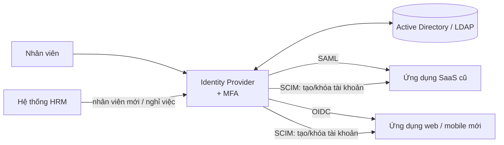
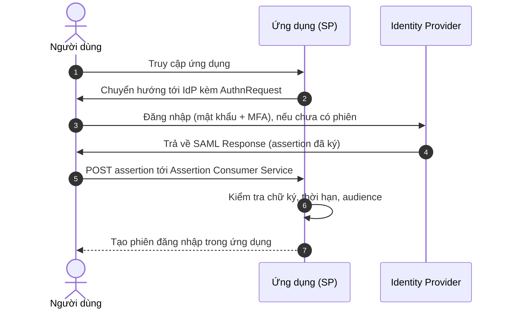
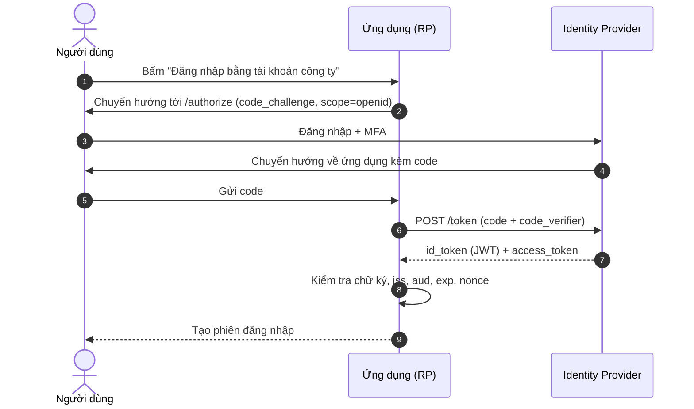

> [!NOTE]
> Một nhân viên văn phòng có thể dùng hàng chục ứng dụng mỗi ngày: email, chat, CRM, hệ thống nhân sự, công cụ nội bộ. **Single Sign-On (SSO)** cho phép họ đăng nhập một lần ở một nơi duy nhất, rồi dùng được tất cả. Với bộ phận IT, SSO còn là nơi tập trung kiểm soát: bật MFA, khóa tài khoản người nghỉ việc, ghi nhật ký truy cập.

## Các vai trò

| Thuật ngữ | Vai trò | Ví dụ |
|---|---|---|
| **Identity Provider (IdP)** | Xác thực người dùng và phát hành "giấy chứng nhận" danh tính | Microsoft Entra ID, Okta, Google Workspace, Keycloak |
| **Service Provider (SP)** / **Relying Party (RP)** | Ứng dụng tin vào giấy chứng nhận của IdP | Salesforce, Slack, ứng dụng nội bộ của bạn |
| **Thư mục (Directory)** | Kho lưu tài khoản, nhóm, phòng ban | Active Directory, OpenLDAP |



## LDAP và Active Directory: kho danh tính

**LDAP** (Lightweight Directory Access Protocol) là giao thức truy vấn một thư mục dạng cây. Mỗi mục có một tên định danh (DN) như `uid=an,ou=engineering,dc=example,dc=com`. **Active Directory** của Microsoft là dịch vụ thư mục phổ biến nhất trong doanh nghiệp, hỗ trợ LDAP và dùng Kerberos để xác thực trong mạng nội bộ.

Ứng dụng cũ thường xác thực bằng cách **bind** trực tiếp vào LDAP với tên đăng nhập và mật khẩu. Cách này buộc mật khẩu phải đi qua ứng dụng, và không hỗ trợ MFA hay đăng nhập một lần cho web. Vì vậy ngày nay LDAP/AD thường đóng vai trò **kho tài khoản phía sau IdP**, còn ứng dụng nói chuyện với IdP qua SAML hoặc OIDC.

## SAML 2.0

SAML ra đời năm 2005, dùng XML và chuyển dữ liệu qua trình duyệt bằng các lần chuyển hướng. Đây vẫn là chuẩn phổ biến nhất cho các ứng dụng SaaS doanh nghiệp.



Assertion là một tài liệu XML được IdP **ký số**, chứa danh tính và các thuộc tính của người dùng:

```xml
<saml:Assertion ID="_a1b2c3" IssueInstant="2026-11-14T08:00:00Z">
  <saml:Issuer>https://idp.example.com</saml:Issuer>
  <saml:Subject>
    <saml:NameID Format="urn:oasis:names:tc:SAML:1.1:nameid-format:emailAddress">an@example.com</saml:NameID>
  </saml:Subject>
  <saml:Conditions NotBefore="2026-11-14T08:00:00Z" NotOnOrAfter="2026-11-14T08:05:00Z">
    <saml:AudienceRestriction><saml:Audience>https://crm.example.com</saml:Audience></saml:AudienceRestriction>
  </saml:Conditions>
  <saml:AttributeStatement>
    <saml:Attribute Name="department"><saml:AttributeValue>Engineering</saml:AttributeValue></saml:Attribute>
  </saml:AttributeStatement>
  <ds:Signature>…</ds:Signature>
</saml:Assertion>
```

## OpenID Connect (OIDC)

OIDC là lớp xác thực xây trên OAuth 2.0, dùng JSON và JWT. Chuẩn này dễ triển khai hơn SAML, hợp với ứng dụng web hiện đại, ứng dụng di động và SPA. Luồng khuyến nghị là **Authorization Code + PKCE**.



Phần payload của `id_token`:

```json
{
  "iss": "https://login.example.com",
  "sub": "8f14e45f-ceea-467a-9575-1e0c6f5b2a10",
  "aud": "crm-web",
  "email": "an@example.com",
  "name": "Nguyen Van An",
  "groups": ["engineering", "crm-admins"],
  "iat": 1795161600,
  "exp": 1795165200,
  "nonce": "n-0S6_WzA2Mj"
}
```

## So sánh

| | LDAP | SAML 2.0 | OIDC |
|---|---|---|---|
| Mục đích chính | Truy vấn thư mục, xác thực nội bộ | SSO cho ứng dụng web | SSO cho web, mobile, API |
| Định dạng | Nhị phân (ASN.1) | XML | JSON / JWT |
| Mật khẩu đi qua ứng dụng? | **Có** | Không | Không |
| Ứng dụng di động / SPA | Không phù hợp | Khó | Phù hợp |
| Thường gặp ở | Hệ thống nội bộ cũ | SaaS doanh nghiệp | Ứng dụng mới, API |

## Cấp phát tài khoản: SCIM và JIT

SSO giải quyết bài toán **đăng nhập**, nhưng tài khoản trong từng ứng dụng vẫn phải được tạo, cập nhật và **khóa**:

- **JIT provisioning (just-in-time):** tài khoản được tạo tự động ở lần đăng nhập đầu tiên, dựa trên thuộc tính trong assertion hoặc token. Cách này đơn giản, nhưng không khóa được tài khoản khi người dùng nghỉ việc.
- **SCIM 2.0:** giao thức REST chuẩn để IdP chủ động tạo, sửa, vô hiệu hóa người dùng và nhóm trong từng ứng dụng. Khi HRM ghi nhận một nhân viên nghỉ việc, IdP khóa tài khoản ở mọi ứng dụng gần như ngay lập tức.

> [!IMPORTANT]
> Thu hồi quyền truy cập khi nhân viên nghỉ việc là yêu cầu bắt buộc trong hầu hết các chuẩn kiểm toán như SOC 2 và ISO 27001. Đây là lý do đáng giá nhất để đầu tư vào SSO kết hợp SCIM.

## Những điểm hay sai

- **Không kiểm tra đủ:** phải kiểm tra chữ ký, `issuer`, `audience`, thời hạn hiệu lực. Với OIDC còn có `nonce`; với SAML cần chống dùng lại assertion (replay).
- **Lấy email làm định danh vĩnh viễn:** email có thể đổi hoặc được cấp lại cho người khác. Hãy dùng `sub` (OIDC) hoặc một NameID bất biến.
- **Đăng xuất:** đăng xuất khỏi IdP không tự động kết thúc phiên trong từng ứng dụng. Single Logout (SLO) phức tạp và thường không đáng tin cậy, nên giữ phiên ứng dụng ngắn và kiểm tra lại với IdP định kỳ.
- **Ánh xạ nhóm sang quyền:** nên ánh xạ nhóm từ IdP sang vai trò trong ứng dụng, thay vì hard-code tên nhóm trong code.
- **Tài khoản khẩn cấp:** giữ ít nhất một tài khoản quản trị không phụ thuộc vào SSO (break-glass), phòng khi IdP gặp sự cố.

## Tóm tắt

- IdP xác thực người dùng; ứng dụng tin vào chứng nhận đã ký của IdP; LDAP/AD là kho tài khoản phía sau.
- SAML (XML) phổ biến với SaaS doanh nghiệp; OIDC (JSON/JWT) là lựa chọn mặc định cho ứng dụng mới và mobile.
- SSO giải quyết việc đăng nhập; SCIM giải quyết vòng đời tài khoản, đặc biệt là khóa tài khoản khi nghỉ việc.
- Kiểm tra token/assertion đầy đủ và dùng định danh bất biến là hai điều không được bỏ qua.
