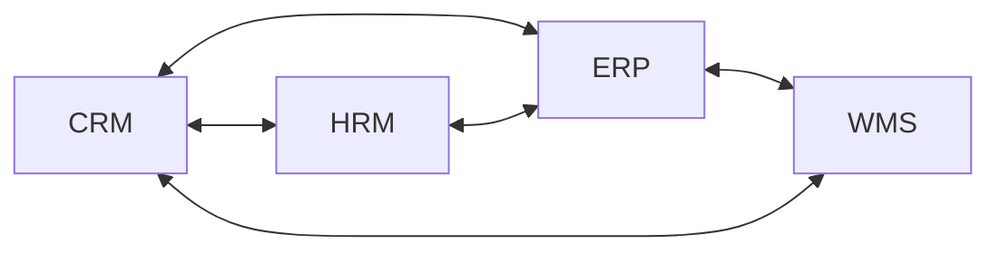
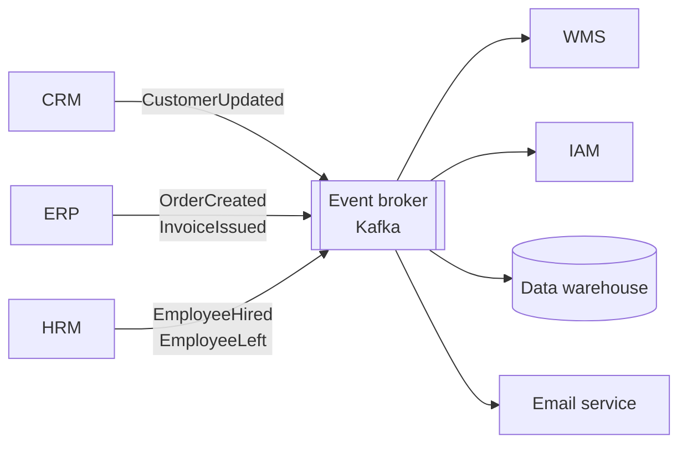
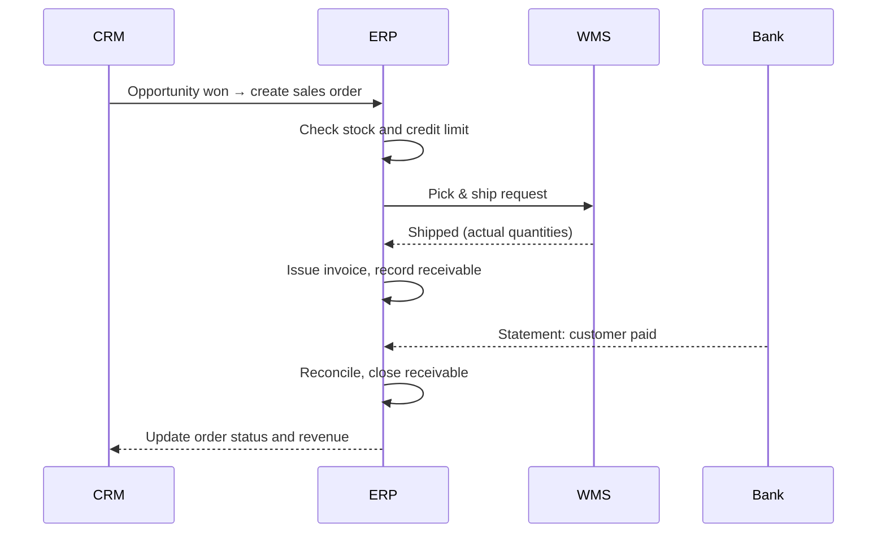

> [!NOTE]
> A mid-size or large company typically runs dozens of software systems at once. The hardest part is usually not any single system but **how they exchange data**. Understanding this landscape helps backend developers design integrations right from the start.

## The core systems

| System | Stands for | Responsible for | Example products |
|---|---|---|---|
| **ERP** | Enterprise Resource Planning | Finance & accounting, purchasing, inventory, manufacturing, sales | SAP S/4HANA, Oracle NetSuite, Odoo, Microsoft Dynamics 365 |
| **CRM** | Customer Relationship Management | Leads, opportunities, marketing, customer service | Salesforce, HubSpot, Dynamics 365 Sales |
| **HRM / HCM** | Human Resource / Capital Management | Employee records, recruiting, time tracking, payroll, reviews | Workday, SAP SuccessFactors, BambooHR |
| **SCM / WMS** | Supply Chain / Warehouse Management | Supply chain, goods in/out, shipping | Manhattan, Blue Yonder, ERP WMS modules |
| **IAM** | Identity & Access Management | Accounts, single sign-on (SSO), permissions | Microsoft Entra ID, Okta, Keycloak |
| **BI / DW** | Business Intelligence / Data Warehouse | Reports and analytics across all systems | Snowflake, BigQuery, Power BI |

## Where does master data live?

The key integration question is **which system is the system of record** for each kind of data:

- **Customers:** usually the CRM; the ERP keeps what it needs for invoicing and receivables.
- **Products, prices, inventory:** the ERP.
- **Employees:** the HRM; IAM creates and disables accounts based on HRM data.
- **Orders, invoices:** the ERP.

When the same customer exists in three systems under three different IDs, the company needs **Master Data Management (MDM)**: one "golden" record plus a cross-reference of IDs between systems.

## Integration patterns

### Point-to-point: wire every pair directly

Simple with a handful of systems. But `n` systems can need up to `n(n−1)/2` connections — 45 for 10 systems — each with its own format and error handling. Changing one system can ripple into many connections.

### Hub-and-spoke / ESB: a central backbone

An **Enterprise Service Bus** (MuleSoft, IBM App Connect, WSO2) sits in the middle and handles transformation, routing and orchestration. Each system connects only to the bus. In exchange, the bus concentrates risk and tends to grow into a hard-to-maintain blob of business logic.

### API-led: layered APIs

APIs are organized in three layers:

- **System APIs** wrap each core system (ERP, CRM) in a stable API that hides its internals.
- **Process APIs** orchestrate business flows that span systems, e.g. "create order".
- **Experience APIs** serve a specific channel (mobile app, partner portal).

Replacing the ERP means rewriting only its System API; the layers above stay the same.

### Event-driven: publish events, whoever cares listens

Source systems just publish events ("order created", "employee left") without knowing who consumes them. Adding a new consumer needs no change to the source. The trade-off: data is only **eventually consistent**, and following one business flow across many events is harder.

**Change Data Capture (CDC)** — e.g. with Debezium — reads a database's transaction log and emits an event for every change. It's an effective way to bring legacy systems (no APIs, no events) into an event-driven architecture without touching their code.

### Batch / files: still very common

Exchanging CSV/XML files over SFTP every night, or ETL jobs loading a data warehouse, are still the main integration method in many companies — especially with banks, tax authorities and large partners. Simple and reliable, but data lags by hours.

## Example: the order-to-cash flow

One business flow crosses four systems, and every arrow is an integration point that can fail. That's why the principles below matter.

## Principles for building integrations

- **Idempotency:** the same message delivered twice must not create two orders. Use unique transaction IDs and check before processing.
- **Retries and a dead-letter queue:** failed messages are retried with increasing delays; after repeated failures they move to a separate queue for a human to inspect.
- **Correlation IDs:** one ID carried through the whole flow to trace it across many systems' logs.
- **Data contracts:** API and event schemas are versioned, and changes must be backward compatible.
- **Audit and compliance:** financial and HR data need access logs, encryption and retention policies that meet regulations.

## Summary

- ERP holds finance and operations, CRM holds customer relationships, HRM holds people, IAM holds identities, and BI/DW brings everything together.
- Be explicit about the system of record for each data type; use MDM when one entity lives in several places.
- Point-to-point doesn't scale; ESB and API-led add an intermediate layer; event-driven and CDC decouple systems the most.
- Idempotency, retries, correlation IDs and data contracts are the foundation of every reliable integration.
