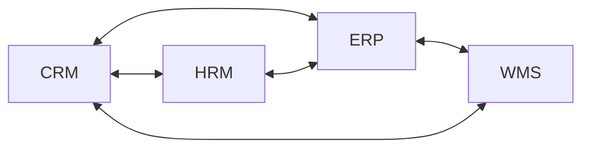
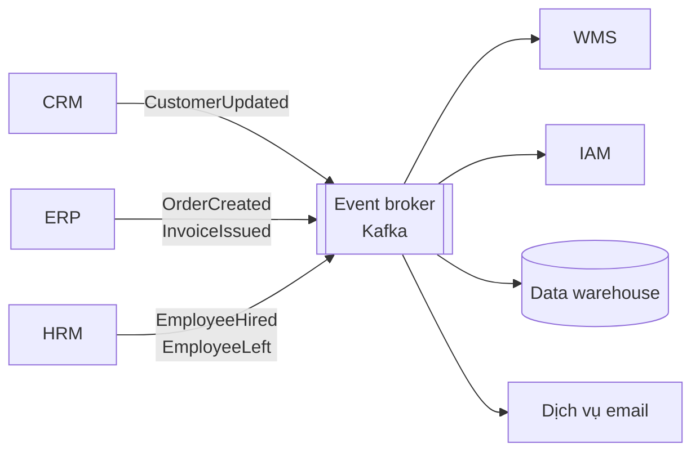
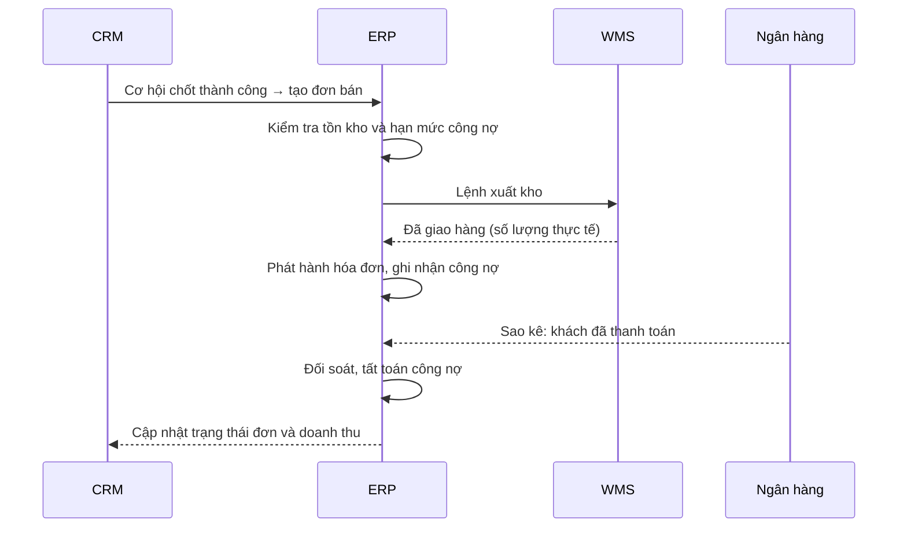

> [!NOTE]
> Một doanh nghiệp vừa và lớn thường chạy hàng chục hệ thống phần mềm cùng lúc. Phần khó nhất thường không nằm ở từng hệ thống riêng lẻ, mà ở **việc chúng trao đổi dữ liệu với nhau**. Hiểu bức tranh này giúp backend developer thiết kế tích hợp đúng ngay từ đầu.

## Các hệ thống lõi

| Hệ thống | Viết tắt của | Phụ trách | Ví dụ sản phẩm |
|---|---|---|---|
| **ERP** | Enterprise Resource Planning | Tài chính–kế toán, mua hàng, kho, sản xuất, bán hàng | SAP S/4HANA, Oracle NetSuite, Odoo, Microsoft Dynamics 365 |
| **CRM** | Customer Relationship Management | Khách hàng tiềm năng, cơ hội bán hàng, marketing, chăm sóc khách hàng | Salesforce, HubSpot, Dynamics 365 Sales |
| **HRM / HCM** | Human Resource / Capital Management | Hồ sơ nhân sự, tuyển dụng, chấm công, tính lương, đánh giá | Workday, SAP SuccessFactors, BambooHR |
| **SCM / WMS** | Supply Chain / Warehouse Management | Chuỗi cung ứng, nhập–xuất kho, vận chuyển | Manhattan, Blue Yonder, module WMS của ERP |
| **IAM** | Identity & Access Management | Tài khoản, đăng nhập một lần (SSO), phân quyền | Microsoft Entra ID, Okta, Keycloak |
| **BI / DW** | Business Intelligence / Data Warehouse | Báo cáo, phân tích tổng hợp từ mọi hệ thống | Snowflake, BigQuery, Power BI |

## Dữ liệu gốc nằm ở đâu?

Câu hỏi quan trọng nhất khi tích hợp là **hệ thống nào là nguồn gốc (system of record)** của từng loại dữ liệu:

- **Khách hàng:** thường là CRM. ERP giữ thông tin phục vụ xuất hóa đơn và công nợ.
- **Sản phẩm, giá, tồn kho:** ERP.
- **Nhân viên:** HRM. IAM tạo và khóa tài khoản dựa trên dữ liệu từ HRM.
- **Đơn hàng, hóa đơn:** ERP.

Khi cùng một khách hàng tồn tại ở ba hệ thống với ba mã khác nhau, doanh nghiệp cần **quản lý dữ liệu chủ (Master Data Management, MDM)**: một bản ghi "chuẩn" duy nhất, cùng bảng ánh xạ mã giữa các hệ thống.

## Các mẫu tích hợp

### Point-to-point: nối thẳng từng cặp

Cách này đơn giản khi chỉ có vài hệ thống. Nhưng với `n` hệ thống có thể cần tới `n(n−1)/2` kết nối: 10 hệ thống là 45 kết nối, mỗi kết nối có định dạng và cách xử lý lỗi riêng. Thay đổi một hệ thống có thể kéo theo việc sửa nhiều kết nối khác.

### Hub-and-spoke / ESB: một trục trung tâm

Một **Enterprise Service Bus** (MuleSoft, IBM App Connect, WSO2) đứng ở giữa, đảm nhận chuyển đổi định dạng, định tuyến và điều phối. Mỗi hệ thống chỉ cần kết nối tới bus. Đổi lại, bus trở thành điểm tập trung rủi ro và dễ phình to thành một khối logic nghiệp vụ khó bảo trì.

### API-led: chia API thành nhiều lớp

API được tổ chức thành ba lớp:

- **System API:** bọc từng hệ thống gốc (ERP, CRM) thành API ổn định, che đi chi tiết bên trong.
- **Process API:** điều phối nghiệp vụ trải qua nhiều hệ thống, ví dụ "tạo đơn hàng".
- **Experience API:** phục vụ từng kênh cụ thể (ứng dụng di động, cổng đối tác).

Thay hệ thống ERP thì chỉ phải viết lại System API; các lớp phía trên giữ nguyên.

### Event-driven: phát sự kiện, ai cần thì nghe

Hệ thống nguồn chỉ phát sự kiện ("đơn hàng đã tạo", "nhân viên đã nghỉ") mà không cần biết ai sẽ dùng. Thêm một hệ thống tiêu thụ mới không phải sửa hệ thống nguồn. Đổi lại, dữ liệu chỉ **nhất quán sau một khoảng trễ (eventual consistency)**, và việc theo dõi một luồng nghiệp vụ trải qua nhiều sự kiện khó hơn.

**Change Data Capture (CDC)**, ví dụ dùng Debezium, đọc nhật ký giao dịch của database để phát sự kiện mỗi khi dữ liệu thay đổi. Đây là cách hiệu quả để đưa hệ thống cũ (không có API hay sự kiện) vào kiến trúc hướng sự kiện mà không phải sửa code của nó.

### Batch / file: vẫn còn rất phổ biến

Trao đổi file CSV/XML qua SFTP mỗi đêm, hay các job ETL đổ dữ liệu vào data warehouse, vẫn là cách tích hợp chính ở nhiều doanh nghiệp, đặc biệt với ngân hàng, cơ quan thuế và đối tác lớn. Cách này đơn giản và đáng tin cậy, nhưng dữ liệu trễ hàng giờ.

## Ví dụ: luồng order-to-cash

Một luồng nghiệp vụ đi qua bốn hệ thống, và mỗi mũi tên là một điểm tích hợp có thể lỗi. Vì vậy cần các nguyên tắc chung bên dưới.

## Nguyên tắc khi xây dựng tích hợp

- **Idempotency:** cùng một thông điệp bị gửi lại không được tạo ra hai đơn hàng. Dùng mã giao dịch duy nhất và kiểm tra trước khi xử lý.
- **Retry và dead-letter queue:** thông điệp lỗi được thử lại với thời gian chờ tăng dần; sau nhiều lần vẫn lỗi thì chuyển vào hàng đợi riêng để người kiểm tra.
- **Correlation ID:** gắn một mã xuyên suốt toàn bộ luồng để truy vết qua log của nhiều hệ thống.
- **Hợp đồng dữ liệu (data contract):** schema của API hay sự kiện được quản lý phiên bản, thay đổi phải tương thích ngược.
- **Kiểm toán và tuân thủ:** dữ liệu tài chính và nhân sự cần nhật ký truy cập, mã hóa, và chính sách lưu trữ theo quy định.

## Tóm tắt

- ERP giữ tài chính và vận hành, CRM giữ quan hệ khách hàng, HRM giữ con người, IAM giữ định danh, còn BI/DW tổng hợp dữ liệu từ tất cả.
- Xác định rõ hệ thống nguồn của từng loại dữ liệu, và dùng MDM khi cùng một thực thể tồn tại ở nhiều nơi.
- Point-to-point không mở rộng được; ESB và API-led tạo lớp trung gian; event-driven và CDC giúp các hệ thống ít phụ thuộc vào nhau nhất.
- Idempotency, retry, correlation ID và data contract là nền tảng của mọi tích hợp đáng tin cậy.
