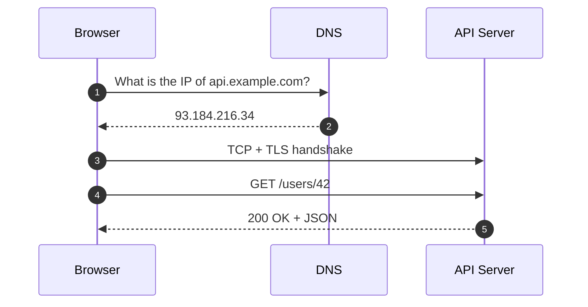

> [!NOTE]
> **Goal:** understand what happens when a client calls an API, read raw requests and responses, and pick the right method and status code.

## 1. The life of a request

When you hit `https://api.example.com/users/42`:

1. **DNS** resolves `api.example.com` to an IP address.
2. **TCP** opens a connection to the server (port 443).
3. A **TLS handshake** sets up an encrypted channel (HTTPS).
4. The client sends an **HTTP request**; the server processes it and returns an **HTTP response**.
5. The connection may be kept alive and reused for the next request.


## 2. Anatomy of a request and response

```http
GET /users/42 HTTP/1.1
Host: api.example.com
Accept: application/json
Authorization: Bearer eyJhbGciOi...
```

```http
HTTP/1.1 200 OK
Content-Type: application/json
Cache-Control: max-age=60

{"id": 42, "name": "An"}
```




A request is a **start line** (method + path + version), **headers**, a blank line, and an optional **body**.

## 3. Methods

| Method | Used for | Safe | Idempotent |
|---|---|---|---|
| GET | Read | ✅ | ✅ |
| POST | Create / trigger an action | ❌ | ❌ |
| PUT | Replace entirely | ❌ | ✅ |
| PATCH | Partial update | ❌ | ❌ |
| DELETE | Remove | ❌ | ✅ |

- **Safe:** does not change server state.
- **Idempotent:** calling once or ten times leaves the server in the same state. This matters a lot when clients **retry** over flaky networks.

## 4. Status codes worth memorizing

- `200 OK`, `201 Created`, `204 No Content`
- `301/308` permanent redirect, `304 Not Modified` (caching)
- `400 Bad Request`, `401 Unauthorized`, `403 Forbidden`, `404 Not Found`, `409 Conflict`, `422 Unprocessable Content`, `429 Too Many Requests`
- `500 Internal Server Error`, `502 Bad Gateway`, `503 Service Unavailable`, `504 Gateway Timeout`

> [!TIP]
> **Rule of thumb:** 4xx means "you (the client) made a mistake", 5xx means "I (the server) made one".


## 5. Headers that matter

- `Content-Type`: format of the body (`application/json`).
- `Accept`: format the client wants back.
- `Authorization`: credentials (`Bearer <token>`).
- `Cache-Control`, `ETag`: caching behavior.
- `Set-Cookie` / `Cookie`: login sessions.

## 6. CORS in one paragraph

Browsers **block** JavaScript on `https://app.com` from reading responses from `https://api.com` unless the server sends `Access-Control-Allow-Origin: https://app.com`. For non-simple requests (for example, ones with an `Authorization` header), the browser first sends a **preflight** `OPTIONS` request.

CORS protects **browsers**. `curl` and Postman are never blocked by it.

## 7. Hands-on

```bash
# See every request/response header
curl -v https://httpbin.org/get

# POST some JSON
curl -X POST https://httpbin.org/post \
  -H "Content-Type: application/json" \
  -d '{"name":"An"}'
```

## ✅ Self-check

1. Why is `PUT` idempotent while `POST` is not?
2. A logged-in user opens an admin-only page. Should you return 401 or 403?
3. Why does an API call work in Postman but fail with a CORS error from the frontend?
