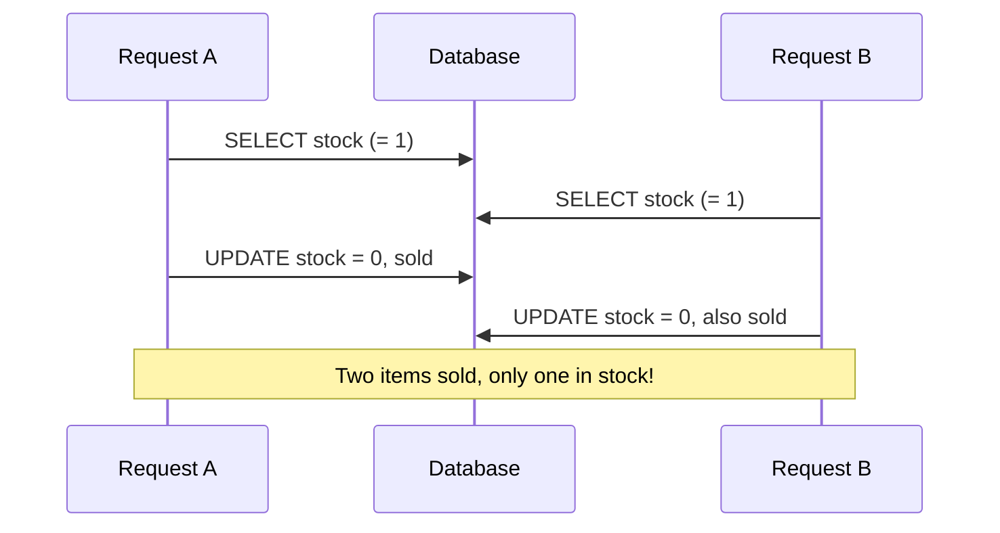

> [!NOTE]
> **Goal:** know why queries get slow and how to fix them, keep data correct under concurrent requests, and spot the N+1 trap in ORMs.

## 1. Indexes: the table of contents

Without an index, `WHERE customer_id = 1` forces a **full table scan** (O(n)). A B-tree index **jumps straight** to the matching rows (O(log n)).

Run the box to see the query plan **after** creating the index. Delete the `CREATE INDEX` line and run again to see it turn into `SCAN orders`.

```sql-run
CREATE INDEX idx_orders_customer_id ON orders(customer_id);

EXPLAIN QUERY PLAN            -- SQLite
SELECT * FROM orders WHERE customer_id = 1;
```


In PostgreSQL, use `EXPLAIN ANALYZE SELECT ...`.

### When to add an index

- Columns used in `WHERE`, `JOIN ... ON` and `ORDER BY`.
- Foreign key columns. Postgres does **not** index them automatically!

> [!WARNING]
> Don't index every column. Measure with `EXPLAIN` first, then add the index that fixes the slow query.
- `UNIQUE` constraints (these create an index for you).

### Trade-offs

- Every index costs storage and slows `INSERT/UPDATE/DELETE`.
- A **composite index** `(a, b)` serves `WHERE a = ?` and `WHERE a = ? AND b = ?`, but usually **not** `WHERE b = ?` (leftmost-prefix rule).
- Wrapping a column in a function (`WHERE LOWER(email) = ?`) can stop a plain index from being used.

## 2. Transactions and ACID

Moving $100 from account A to B takes two `UPDATE`s. What if the server crashes in between?

```sql-run
-- db: none
CREATE TABLE accounts (id TEXT PRIMARY KEY, balance INTEGER NOT NULL CHECK (balance >= 0));
INSERT INTO accounts VALUES ('A', 150), ('B', 20);
-- ---
BEGIN;
UPDATE accounts SET balance = balance - 100 WHERE id = 'A';
UPDATE accounts SET balance = balance + 100 WHERE id = 'B';
COMMIT;   -- or ROLLBACK on error

SELECT * FROM accounts;
```

Try changing `100` to `200`: the `CHECK (balance >= 0)` constraint makes the first statement fail, so money never leaves A without reaching B.

- **A**tomicity: all of it happens, or none of it.
- **C**onsistency: constraints (CHECK, FK) always hold.
- **I**solation: concurrent transactions don't see each other's half-done work.
- **D**urability: once `COMMIT`ted, data survives crashes.

### The classic race: overselling stock

```sql
-- ❌ Read-then-write: two requests both read stock = 1 and both sell
SELECT stock FROM products WHERE id = 10;   -- 1
UPDATE products SET stock = 0 WHERE id = 10;
```

The safe version is a single conditional `UPDATE`. `changes()` reports how many rows were affected — `0` means sold out. Product 10 has 8 units in stock; try changing `>= 1` to `>= 9`.

```sql-run
UPDATE products SET stock = stock - 1
WHERE id = 10 AND stock >= 1;

SELECT changes() AS rows_updated,
       (SELECT stock FROM products WHERE id = 10) AS stock_now;
```




Alternatives: `SELECT ... FOR UPDATE` (pessimistic locking) or a `version` column (optimistic locking).

### Isolation levels

| Level | Prevents |
|---|---|
| Read Committed (Postgres default) | dirty reads |
| Repeatable Read (MySQL InnoDB default) | + non-repeatable reads |
| Serializable | + phantom reads — safest, slowest |

## 3. The N+1 problem

```python
# ❌ 1 query for 50 orders + 50 queries for customers = 51 queries
orders = session.query(Order).limit(50).all()
for o in orders:
    print(o.customer.name)   # lazy load fires a SELECT each iteration

# ✅ Eager loading: 1–2 queries
from sqlalchemy.orm import joinedload
orders = session.query(Order).options(joinedload(Order.customer)).limit(50).all()
```

Django equivalents: `select_related()` (FKs) and `prefetch_related()` (many-relations). Turn on SQL logging during development to catch N+1 early.

## ✅ Self-check

1. A 10-million-row `users` table takes 2s for `WHERE email = ?`. How do you fix it?
2. Why is `UPDATE ... WHERE stock >= 1` safer than read-then-write?
3. How would you detect N+1 in a slow production endpoint?
