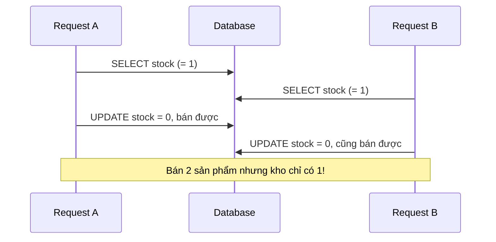

> [!NOTE]
> **Mục tiêu:** biết vì sao truy vấn chậm và sửa thế nào, giữ dữ liệu đúng khi nhiều request chạy đồng thời, và nhận ra lỗi N+1 trong ORM.

## 1. Index: mục lục của bảng

Không có index, `WHERE customer_id = 1` buộc database **quét toàn bảng** (full scan, O(n)). Index B-tree cho phép **tìm thẳng** tới dòng cần lấy (O(log n)).

Chạy ô dưới để xem kế hoạch truy vấn **sau** khi tạo index. Xóa dòng `CREATE INDEX` rồi chạy lại để thấy kết quả chuyển thành `SCAN orders`.

```sql-run
CREATE INDEX idx_orders_customer_id ON orders(customer_id);

EXPLAIN QUERY PLAN            -- SQLite
SELECT * FROM orders WHERE customer_id = 1;
```


Trong PostgreSQL, câu tương đương là `EXPLAIN ANALYZE SELECT ...`.

### Nên tạo index khi nào?

- Cột hay xuất hiện trong `WHERE`, `JOIN ... ON`, `ORDER BY`.
- Cột khóa ngoại (foreign key). Postgres **không** tự tạo index cho cột này!

> [!WARNING]
> Đừng tạo index cho mọi cột. Hãy đo bằng `EXPLAIN` trước, rồi mới thêm index cho đúng truy vấn chậm.
- Ràng buộc `UNIQUE` (tự động sinh index).

### Đánh đổi

- Mỗi index tốn dung lượng và làm `INSERT/UPDATE/DELETE` chậm hơn.
- **Composite index** `(a, b)` dùng được cho `WHERE a = ?` và `WHERE a = ? AND b = ?`, nhưng thường **không** dùng được cho `WHERE b = ?` (quy tắc leftmost prefix).
- Bọc cột trong hàm (`WHERE LOWER(email) = ?`) có thể làm mất tác dụng của index thường.

## 2. Transaction và ACID

Chuyển 100$ từ tài khoản A sang B gồm 2 lệnh `UPDATE`. Nếu server sập giữa chừng thì sao?

```sql-run
-- db: none
CREATE TABLE accounts (id TEXT PRIMARY KEY, balance INTEGER NOT NULL CHECK (balance >= 0));
INSERT INTO accounts VALUES ('A', 150), ('B', 20);
-- ---
BEGIN;
UPDATE accounts SET balance = balance - 100 WHERE id = 'A';
UPDATE accounts SET balance = balance + 100 WHERE id = 'B';
COMMIT;   -- hoặc ROLLBACK nếu có lỗi

SELECT * FROM accounts;
```

Thử đổi `100` thành `200`: ràng buộc `CHECK (balance >= 0)` làm lệnh đầu tiên thất bại, nên số dư không bị trừ một nửa.

- **A**tomicity: tất cả cùng thành công, hoặc không có gì xảy ra.
- **C**onsistency: các ràng buộc (CHECK, FK) luôn được thỏa.
- **I**solation: các transaction chạy song song không thấy trạng thái dở dang của nhau.
- **D**urability: đã `COMMIT` thì không mất, kể cả khi mất điện.

### Race condition kinh điển: bán vượt tồn kho

```sql
-- ❌ Đọc rồi mới ghi: hai request cùng đọc stock = 1 và cùng bán được
SELECT stock FROM products WHERE id = 10;   -- 1
UPDATE products SET stock = 0 WHERE id = 10;
```

Cách an toàn là một lệnh `UPDATE` có điều kiện. `changes()` cho biết số dòng bị ảnh hưởng: `0` nghĩa là đã hết hàng. Sản phẩm 10 có 8 chiếc, nên hãy thử đổi `>= 1` thành `>= 9`.

```sql-run
UPDATE products SET stock = stock - 1
WHERE id = 10 AND stock >= 1;

SELECT changes() AS rows_updated,
       (SELECT stock FROM products WHERE id = 10) AS stock_now;
```




Cách khác: `SELECT ... FOR UPDATE` (pessimistic lock), hoặc cột `version` (optimistic locking).

### Các mức isolation

| Mức | Ngăn được |
|---|---|
| Read Committed (mặc định của Postgres) | dirty read |
| Repeatable Read (mặc định của MySQL InnoDB) | + non-repeatable read |
| Serializable | + phantom read, an toàn nhất nhưng chậm nhất |

## 3. Vấn đề N+1

```python
# ❌ 1 query lấy 50 đơn hàng, rồi thêm 50 query lấy khách hàng = 51 query
orders = session.query(Order).limit(50).all()
for o in orders:
    print(o.customer.name)   # mỗi vòng lặp lại sinh ra một SELECT mới

# ✅ Eager loading: chỉ 1–2 query
from sqlalchemy.orm import joinedload
orders = session.query(Order).options(joinedload(Order.customer)).limit(50).all()
```

Với Django, cách tương đương là `select_related()` (cho FK) và `prefetch_related()` (cho quan hệ many). Hãy bật log SQL khi phát triển để phát hiện N+1 sớm.

## ✅ Tự kiểm tra

1. Bảng `users` có 10 triệu dòng, query `WHERE email = ?` mất 2 giây. Bạn sửa thế nào?
2. Vì sao `UPDATE ... WHERE stock >= 1` an toàn hơn đọc rồi mới ghi?
3. Làm sao phát hiện N+1 trong một API đang chạy chậm?
