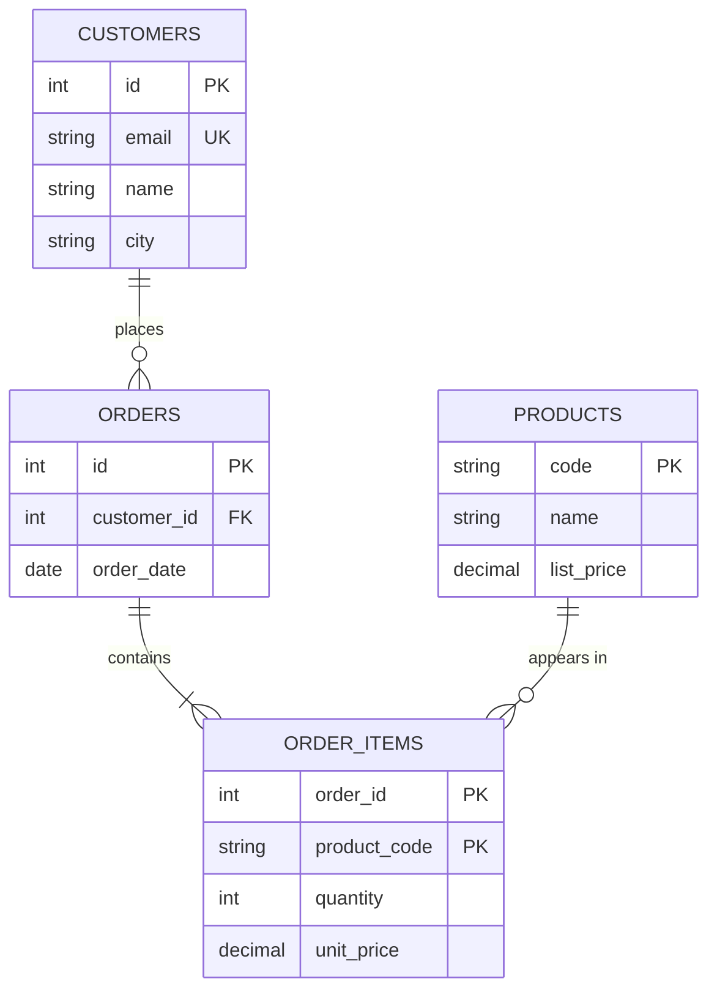

> [!NOTE]
> Normalization organizes tables so that **each fact is stored in exactly one place**. The goal isn't theoretical purity; it's avoiding very practical data bugs: fixing a value in one place but not another, or deleting a row and losing unrelated information. The SQL boxes in this article run right in the browser.

## Starting point: an order "spreadsheet"

Many systems start with a single table that looks like an Excel file:

```sql-run
-- db: none
CREATE TABLE order_sheet (
  order_id INTEGER, order_date TEXT,
  customer_email TEXT, customer_name TEXT, customer_city TEXT,
  products TEXT
);
INSERT INTO order_sheet VALUES
 (1001, '2026-10-02', 'an@example.com',   'Nguyen Van An', 'Ho Chi Minh City', 'KB01 Keyboard x1; MS02 Mouse x2'),
 (1002, '2026-10-03', 'binh@example.com', 'Tran Thi Binh', 'Hanoi',            'MN27 Monitor x1'),
 (1003, '2026-10-05', 'an@example.com',   'Nguyen Van An', 'Ha Noi',           'MS02 Mouse x1');
-- ---
SELECT * FROM order_sheet;
```

This table has three classic problems, together called **anomalies**:

- **Update anomaly:** An's details repeat across rows. When An moves, every row must be changed; miss one and the data contradicts itself. In fact the table above already has two different cities for the same email.
- **Insert anomaly:** you can't store a new customer who hasn't ordered yet, because every row is an order.
- **Delete anomaly:** deleting order 1002 also deletes everything known about customer Binh.

## First normal form (1NF): atomic values

**Rule:** each cell holds exactly one value — no lists or repeating groups.

The `products` column holds a whole list (`"KB01 Keyboard x1; MS02 Mouse x2"`), so you can't filter, count or join by product. To reach 1NF, each product in an order becomes its own row:

| order_id | order_date | customer_email | customer_name | customer_city | product_code | product_name | unit_price | quantity |
|---|---|---|---|---|---|---|---|---|
| 1001 | 2026-10-02 | an@example.com | Nguyen Van An | Ho Chi Minh City | KB01 | Keyboard | 89 | 1 |
| 1001 | 2026-10-02 | an@example.com | Nguyen Van An | Ho Chi Minh City | MS02 | Mouse | 29.5 | 2 |
| 1002 | 2026-10-03 | binh@example.com | Tran Thi Binh | Hanoi | MN27 | Monitor | 329 | 1 |

The primary key is now `(order_id, product_code)`. The data is queryable, but there's even more repetition than before.

## Second normal form (2NF): no partial dependencies

**Rule:** be in 1NF, and every non-key column must depend on the **whole** primary key, not just part of it.

With the key `(order_id, product_code)`:

- `order_date` and `customer_*` depend only on `order_id`.
- `product_name` and `unit_price` (list price) depend only on `product_code`.
- Only `quantity` depends on both.

Splitting by dependency gives three tables: `orders`, `products` and `order_items(order_id, product_code, quantity)`.

> [!TIP]
> The price **at the time of sale** is a different fact from today's list price. Storing `unit_price` in `order_items` doesn't break normalization: it's historical data for that order line, and old invoices must not change when the price list does.

## Third normal form (3NF): no transitive dependencies

**Rule:** be in 2NF, and non-key columns must not depend on other non-key columns.

In `orders`, `customer_name` and `customer_city` depend on `customer_email`, which in turn depends on `order_id`. That's a **transitive** dependency `order_id → customer_email → customer_city`. Moving customer details into a `customers` table removes it.



Here is the normalized schema plus a query that rebuilds the original "spreadsheet". Change An's city with **a single** `UPDATE` and run it again:

```sql-run
-- db: none
CREATE TABLE customers (
  id INTEGER PRIMARY KEY, email TEXT NOT NULL UNIQUE, name TEXT NOT NULL, city TEXT NOT NULL
);
CREATE TABLE products (
  code TEXT PRIMARY KEY, name TEXT NOT NULL, list_price REAL NOT NULL CHECK (list_price >= 0)
);
CREATE TABLE orders (
  id INTEGER PRIMARY KEY, customer_id INTEGER NOT NULL REFERENCES customers(id), order_date TEXT NOT NULL
);
CREATE TABLE order_items (
  order_id INTEGER NOT NULL REFERENCES orders(id),
  product_code TEXT NOT NULL REFERENCES products(code),
  quantity INTEGER NOT NULL CHECK (quantity > 0),
  unit_price REAL NOT NULL,
  PRIMARY KEY (order_id, product_code)
);
INSERT INTO customers VALUES (1, 'an@example.com', 'Nguyen Van An', 'Ho Chi Minh City'),
                             (2, 'binh@example.com', 'Tran Thi Binh', 'Hanoi'),
                             (3, 'chau@example.com', 'Le Minh Chau', 'Da Nang');  -- no orders yet: now storable
INSERT INTO products VALUES ('KB01', 'Keyboard', 89), ('MS02', 'Mouse', 29.5), ('MN27', 'Monitor', 329);
INSERT INTO orders VALUES (1001, 1, '2026-10-02'), (1002, 2, '2026-10-03'), (1003, 1, '2026-10-05');
INSERT INTO order_items VALUES (1001, 'KB01', 1, 89), (1001, 'MS02', 2, 29.5), (1002, 'MN27', 1, 329), (1003, 'MS02', 1, 29.5);
-- ---
UPDATE customers SET city = 'Hanoi' WHERE email = 'an@example.com';

SELECT o.id AS order_id, o.order_date, c.name, c.city,
       p.name AS product, i.quantity, i.quantity * i.unit_price AS line_total
FROM orders o
JOIN customers c   ON c.id = o.customer_id
JOIN order_items i ON i.order_id = o.id
JOIN products p    ON p.code = i.product_code
ORDER BY o.id;
```

All three anomalies are gone: customer details change in one place, customers without orders can be stored, and deleting an order no longer loses customer information.

## BCNF and beyond

**BCNF (Boyce–Codd)** is slightly stricter than 3NF: for every functional dependency `X → Y`, `X` must be a candidate key. The two only differ in rare cases with overlapping candidate keys; in practice 3NF is usually enough. 4NF and 5NF deal with multi-valued dependencies and rarely come up in typical business systems.

## When to denormalize?

Normalization optimizes for **correct writes**. Deliberate denormalization optimizes for **fast reads**, at the cost of keeping data in sync yourself.

| Situation | Denormalization | Cost |
|---|---|---|
| Like/comment counts shown everywhere | A `comment_count` column on posts | Update the count in the same transaction |
| Reports, dashboards | Summary tables, materialized views, a data warehouse | Data lags behind the source |
| Lists that need the customer name | Store `customer_name` on the order (snapshot) | Doesn't follow name changes (sometimes that's desired) |
| Very read-heavy, expensive JOINs | Nested documents (JSON, NoSQL) | Partial updates are harder; data can drift |

> [!IMPORTANT]
> A practical rule: **design in 3NF first**, measure, then denormalize only where it's actually slow — with an explicit sync mechanism (trigger, transaction or refresh job).

## Summary

- **1NF:** one value per cell, no lists in a column.
- **2NF:** no column depends on only part of a composite key.
- **3NF:** no transitive dependencies through non-key columns.
- Normalization removes insert, update and delete anomalies; denormalization is a deliberate read optimization that always comes with a sync cost.
