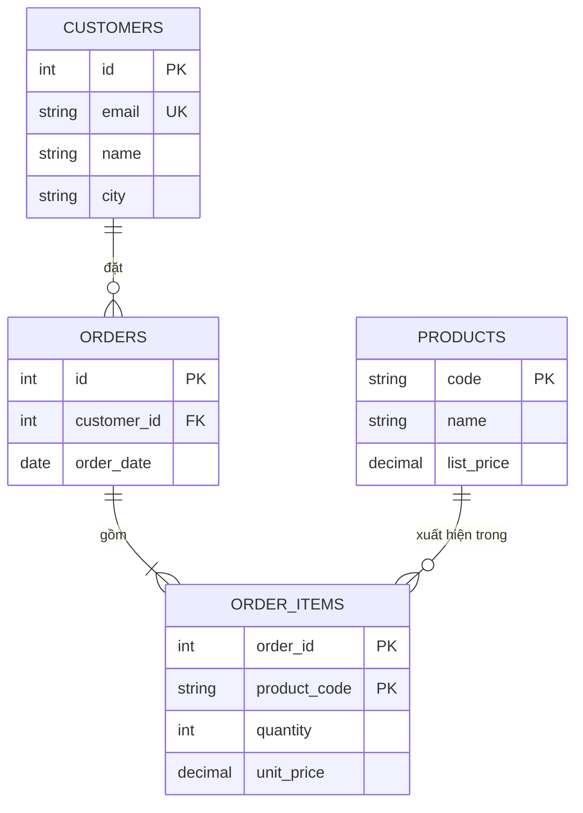

> [!NOTE]
> Chuẩn hóa (normalization) là quá trình tổ chức bảng sao cho **mỗi sự thật chỉ được lưu ở một chỗ**. Mục tiêu không phải tuân thủ lý thuyết cho đẹp, mà là tránh những lỗi dữ liệu rất thực tế: sửa chỗ này quên chỗ kia, xóa một dòng làm mất luôn thông tin không liên quan. Các ô SQL trong bài chạy được ngay trên trình duyệt.

## Điểm xuất phát: một "bảng tính" đơn hàng

Nhiều hệ thống bắt đầu từ một bảng duy nhất, giống một file Excel:

```sql-run
-- db: none
CREATE TABLE order_sheet (
  order_id INTEGER, order_date TEXT,
  customer_email TEXT, customer_name TEXT, customer_city TEXT,
  products TEXT
);
INSERT INTO order_sheet VALUES
 (1001, '2026-10-02', 'an@example.com',   'Nguyen Van An', 'Ho Chi Minh City', 'KB01 Keyboard x1; MS02 Mouse x2'),
 (1002, '2026-10-03', 'binh@example.com', 'Tran Thi Binh', 'Hanoi',            'MN27 Monitor x1'),
 (1003, '2026-10-05', 'an@example.com',   'Nguyen Van An', 'Ha Noi',           'MS02 Mouse x1');
-- ---
SELECT * FROM order_sheet;
```

Bảng này có ba vấn đề điển hình, gọi chung là **bất thường dữ liệu (anomalies)**:

- **Bất thường khi cập nhật:** thông tin của An lặp ở nhiều dòng. Khi An chuyển nhà, phải sửa mọi dòng; sót một dòng là dữ liệu mâu thuẫn. Thực tế bảng trên đã có hai thành phố khác nhau cho cùng một email.
- **Bất thường khi thêm:** không thể lưu một khách hàng mới chưa có đơn hàng nào, vì mỗi dòng là một đơn.
- **Bất thường khi xóa:** xóa đơn 1002 thì mất luôn mọi thông tin về khách hàng Bình.

## Dạng chuẩn 1 (1NF): giá trị nguyên tử

**Quy tắc:** mỗi ô chứa đúng một giá trị, không có danh sách hay nhóm lặp lại.

Cột `products` chứa cả một danh sách (`"KB01 Keyboard x1; MS02 Mouse x2"`), nên không thể lọc, đếm hay JOIN theo sản phẩm. Muốn đạt 1NF, mỗi sản phẩm trong đơn phải thành một dòng riêng:

| order_id | order_date | customer_email | customer_name | customer_city | product_code | product_name | unit_price | quantity |
|---|---|---|---|---|---|---|---|---|
| 1001 | 2026-10-02 | an@example.com | Nguyen Van An | Ho Chi Minh City | KB01 | Keyboard | 89 | 1 |
| 1001 | 2026-10-02 | an@example.com | Nguyen Van An | Ho Chi Minh City | MS02 | Mouse | 29.5 | 2 |
| 1002 | 2026-10-03 | binh@example.com | Tran Thi Binh | Hanoi | MN27 | Monitor | 329 | 1 |

Khóa chính bây giờ là cặp `(order_id, product_code)`. Dữ liệu đã truy vấn được, nhưng sự lặp lại còn nhiều hơn trước.

## Dạng chuẩn 2 (2NF): không phụ thuộc một phần vào khóa

**Quy tắc:** đạt 1NF, và mọi cột không phải khóa phải phụ thuộc vào **toàn bộ** khóa chính, không chỉ một phần của nó.

Với khóa `(order_id, product_code)`:

- `order_date`, `customer_*` chỉ phụ thuộc vào `order_id`.
- `product_name`, `unit_price` (giá niêm yết) chỉ phụ thuộc vào `product_code`.
- Chỉ có `quantity` phụ thuộc vào cả hai.

Tách theo phụ thuộc, ta được ba bảng: `orders`, `products` và `order_items(order_id, product_code, quantity)`.

> [!TIP]
> Giá **tại thời điểm bán** là một sự thật khác với giá niêm yết hiện tại. Lưu `unit_price` trong `order_items` không vi phạm chuẩn hóa: đó là dữ liệu lịch sử của từng dòng đơn hàng, và hóa đơn cũ không được thay đổi khi bảng giá đổi.

## Dạng chuẩn 3 (3NF): không phụ thuộc bắc cầu

**Quy tắc:** đạt 2NF, và các cột không phải khóa không được phụ thuộc vào một cột không phải khóa khác.

Trong `orders`, `customer_name` và `customer_city` phụ thuộc vào `customer_email`, mà `customer_email` lại phụ thuộc vào `order_id`. Đây là phụ thuộc **bắc cầu** `order_id → customer_email → customer_city`. Tách thông tin khách hàng ra bảng `customers` sẽ loại bỏ nó.



Lược đồ sau chuẩn hóa, kèm truy vấn ghép lại "bảng tính" ban đầu. Thử sửa thành phố của An bằng **một** lệnh `UPDATE` duy nhất rồi chạy lại:

```sql-run
-- db: none
CREATE TABLE customers (
  id INTEGER PRIMARY KEY, email TEXT NOT NULL UNIQUE, name TEXT NOT NULL, city TEXT NOT NULL
);
CREATE TABLE products (
  code TEXT PRIMARY KEY, name TEXT NOT NULL, list_price REAL NOT NULL CHECK (list_price >= 0)
);
CREATE TABLE orders (
  id INTEGER PRIMARY KEY, customer_id INTEGER NOT NULL REFERENCES customers(id), order_date TEXT NOT NULL
);
CREATE TABLE order_items (
  order_id INTEGER NOT NULL REFERENCES orders(id),
  product_code TEXT NOT NULL REFERENCES products(code),
  quantity INTEGER NOT NULL CHECK (quantity > 0),
  unit_price REAL NOT NULL,
  PRIMARY KEY (order_id, product_code)
);
INSERT INTO customers VALUES (1, 'an@example.com', 'Nguyen Van An', 'Ho Chi Minh City'),
                             (2, 'binh@example.com', 'Tran Thi Binh', 'Hanoi'),
                             (3, 'chau@example.com', 'Le Minh Chau', 'Da Nang');  -- khách chưa có đơn: giờ lưu được
INSERT INTO products VALUES ('KB01', 'Keyboard', 89), ('MS02', 'Mouse', 29.5), ('MN27', 'Monitor', 329);
INSERT INTO orders VALUES (1001, 1, '2026-10-02'), (1002, 2, '2026-10-03'), (1003, 1, '2026-10-05');
INSERT INTO order_items VALUES (1001, 'KB01', 1, 89), (1001, 'MS02', 2, 29.5), (1002, 'MN27', 1, 329), (1003, 'MS02', 1, 29.5);
-- ---
UPDATE customers SET city = 'Hanoi' WHERE email = 'an@example.com';

SELECT o.id AS order_id, o.order_date, c.name, c.city,
       p.name AS product, i.quantity, i.quantity * i.unit_price AS line_total
FROM orders o
JOIN customers c   ON c.id = o.customer_id
JOIN order_items i ON i.order_id = o.id
JOIN products p    ON p.code = i.product_code
ORDER BY o.id;
```

Cả ba bất thường đều biến mất: thông tin khách hàng chỉ sửa ở một chỗ, khách chưa mua hàng vẫn được lưu, và xóa đơn hàng không làm mất thông tin khách.

## BCNF và các dạng chuẩn cao hơn

**BCNF (Boyce–Codd)** chặt hơn 3NF một chút: mọi phụ thuộc hàm `X → Y` đều phải có `X` là khóa ứng viên. Hai dạng chuẩn này chỉ khác nhau trong các trường hợp hiếm, khi bảng có nhiều khóa ứng viên chồng lên nhau. Trong thực tế, đạt 3NF thường là đủ. Các dạng 4NF và 5NF xử lý phụ thuộc đa trị và hiếm khi gặp trong hệ thống nghiệp vụ thông thường.

## Khi nào nên phi chuẩn hóa?

Chuẩn hóa tối ưu cho **ghi đúng**. Phi chuẩn hóa (denormalization) có chủ đích tối ưu cho **đọc nhanh**, đổi lại phải tự giữ dữ liệu đồng bộ.

| Tình huống | Cách phi chuẩn hóa | Cái giá phải trả |
|---|---|---|
| Đếm lượt thích/bình luận hiển thị liên tục | Cột đếm `comment_count` trên bảng bài viết | Phải cập nhật đếm trong cùng transaction |
| Báo cáo, dashboard | Bảng tổng hợp, materialized view, data warehouse | Dữ liệu trễ so với nguồn |
| Hiển thị danh sách cần tên khách hàng | Lưu thêm `customer_name` vào đơn hàng (snapshot) | Không tự cập nhật khi tên đổi (đôi khi đây lại là điều mong muốn) |
| Đọc rất nhiều, JOIN đắt | Lưu tài liệu lồng nhau (JSON, NoSQL) | Khó cập nhật một phần, dễ lệch dữ liệu |

> [!IMPORTANT]
> Quy tắc thực dụng: **thiết kế ở 3NF trước**, đo hiệu năng, rồi mới phi chuẩn hóa đúng chỗ thật sự chậm, kèm cơ chế đồng bộ rõ ràng (trigger, transaction, hoặc job làm mới).

## Tóm tắt

- **1NF:** mỗi ô một giá trị, không có danh sách trong cột.
- **2NF:** không cột nào phụ thuộc vào chỉ một phần của khóa ghép.
- **3NF:** không có phụ thuộc bắc cầu qua cột không phải khóa.
- Chuẩn hóa loại bỏ bất thường khi thêm, sửa, xóa. Phi chuẩn hóa là một tối ưu có chủ đích cho đọc, và luôn đi kèm chi phí đồng bộ.
