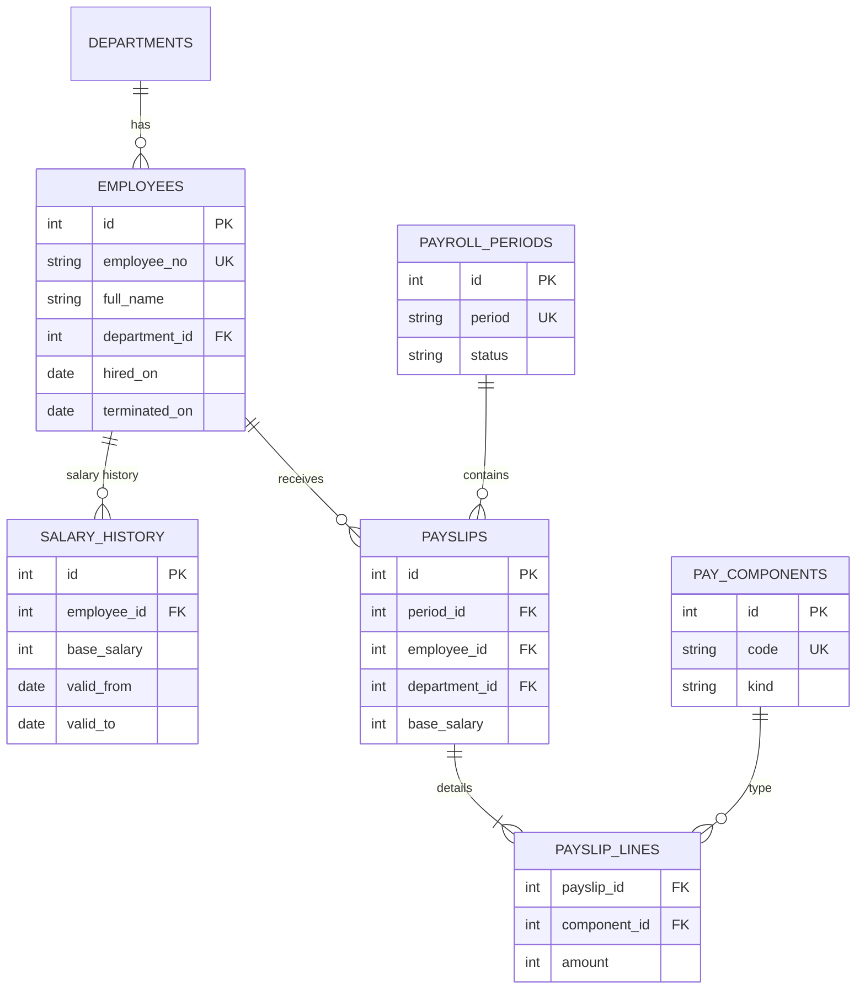

> [!NOTE]
> Payroll is a great example of business database design. Data changes over time, finalized numbers must never drift afterwards, and every change must be traceable. This article walks through the key design decisions. The SQL boxes use the sample `payroll` database and run right in the article.

## Business requirements

- Manage employees, departments, hire and termination dates.
- Base salary changes over time (raises, promotions). We must answer **"what was A's salary on date X?"**
- Each pay period (month) produces a payslip per employee with earnings (base, overtime, allowances) and deductions (insurance, tax).
- A pay period moves through *draft → approved → paid*. Once paid it cannot change.
- Every significant change must be traceable: who changed what, when, before and after.

## Overall schema



## Decision 1: how to store money

Never use floating point (`FLOAT`, `REAL`) for money: `0.1 + 0.2` is not exactly `0.3`. Two safe options:

- **Integers in the smallest unit:** VND has no fractional unit, so store whole numbers; for USD store cents (`1999` = $19.99).
- **`DECIMAL(15, 2)` / `NUMERIC`:** exact decimals, available in PostgreSQL and MySQL.

The sample database uses whole VND integers.

## Decision 2: effective-dated salaries

Instead of a `salary` column on the employee (overwritten at every raise), each change is **a new row** in `salary_history` with a validity range `[valid_from, valid_to)`. A missing `valid_to` means "current".

"Salary on any given date" is just a range filter. Try changing `'2026-10-15'` to `'2025-06-01'`:

```sql-run
-- db: payroll
SELECT e.employee_no, e.full_name, s.base_salary, s.valid_from, s.reason
FROM employees e
JOIN salary_history s ON s.employee_id = e.id
WHERE '2026-10-15' >= s.valid_from
  AND (s.valid_to IS NULL OR '2026-10-15' < s.valid_to)
  AND (e.terminated_on IS NULL OR e.terminated_on >= '2026-10-15')
ORDER BY e.id;
```

> [!WARNING]
> `UNIQUE (employee_id, valid_from)` only blocks two rows with the **same start date**; it can't stop **overlapping** ranges. PostgreSQL solves this with an exclusion constraint: `EXCLUDE USING gist (employee_id WITH =, daterange(valid_from, valid_to) WITH &&)`. Elsewhere, check for overlaps inside the writing transaction.

## Decision 3: a payslip is a snapshot

September's payslip must stay the same after the employee gets a raise or changes department in October. So `payslips` **copies** `department_id` and `base_salary` at calculation time instead of joining to current data.

This is deliberate denormalization: the data repeats, but it records a **historical fact** that differs from the current value.

## Decision 4: flexible pay components

Instead of fixed columns like `overtime`, `meal_allowance`, `insurance`, each amount is a row in `payslip_lines` pointing to a `pay_components` catalog. Adding a new allowance means adding a catalog row, not changing the schema.

```sql-run
-- db: payroll
SELECT e.full_name,
       SUM(CASE WHEN c.kind = 'earning'   THEN l.amount ELSE 0 END) AS gross,
       SUM(CASE WHEN c.kind = 'deduction' THEN l.amount ELSE 0 END) AS deductions,
       SUM(CASE WHEN c.kind = 'earning'   THEN l.amount ELSE -l.amount END) AS net
FROM payslips p
JOIN payroll_periods pp ON pp.id = p.period_id
JOIN employees e        ON e.id = p.employee_id
JOIN payslip_lines l    ON l.payslip_id = p.id
JOIN pay_components c   ON c.id = l.component_id
WHERE pp.period = '2026-10'
GROUP BY p.id
ORDER BY net DESC;
```

Payroll cost per department and period. The department comes from the payslip snapshot, so past periods stay correct even after transfers:

```sql-run
-- db: payroll
SELECT pp.period, d.name AS department,
       COUNT(DISTINCT p.id) AS headcount,
       SUM(CASE WHEN c.kind = 'earning' THEN l.amount ELSE 0 END) AS total_gross
FROM payslips p
JOIN payroll_periods pp ON pp.id = p.period_id
JOIN departments d      ON d.id = p.department_id
JOIN payslip_lines l    ON l.payslip_id = p.id
JOIN pay_components c   ON c.id = l.component_id
GROUP BY pp.period, d.name
ORDER BY pp.period, total_gross DESC;
```

## Decision 5: let the database protect the data

Database constraints are the last line of defence. They hold even when someone edits data by hand or runs a script that bypasses application code.

| Constraint | What it protects |
|---|---|
| `UNIQUE (period_id, employee_id)` | One payslip per employee per period |
| `CHECK (amount >= 0)` | No negative amounts; deductions are classified by `kind` |
| `CHECK (status IN (...))` | Period status only takes valid values |
| `FOREIGN KEY` | No payslip points to a non-existent employee |

Try creating a second payslip for the same employee in the same period:

```sql-run
-- db: payroll
INSERT INTO payslips (period_id, employee_id, department_id, base_salary)
VALUES (2, 1, 1, 34000000);
```

> [!TIP]
> SQLite disables foreign key checks by default; enable them per connection with `PRAGMA foreign_keys = ON;`. PostgreSQL and MySQL (InnoDB) always enforce them.

## Decision 6: an audit log

For financial data, "who changed A's salary, when, from what to what?" must always be answerable. The `audit_log` table stores the table name, record key, action, actor, timestamp and the old and new values (as JSON). Rows are written by a database trigger, or by the application in the same transaction.

```sql-run
-- db: payroll
SELECT changed_at, changed_by, table_name, record_id, action, old_value, new_value
FROM audit_log
ORDER BY changed_at DESC;
```

A pay period in `paid` status should be treated as **immutable**. If a mistake is found, create an adjustment in the next period instead of editing the old payslip — just like an accounting adjustment entry.

## Indexes worth having

- `salary_history (employee_id, valid_from)`: salary lookup by employee and date.
- `payslips (employee_id)`: an employee's payslip history. `UNIQUE (period_id, employee_id)` already indexes per-period queries.
- `payslip_lines (payslip_id)`: covered by `UNIQUE (payslip_id, component_id)`.

## Summary

- Store money as integers in the smallest unit or as `DECIMAL` — never `FLOAT`.
- Time-varying data becomes rows with validity ranges, not overwrites.
- Finalized documents (payslips, invoices) are immutable snapshots; fix mistakes with adjustments.
- A component catalog instead of fixed columns lets the model grow without schema changes.
- Database constraints and an audit log are non-negotiable layers of protection for financial data.
