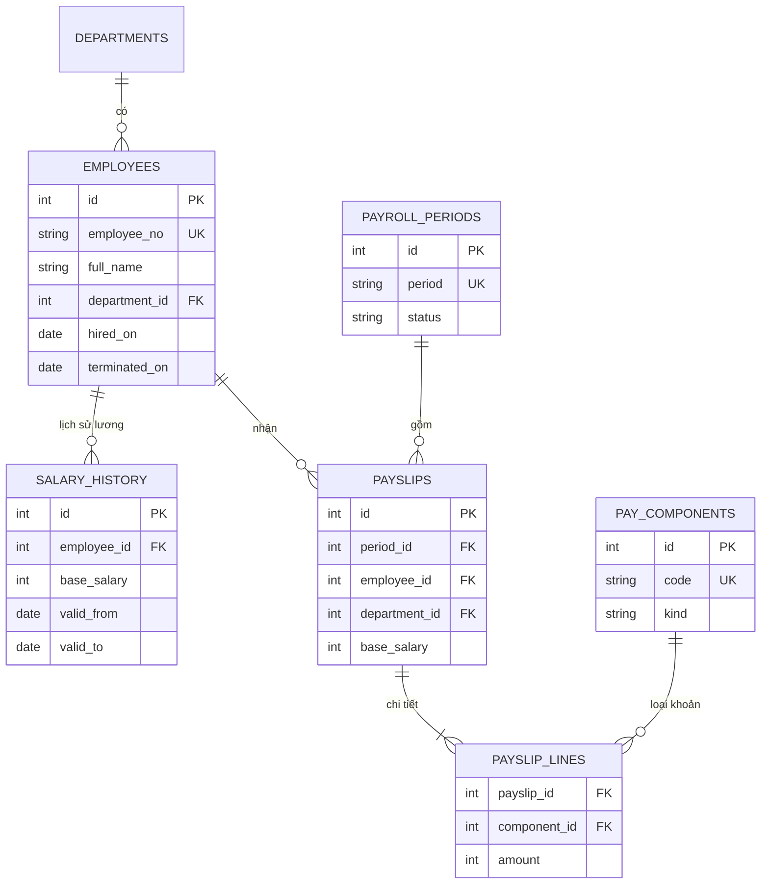

> [!NOTE]
> Hệ thống lương là ví dụ tốt về thiết kế database nghiệp vụ. Dữ liệu thay đổi theo thời gian, số liệu đã chốt không được phép sai lệch về sau, và mọi thay đổi đều cần truy vết được. Bài viết đi qua các quyết định thiết kế chính. Các ô SQL dùng database mẫu `payroll` và chạy được ngay trong bài.

## Yêu cầu nghiệp vụ

- Quản lý nhân viên, phòng ban, ngày vào làm và ngày nghỉ việc.
- Lương cơ bản thay đổi theo thời gian (tăng lương, thăng chức). Phải trả lời được câu hỏi **"lương của A vào ngày X là bao nhiêu?"**
- Mỗi kỳ lương (tháng) tạo phiếu lương cho từng nhân viên, gồm các khoản cộng (lương cơ bản, làm thêm giờ, phụ cấp) và các khoản trừ (bảo hiểm, thuế).
- Kỳ lương đi qua các trạng thái *nháp → đã duyệt → đã trả*. Đã trả thì không được sửa.
- Mọi thay đổi quan trọng phải được ghi vết: ai sửa, sửa lúc nào, giá trị trước và sau.

## Lược đồ tổng thể



## Quyết định 1: lưu tiền thế nào?

Không bao giờ dùng số thực dấu phẩy động (`FLOAT`, `REAL`) cho tiền: `0.1 + 0.2` không bằng chính xác `0.3`. Có hai lựa chọn an toàn:

- **Số nguyên theo đơn vị nhỏ nhất:** VND không có đơn vị lẻ nên lưu thẳng số nguyên; USD thì lưu theo cent (`1999` = $19.99).
- **`DECIMAL(15, 2)` / `NUMERIC`:** số thập phân chính xác, có sẵn trong PostgreSQL và MySQL.

Database mẫu dùng số nguyên VND.

## Quyết định 2: lương có hiệu lực theo thời gian (effective dating)

Thay vì một cột `salary` trên bảng nhân viên (bị ghi đè mỗi lần tăng lương), mỗi lần thay đổi là **một dòng mới** trong `salary_history`, kèm khoảng hiệu lực `[valid_from, valid_to)`. `valid_to` để trống nghĩa là mức lương hiện hành.

Truy vấn "lương tại một ngày bất kỳ" chỉ cần lọc theo khoảng. Thử đổi ngày `'2026-10-15'` thành `'2025-06-01'`:

```sql-run
-- db: payroll
SELECT e.employee_no, e.full_name, s.base_salary, s.valid_from, s.reason
FROM employees e
JOIN salary_history s ON s.employee_id = e.id
WHERE '2026-10-15' >= s.valid_from
  AND (s.valid_to IS NULL OR '2026-10-15' < s.valid_to)
  AND (e.terminated_on IS NULL OR e.terminated_on >= '2026-10-15')
ORDER BY e.id;
```

> [!WARNING]
> Ràng buộc `UNIQUE (employee_id, valid_from)` chỉ chặn hai dòng **cùng ngày bắt đầu**, chứ không chặn được hai khoảng thời gian **chồng lấn**. PostgreSQL xử lý được việc này bằng exclusion constraint: `EXCLUDE USING gist (employee_id WITH =, daterange(valid_from, valid_to) WITH &&)`. Với database không hỗ trợ, cần kiểm tra trong transaction khi ghi.

## Quyết định 3: phiếu lương là một snapshot

Phiếu lương tháng 9 phải giữ nguyên sau khi nhân viên được tăng lương hay chuyển phòng ban vào tháng 10. Vì vậy `payslips` **sao chép** `department_id` và `base_salary` tại thời điểm tính lương, thay vì JOIN sang dữ liệu hiện tại.

Đây là một trường hợp phi chuẩn hóa có chủ đích: dữ liệu lặp lại, nhưng nó ghi lại một **sự thật lịch sử** khác với giá trị hiện hành.

## Quyết định 4: thành phần lương linh hoạt

Thay vì các cột cố định như `overtime`, `meal_allowance`, `insurance`, mỗi khoản là một dòng trong `payslip_lines` trỏ tới danh mục `pay_components`. Thêm một loại phụ cấp mới chỉ cần thêm một dòng danh mục, không phải sửa schema.

```sql-run
-- db: payroll
SELECT e.full_name,
       SUM(CASE WHEN c.kind = 'earning'   THEN l.amount ELSE 0 END) AS gross,
       SUM(CASE WHEN c.kind = 'deduction' THEN l.amount ELSE 0 END) AS deductions,
       SUM(CASE WHEN c.kind = 'earning'   THEN l.amount ELSE -l.amount END) AS net
FROM payslips p
JOIN payroll_periods pp ON pp.id = p.period_id
JOIN employees e        ON e.id = p.employee_id
JOIN payslip_lines l    ON l.payslip_id = p.id
JOIN pay_components c   ON c.id = l.component_id
WHERE pp.period = '2026-10'
GROUP BY p.id
ORDER BY net DESC;
```

Báo cáo chi phí lương theo phòng ban và theo kỳ. Phòng ban lấy từ snapshot trên phiếu lương, nên kỳ cũ vẫn đúng dù nhân viên đã chuyển phòng:

```sql-run
-- db: payroll
SELECT pp.period, d.name AS department,
       COUNT(DISTINCT p.id) AS headcount,
       SUM(CASE WHEN c.kind = 'earning' THEN l.amount ELSE 0 END) AS total_gross
FROM payslips p
JOIN payroll_periods pp ON pp.id = p.period_id
JOIN departments d      ON d.id = p.department_id
JOIN payslip_lines l    ON l.payslip_id = p.id
JOIN pay_components c   ON c.id = l.component_id
GROUP BY pp.period, d.name
ORDER BY pp.period, total_gross DESC;
```

## Quyết định 5: để database tự bảo vệ dữ liệu

Ràng buộc trong database là tuyến phòng thủ cuối cùng. Nó có hiệu lực kể cả khi có ai đó sửa dữ liệu bằng tay hoặc qua một script không đi qua code ứng dụng.

| Ràng buộc | Bảo vệ điều gì |
|---|---|
| `UNIQUE (period_id, employee_id)` | Mỗi nhân viên chỉ có một phiếu lương trong một kỳ |
| `CHECK (amount >= 0)` | Không có khoản lương âm; khoản trừ được phân loại bằng `kind` |
| `CHECK (status IN (...))` | Trạng thái kỳ lương chỉ nhận giá trị hợp lệ |
| `FOREIGN KEY` | Không có phiếu lương trỏ tới nhân viên không tồn tại |

Thử tạo phiếu lương thứ hai cho cùng một nhân viên trong cùng kỳ:

```sql-run
-- db: payroll
INSERT INTO payslips (period_id, employee_id, department_id, base_salary)
VALUES (2, 1, 1, 34000000);
```

> [!TIP]
> SQLite tắt kiểm tra khóa ngoại theo mặc định, cần bật bằng `PRAGMA foreign_keys = ON;` ở mỗi kết nối. PostgreSQL và MySQL (InnoDB) luôn bật.

## Quyết định 6: nhật ký kiểm toán (audit log)

Với dữ liệu tài chính, câu hỏi "ai đã đổi lương của A, lúc nào, từ bao nhiêu thành bao nhiêu?" bắt buộc phải trả lời được. Bảng `audit_log` lưu tên bảng, khóa bản ghi, hành động, người thực hiện, thời điểm, cùng giá trị cũ và mới (dạng JSON). Bản ghi được tạo bằng trigger trong database hoặc ở tầng ứng dụng trong cùng transaction.

```sql-run
-- db: payroll
SELECT changed_at, changed_by, table_name, record_id, action, old_value, new_value
FROM audit_log
ORDER BY changed_at DESC;
```

Kỳ lương ở trạng thái `paid` nên được coi là **bất biến**. Nếu phát hiện sai sót, tạo phiếu điều chỉnh ở kỳ sau thay vì sửa phiếu cũ, giống cách kế toán ghi bút toán điều chỉnh.

## Index nên có

- `salary_history (employee_id, valid_from)`: tra lương theo nhân viên và ngày.
- `payslips (employee_id)`: xem lịch sử phiếu lương của một người. `UNIQUE (period_id, employee_id)` đã tự tạo index cho truy vấn theo kỳ.
- `payslip_lines (payslip_id)`: đã có nhờ `UNIQUE (payslip_id, component_id)`.

## Tóm tắt

- Tiền lưu bằng số nguyên theo đơn vị nhỏ nhất hoặc `DECIMAL`, không bao giờ dùng `FLOAT`.
- Dữ liệu thay đổi theo thời gian lưu thành các dòng có khoảng hiệu lực, không ghi đè.
- Tài liệu đã chốt (phiếu lương, hóa đơn) là snapshot bất biến; sửa sai bằng bút toán điều chỉnh.
- Danh mục thành phần lương thay cho cột cố định giúp mở rộng mà không đổi schema.
- Ràng buộc trong database và audit log là hai lớp bảo vệ bắt buộc với dữ liệu tài chính.
