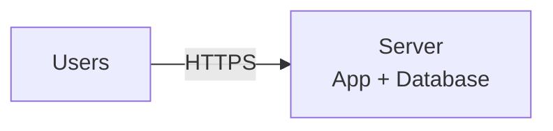
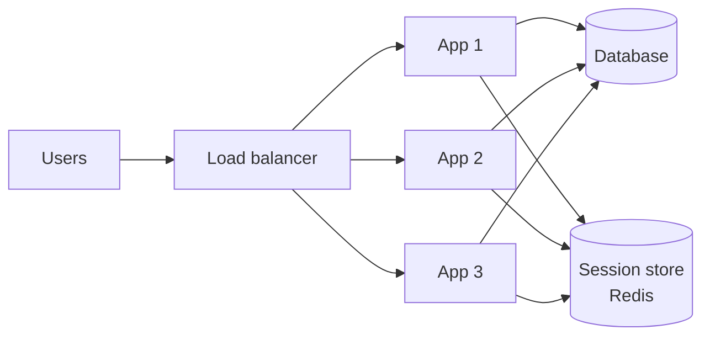
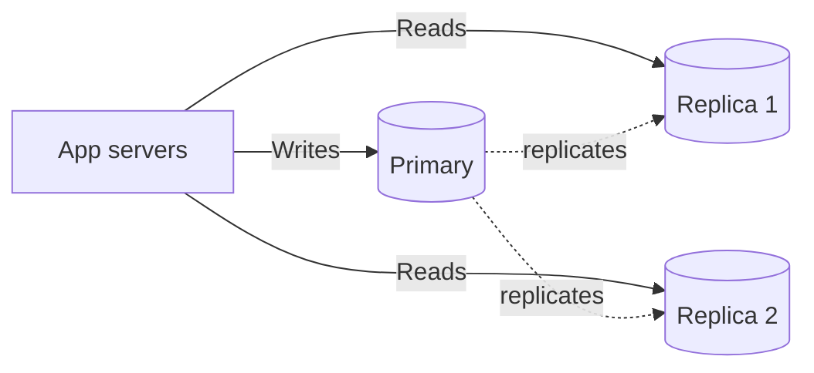
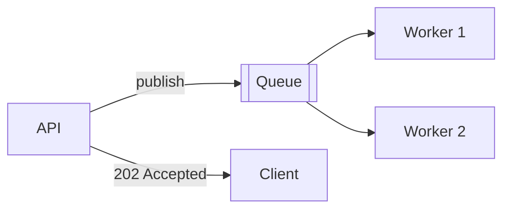
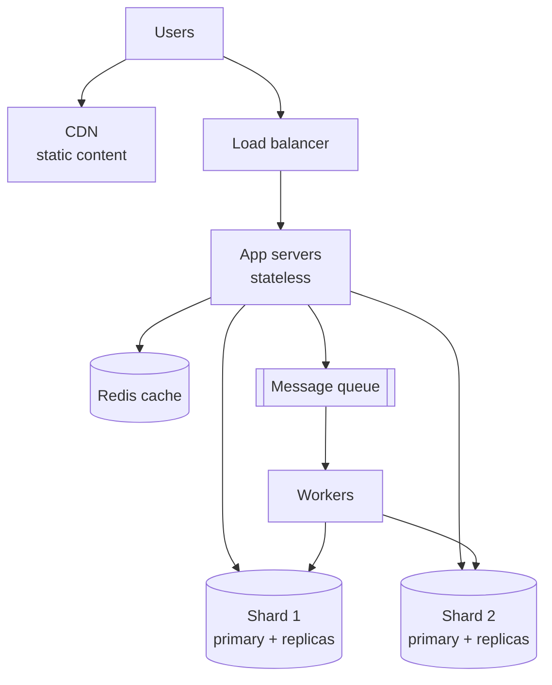

> [!NOTE]
> Most large systems are not designed "big" from day one. They grow, and every growth step removes one specific bottleneck. This article walks through that classic sequence in the order bottlenecks usually appear.

## Starting point: everything on one server

A new application often runs entirely on one machine: web server, application code and database.

This is simple, cheap and fine for a few hundred users. The problem is that everything shares the same CPU, RAM and disk, so when one part is overloaded the whole system slows down. If the server dies, the whole service is down — a **single point of failure**.

## Step 1: move the database to its own machine

The first step is almost always moving the database to a separate server. The application tier (handling requests) and the data tier (storage) have very different resource needs, so separating them lets each scale independently: the app tier needs CPU, the database needs RAM and fast disks.

## Step 2: scale up or scale out?

| | Vertical scaling (scale up) | Horizontal scaling (scale out) |
|---|---|---|
| How | Bigger machine: more CPU, RAM | More identical machines |
| Pros | Simple, no code changes | Nearly unlimited, fault tolerant |
| Cons | Hardware ceiling, still one point of failure | Needs a load balancer, app must be stateless |
| Fits | Early stage, databases | Application tier, high traffic |

Scaling up is a sensible start because it requires no architectural change. But a single machine always has a ceiling, and high-end hardware gets expensive faster than it gets faster. That is why the application tier usually moves to scaling out fairly early.

## Step 3: load balancer and stateless applications

With several application servers, a **load balancer** in front distributes requests.

Load balancers use algorithms such as round robin, least connections or IP hashing. They also run health checks and stop sending traffic to failed servers.

The prerequisite for scaling out is a **stateless application**: servers do not keep user state in memory. If a session lives in App 1's RAM, the next request landing on App 2 won't see it. There are two fixes:

- **Sticky sessions:** the load balancer always routes a user to the same server. Easy, but load gets uneven and sessions die with the server.
- **Shared session store:** sessions live in Redis or the database, or you use self-contained tokens such as JWTs. This is the preferred approach.

## Step 4: add a cache

Most applications read far more than they write. A **cache** such as Redis or Memcached keeps frequently read results in RAM and takes significant load off the database. The most common pattern is *cache-aside*: read the cache first; on a miss, read the database and store the result in the cache with a TTL.

> [!TIP]
> A cache only pays off when the hit ratio is high and the data can tolerate being slightly stale. Data that changes constantly or must be exact (account balances) usually should not be cached.

## Step 5: database replication

The database is now both the single point of failure and the read bottleneck. **Replication** creates copies:

- The **primary** takes every write; **replicas** receive copies and serve reads.
- If the primary fails, a replica is promoted (failover).
- The main trade-off is **replication lag**: replicas can be milliseconds to seconds behind. A user who updates their profile and reloads may see old data. A common fix is reading from the primary right after a write (*read-your-writes*).

## Step 6: a CDN for static content

Images, CSS, JavaScript and video don't need to go through application servers. A **CDN** (Content Delivery Network) caches these files at hundreds of locations worldwide, close to users. The result is lower latency and much less load on the origin.

## Step 7: message queues and asynchronous work

Not everything must happen while the user waits. Sending email, processing images, generating reports or calling third-party APIs can go into a **message queue** (RabbitMQ, Kafka, SQS) for background **workers**.

Benefits: faster API responses, absorbing sudden traffic spikes (the queue acts as a buffer), and scaling workers independently of the API.

## Step 8: sharding — splitting the data

When writes or storage outgrow a single primary, the data is split into parts (**shards**), each on its own database.

| Strategy | How | Pros | Cons |
|---|---|---|---|
| Range | `user_id` 1–1M on shard 1… | Easy range queries | Uneven load (hot shards) |
| Hash | `hash(user_id) % N` | Even distribution | Adding shards moves lots of data |
| Consistent hashing | Shards placed on a hash ring | Adding/removing moves only a fraction | More complex |
| Directory | Lookup table key → shard | Flexible | The lookup becomes a critical dependency |

Sharding is the most expensive step: cross-shard JOINs and transactions become hard, and resharding is painful. It is usually the last resort, after caching, replication and query optimization are exhausted.

## Back-of-the-envelope estimation

Before choosing an architecture, estimate the scale. Take an app with 10 million daily active users (DAU), each sending about 20 requests:

| Quantity | Calculation | Result |
|---|---|---|
| Requests per day | 10M × 20 | 200 million |
| Average QPS | 200M ÷ 86,400 s | ≈ 2,300 |
| Peak QPS | × 3 (peak factor) | ≈ 7,000 |
| New data per day | 10M × 2 records × 1 KB | ≈ 20 GB |
| Data over 5 years | 20 GB × 365 × 5 | ≈ 36 TB |

These few numbers already answer key questions: can one database hold 36 TB, and how many app servers are needed if each handles about 1,000 QPS?

## The big picture

## Summary

- Each scaling step removes a specific bottleneck; don't add components before the matching problem exists.
- A **stateless** application tier is the prerequisite for scaling out.
- **Caching** and **replication** handle heavy reads; **message queues** handle slow work and spikes; **sharding** handles writes and data that outgrow one machine.
- Every choice has trade-offs — replication lag, operational complexity, cost. Estimating scale first helps pick the right level of complexity.
