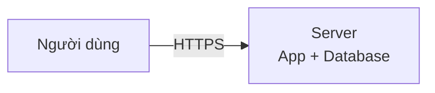
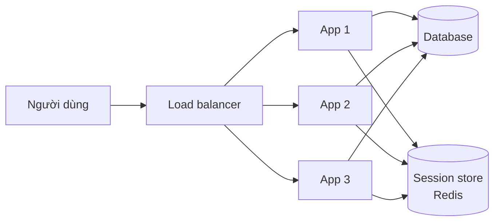
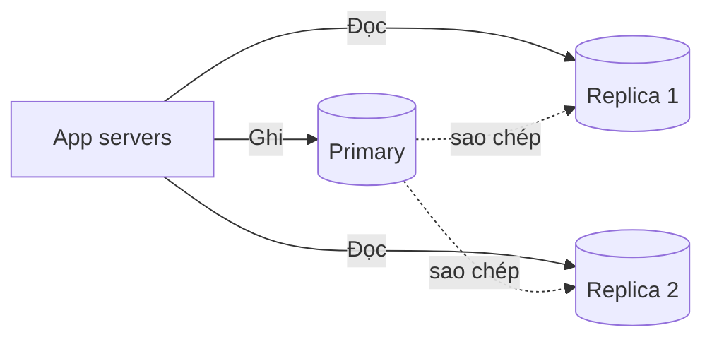
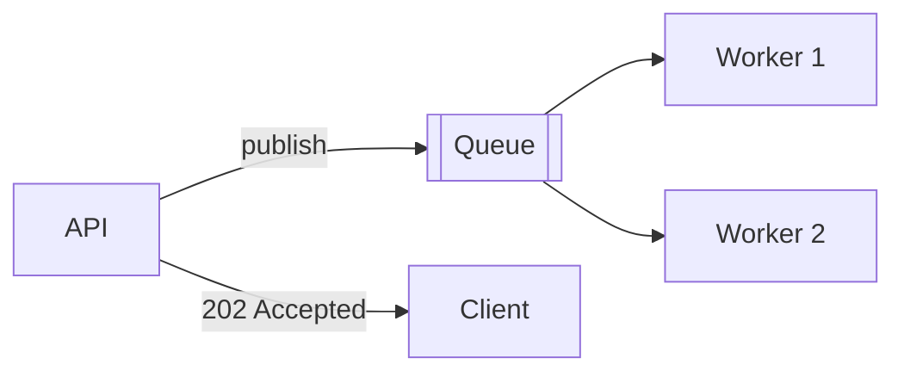
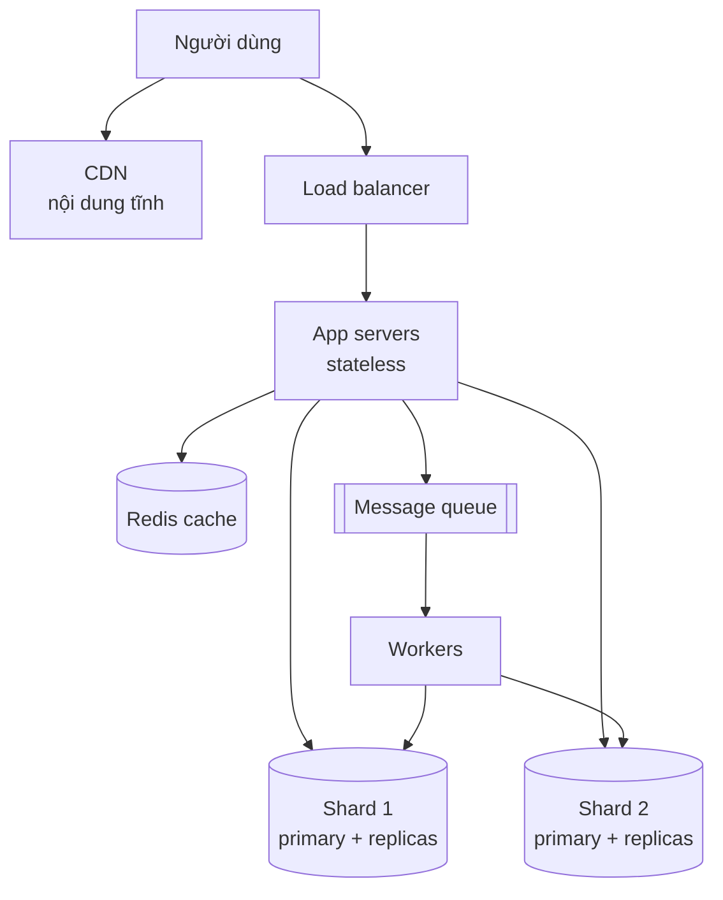

> [!NOTE]
> Hầu hết hệ thống lớn không được thiết kế "to" ngay từ đầu. Chúng lớn dần, và mỗi lần lớn thêm là một lần gỡ một điểm nghẽn cụ thể. Bài viết đi qua chuỗi thay đổi kinh điển đó, theo đúng thứ tự mà các điểm nghẽn thường xuất hiện.

## Điểm xuất phát: mọi thứ trên một server

Một ứng dụng mới thường chạy toàn bộ trên một máy: web server, mã ứng dụng và database.

Cách này đơn giản, rẻ và đủ dùng cho vài trăm người dùng. Vấn đề là mọi thứ dùng chung CPU, RAM và ổ đĩa, nên khi một phần quá tải thì cả hệ thống chậm theo. Server hỏng thì toàn bộ dịch vụ dừng: đây là **single point of failure** (điểm lỗi duy nhất).

## Bước 1: tách database ra máy riêng

Bước đầu tiên gần như luôn là đưa database sang một máy chủ riêng. Tầng ứng dụng (xử lý request) và tầng dữ liệu (lưu trữ) có nhu cầu tài nguyên rất khác nhau, nên tách ra giúp mỗi tầng được nâng cấp độc lập. Tầng ứng dụng cần CPU, còn database cần RAM và ổ đĩa nhanh.

## Bước 2: scale dọc hay scale ngang?

| | Scale dọc (vertical) | Scale ngang (horizontal) |
|---|---|---|
| Cách làm | Nâng cấp máy: thêm CPU, RAM | Thêm nhiều máy giống nhau |
| Ưu điểm | Đơn giản, không đổi code | Gần như không giới hạn, chịu lỗi tốt |
| Nhược điểm | Có giới hạn phần cứng, vẫn là một điểm lỗi | Cần load balancer, ứng dụng phải stateless |
| Phù hợp | Giai đoạn đầu, database | Tầng ứng dụng, lưu lượng lớn |

Scale dọc là lựa chọn hợp lý lúc đầu vì không tốn công sửa kiến trúc. Nhưng một máy luôn có trần, và giá phần cứng cao cấp tăng nhanh hơn hiệu năng nhận được. Vì vậy tầng ứng dụng thường chuyển sang scale ngang khá sớm.

## Bước 3: load balancer và ứng dụng stateless

Khi có nhiều server ứng dụng, cần một **load balancer** đứng trước để phân phối request.

Load balancer phân phối theo nhiều thuật toán: round robin, least connections, hoặc hash theo IP. Nó cũng kiểm tra sức khỏe (health check) và ngừng gửi request tới server bị lỗi.

Điều kiện tiên quyết để scale ngang là **ứng dụng stateless**: server không giữ trạng thái của người dùng trong bộ nhớ. Nếu session nằm trong RAM của App 1, request tiếp theo rơi vào App 2 sẽ không thấy session đó. Có hai cách xử lý:

- **Sticky session:** load balancer luôn gửi một người dùng tới cùng một server. Cách này dễ làm nhưng phân tải không đều, và server chết thì session mất theo.
- **Session store dùng chung:** session được lưu ở Redis hoặc database, hoặc dùng token tự chứa thông tin như JWT. Đây là cách được ưu tiên.

## Bước 4: thêm cache

Phần lớn ứng dụng đọc nhiều hơn ghi rất nhiều. Một **cache** như Redis hay Memcached giữ các kết quả đọc thường xuyên trong RAM, giảm tải đáng kể cho database. Mẫu phổ biến nhất là *cache-aside*: đọc cache trước; nếu không có (miss) thì đọc database rồi ghi vào cache kèm TTL.

> [!TIP]
> Cache chỉ hiệu quả khi tỷ lệ cache hit cao và dữ liệu chấp nhận được việc cũ đi một chút. Dữ liệu thay đổi liên tục hoặc cần chính xác tuyệt đối (số dư tài khoản) thường không nên cache.

## Bước 5: replication cho database

Database lúc này là điểm lỗi duy nhất và cũng là điểm nghẽn đọc. **Replication** tạo các bản sao:

- **Primary** nhận mọi lệnh ghi; các **replica** nhận bản sao dữ liệu và phục vụ lệnh đọc.
- Primary hỏng thì một replica được đề bạt (failover) lên làm primary.
- Đánh đổi chính là **replication lag**: replica có thể chậm hơn primary vài mili giây đến vài giây. Người dùng vừa cập nhật hồ sơ rồi tải lại trang có thể thấy dữ liệu cũ. Cách xử lý thường gặp là đọc từ primary ngay sau khi ghi (*read-your-writes*).

## Bước 6: CDN cho nội dung tĩnh

Ảnh, CSS, JavaScript và video không cần đi qua server ứng dụng. Một **CDN** (Content Delivery Network) lưu bản sao các tệp này ở hàng trăm điểm trên thế giới, gần người dùng hơn. Kết quả là độ trễ thấp hơn và tải lên server gốc giảm mạnh.

## Bước 7: message queue và xử lý bất đồng bộ

Không phải việc gì cũng cần làm ngay trong lúc người dùng chờ. Gửi email, xử lý ảnh, tạo báo cáo hay gọi API bên thứ ba có thể đưa vào **message queue** (RabbitMQ, Kafka, SQS) để các **worker** xử lý ở nền.

Lợi ích: API phản hồi nhanh hơn, hệ thống hấp thụ được đợt tăng tải đột ngột (queue đóng vai trò bộ đệm), và số worker có thể tăng giảm độc lập với API.

## Bước 8: sharding — chia nhỏ dữ liệu

Khi lượng ghi hoặc dung lượng vượt quá khả năng của một primary, dữ liệu được chia thành nhiều phần (**shard**), mỗi shard nằm trên một database riêng.

| Chiến lược | Cách chia | Ưu điểm | Nhược điểm |
|---|---|---|---|
| Theo khoảng (range) | `user_id` 1–1M ở shard 1… | Truy vấn theo khoảng dễ | Dễ lệch tải (hot shard) |
| Theo hash | `hash(user_id) % N` | Phân bố đều | Thêm shard phải di chuyển nhiều dữ liệu |
| Consistent hashing | Đặt shard trên một vòng hash | Thêm/bớt shard chỉ di chuyển một phần nhỏ | Phức tạp hơn |
| Theo thư mục (directory) | Bảng tra cứu khóa → shard | Linh hoạt | Bảng tra cứu trở thành phụ thuộc quan trọng |

Sharding là bước tốn kém nhất: các phép JOIN và transaction giữa các shard trở nên khó, và việc chia lại dữ liệu (resharding) rất phức tạp. Vì vậy nó thường là lựa chọn cuối cùng, sau khi đã tận dụng hết cache, replication và tối ưu truy vấn.

## Ước lượng nhanh (back-of-the-envelope)

Trước khi chọn kiến trúc, cần ước lượng quy mô. Ví dụ một ứng dụng có 10 triệu người dùng hoạt động mỗi ngày (DAU), mỗi người gửi trung bình 20 request:

| Đại lượng | Cách tính | Kết quả |
|---|---|---|
| Request mỗi ngày | 10M × 20 | 200 triệu |
| QPS trung bình | 200M ÷ 86.400 giây | ≈ 2.300 |
| QPS cao điểm | × 3 (hệ số cao điểm) | ≈ 7.000 |
| Dữ liệu mới mỗi ngày | 10M × 2 bản ghi × 1 KB | ≈ 20 GB |
| Dữ liệu trong 5 năm | 20 GB × 365 × 5 | ≈ 36 TB |

Một vài con số này đã đủ để trả lời các câu hỏi quan trọng: một database có chứa nổi 36 TB không, cần bao nhiêu server ứng dụng nếu mỗi server xử lý được khoảng 1.000 QPS.

## Bức tranh tổng thể

## Tóm tắt

- Mỗi bước mở rộng giải quyết một điểm nghẽn cụ thể; không nên thêm thành phần khi chưa có vấn đề tương ứng.
- Ứng dụng **stateless** là điều kiện để scale ngang tầng ứng dụng.
- **Cache** và **replication** xử lý lượng đọc lớn; **message queue** xử lý việc chậm và tải đột biến; **sharding** xử lý lượng ghi và dung lượng vượt quá một máy.
- Mọi lựa chọn đều có đánh đổi: replication lag, độ phức tạp vận hành, chi phí. Ước lượng quy mô trước giúp chọn đúng mức độ phức tạp.
