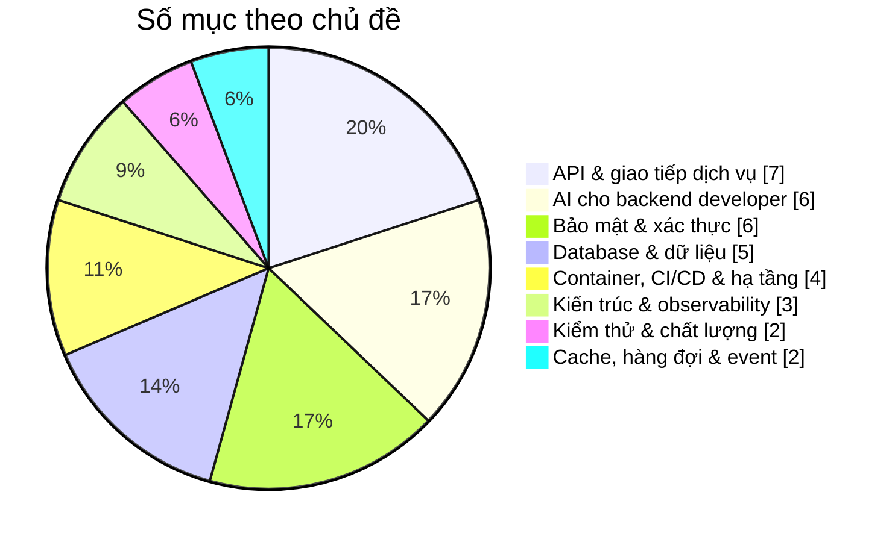

> [!NOTE]
> 🤖 Bài viết được **Tech Radar Bot** tổng hợp tự động ngày 19/11/2026 từ GitHub (4), GitHub Releases (8), Hacker News (8), DEV Community (15). Mỗi mục được xếp theo chủ đề và liên kết tới chuyên mục tương ứng trên blog.
>
> Mô tả của repo/bài viết được giữ nguyên tiếng Anh — đây cũng là cách luyện đọc tài liệu kỹ thuật!

## 📊 Toàn cảnh tuần này

| Chủ đề | Số mục | Chuyên mục liên quan |
|---|---:|---|
| 🔌 API & giao tiếp dịch vụ | 7 | [🔌 Backend](#/c/backend) |
| 🤖 AI cho backend developer | 6 | Chủ đề mở rộng |
| 🛡️ Bảo mật & xác thực | 6 | [🔌 Backend](#/c/backend) |
| 🗄️ Database & dữ liệu | 5 | [🗄️ Thiết kế database](#/c/database) |
| 🐳 Container, CI/CD & hạ tầng | 4 | [🚀 CI/CD & DevOps](#/c/cicd) |
| 🔭 Kiến trúc & observability | 3 | [🏗️ Thiết kế hệ thống](#/c/system-design) |
| 🧪 Kiểm thử & chất lượng | 2 | [🚀 CI/CD & DevOps](#/c/cicd) |
| ⚡ Cache, hàng đợi & event | 2 | [🏗️ Thiết kế hệ thống](#/c/system-design) |

## 🔥 Top 5 đáng chú ý

### 1. agentes-chat/agentes-chat

**GitHub** · ⭐ 1.7k · TypeScript · repo mới · 🤖 AI cho backend developer · 📅 2026-11-09 · ⏱ ~2 phút đọc bài gốc

Open-source, self-hosted Slack alternative where your team and AI agents work together in channels and DMs. Agents run on Claude, ChatGPT/Codex, Gemini or Grok, with MCP tools, their own computer and browser, routines,…

> “The open-source, self-hosted Slack alternative where your team and AI agents work together.”
> — *GitHub*

**📌 Điểm chính**

- One conversation for people and agents. Agents are members of the workspace, not a sidebar bot: they read the channel, answer when it's…
- Safe by default. Merges, deploys and anything a connector marks sensitive wait for a person's approval in the chat. Every model call is…
- Agents that actually do the work. Their own computer, a real browser you can watch and take over, Claude Code and Codex, routines on a…
- Yours to run. One command on a Linux server, Postgres as the only dependency, web, desktop and phone apps that connect to your server.

> [!TIP]
> **Vì sao nên quan tâm:** Backend hiện đại ngày càng phải tích hợp LLM, vector search và agent — đây là kỹ năng đang được tuyển nhiều.

[Xem chi tiết →](https://github.com/agentes-chat/agentes-chat)

### 2. yjid/kensaku

**GitHub** · ⭐ 1.9k · Rust · repo mới · 🤖 AI cho backend developer · 📅 2026-10-24 · ⏱ ~3 phút đọc bài gốc

Search inside documents, code, and even screenshots - instantly and locally. A free, open-source file launcher with OCR, semantic search, and MCP agent access.

> “Search 100,000 file names in milliseconds, with about 12 MB of metadata. Search inside documents, images, and code too. Nothing leaves your machine.”
> — *GitHub*

**📌 Điểm chính**

- The PDF about database indexing, saved as notes-final-2.pdf.
- The log line from the failed deploy, somewhere in a folder of logs.
- The screenshot with a CUDA error, which has no useful name at all.
- Screenshot archaeology. You know you saw that error in a screenshot. Kensaku read the pixels — search the error text.

> [!TIP]
> **Vì sao nên quan tâm:** Backend hiện đại ngày càng phải tích hợp LLM, vector search và agent — đây là kỹ năng đang được tuyển nhiều.

[Xem chi tiết →](https://github.com/yjid/kensaku)

### 3. Java4Shell: RCE in OpenJDK when processing Base64

**Hacker News** · ▲ 1.2k điểm · 💬 326 bình luận · 🛡️ Bảo mật & xác thực · 📅 2026-11-17 · ⏱ ~11 phút đọc bài gốc

On affected OpenJDK builds, malformed Base64 data can cause a constant-value overwrite of allocated heap memory. Through remote Heap Feng Shui, we turn that overwrite into a heap leak and remote code execution. A few months back, I was developing a 0-click exploit on a certain…

> “On affected OpenJDK builds, malformed Base64 data can cause a constant-value overwrite of allocated heap memory. Through remote Heap Feng Shui, we turn that overwrite into a heap leak and remote code execution. A few months back, I was developing a 0-click exploit on a certain…”
> — *calif.io*

**📌 Điểm chính**

- Full controlled write to byte 0 (in bound)
- 4-bit controlled write to byte 1 (in bound)
- Uncontrolled write to bytes \[2, 63\]. For bytes 48..63, the value will always be 0x9a.

> [!TIP]
> **Vì sao nên quan tâm:** Một lỗ hổng có thể xóa sạch mọi công sức — cập nhật kiến thức bảo mật là việc phải làm định kỳ.

[Xem chi tiết →](https://calif.io/java4shell/) · [Thảo luận trên HN](https://news.ycombinator.com/item?id=50538240)

### 4. replit/datacat

**GitHub** · ⭐ 253 · TypeScript · repo mới · 🔭 Kiến trúc & observability · 📅 2026-11-17 · ⏱ ~2 phút đọc bài gốc

Self-hosted observability: metrics, logs, traces, dashboards and alerts. Stores data in PostgreSQL or ClickHouse. Accepts OpenTelemetry data.

> “Self-hosted observability: metrics, logs, distributed traces, dashboards, infrastructure and alerts in one place. DataCat runs on your infrastructure, stores data in PostgreSQL (or telemetry in ClickHouse, if you choose; see docs/SELFHOSTING.md), and accepts OpenTelemetry and…”
> — *GitHub*

**📌 Điểm chính**

- Metrics explorer, formulas, dashboards and host maps
- Searchable logs with facets, live tail and trace correlation
- APM service catalog, trace explorer and waterfall
- Metric, log and trace monitors with webhook/Slack notifications

> [!TIP]
> **Vì sao nên quan tâm:** Hệ thống lớn chỉ vận hành được khi bạn nhìn thấy nó đang làm gì — đây là kỹ năng phân biệt junior và senior.

[Xem chi tiết →](https://github.com/replit/datacat)

### 5. Java4Shell: pre-auth RCE flaw in Java 17 puts servers at risk (CVE-2026-114938)

**Hacker News** · ▲ 150 điểm · 💬 30 bình luận · 🛡️ Bảo mật & xác thực · 📅 2026-11-17 · ⏱ ~7 phút đọc bài gốc

Java4Shell is the names given to CVE-2026-114938. It is a memory corruption flaw in the x86-64 Base64 decoder in OpenJDK's HotSpot runtime. The optimized decoder miscalculates the store mask for the padded tail of its input, so it writes past the end of the output buffer. The…

> “Java4Shell is the names given to CVE-2026-114938. It is a memory corruption flaw in the x86-64 Base64 decoder in OpenJDK's HotSpot runtime. The optimized decoder miscalculates the store mask for the padded tail of its input, so it writes past the end of the output buffer. The…”
> — *aikido.dev*

**📌 Điểm chính**

- Java4Shell (CVE-2026-114938) is a memory corruption flaw in OpenJDK's Base64 decoder, found by Calif. It can let an attacker run code…
- Exposure requires an affected Java build, an x86-64 CPU with AVX-512 VBMI, and attacker-controlled data reaching the decoder, according to…
- Patch affected runtimes, including those bundled in applications and containers. Oracle has released fixes for Java 17, 21, 25 and 27;…
- Eclipse Temurin is releasing fixes (17.0.21.1, 21.0.13.1, 25.0.5.1 and 27.0.1.1). If you cannot upgrade yet, Aikido has patched Java…

> [!TIP]
> **Vì sao nên quan tâm:** Một lỗ hổng có thể xóa sạch mọi công sức — cập nhật kiến thức bảo mật là việc phải làm định kỳ.

[Xem chi tiết →](https://www.aikido.dev/blog/java-17-rce-vulnerability-cve-2026-114938) · [Thảo luận trên HN](https://news.ycombinator.com/item?id=50532118)

## 🚀 Bản phát hành mới của công cụ quen thuộc

| Công cụ | Phiên bản | Ngày | Ghi chú |
|---|---|---|---|
| [sqlalchemy/sqlalchemy](https://github.com/sqlalchemy/sqlalchemy/releases/tag/rel_2_1_9) | `rel_2_1_9` | 2026-11-16 | 2.1.9 Released: November 16, 2026 orm - \[orm\] \[bug\] Fixed issue where deleting the parent object of a one-to-many relationship configured with… |
| [astral-sh/ruff](https://github.com/astral-sh/ruff/releases/tag/0.17.5) | `0.17.5` | 2026-11-12 | Redirect renamed rules; \[flake8-async\] Implement pytest-raises-exception-group (ASYNC401); \[flake8-logging-format\] Mark G004 fix as unsafe |
| [grafana/k6](https://github.com/grafana/k6/releases/tag/v2.4.0) | `v2.4.0` | 2026-11-12 | Experimental tracing of test runs, scenarios, VUs, and iterations.; Ed25519 signatures and X25519 key agreement in WebCrypto.; Credential-header redaction for HTTP and… |
| [fastapi/fastapi](https://github.com/fastapi/fastapi/releases/tag/0.165.0) | `0.165.0` | 2026-11-18 | ✨ Add configurable form parsing limits |
| [nestjs/nest](https://github.com/nestjs/nest/releases/tag/v12.5.1) | `v12.5.1` | 2026-11-16 | feat(core): accept module metadata as the root module; fix(common): reject a date past the end of its month in parse date pipe; microservices |
| [honojs/hono](https://github.com/honojs/hono/releases/tag/v4.13.19) | `v4.13.19` | 2026-11-16 | fix(jsx): render an async component that returns null, a boolean, or a number in; fix(jsx/dom): align useActionState with React 19 in; fix(jsx/dom): reset a form's… |
| [valkey-io/valkey](https://github.com/valkey-io/valkey/releases/tag/9.2.0) | `9.2.0` | 2026-11-19 | ZRANGEBYSCORE, ZREVRANGEBYSCORE, ZCOUNT, and ZRANGESTORE now reject a bare ( or an empty string as a score bound instead of silently treating it as 0 by @AlisinaDevelo;… |
| [docker/compose](https://github.com/docker/compose/releases/tag/v5.8.0) | `v5.8.0` | 2026-11-17 | Jobs: add support for one-shot and scheduled jobs |

## 🧭 Theo chủ đề

### 🔌 API & giao tiếp dịch vụ

- **[FastAPI 0.163's new dependency concurrency limit deadlocked two of my routes](https://dev.to/alexgeorgiev17/fastapi-0163s-new-dependency-concurrency-limit-deadlocked-two-of-my-routes-33k6)** — FastAPI 0.163.0's Depends(max concurrency=...) cut 20 concurrent calls to a peak of 5, but applies per Depends() object and per worker process, and two yield dependencies acquired in opposite order hung forever. _(DEV · ❤️ 12 lượt thích)_
- **[nginx 1.31's json\_set directive rejects a bad webhook payload about 13 times faster than forwarding it](https://dev.to/alexgeorgiev17/nginx-131s-jsonset-directive-rejects-a-bad-webhook-payload-about-13-times-faster-than-forwarding-3b00)** — I measured nginx 1.31's new native JSON parser against a Python backend doing the same validation: roughly 13x faster per-request rejection at low concurrency, half a backend's request count removed outright in a 50/50… _(DEV · ❤️ 8 lượt thích)_
- **[Longer Timeouts Won't Fix Your Webhook Duplicates. Claiming the Work Once Will](https://dev.to/aheadkit/longer-timeouts-wont-fix-your-webhook-duplicates-claiming-the-work-once-will-d90)** — The receiver was not down. That is the part I keep coming back to. It was answering every single... _(DEV · ❤️ 3 lượt thích)_
- **[Find experiment checkpoints through the Tinker SDK](https://dev.to/zkasuran/find-experiment-checkpoints-through-the-tinker-sdk-4776)** — Adding metadata filters and stable cursor paging to tinker-cloud, checked through SDK 0.39 on a CPU fake backend. _(DEV · ❤️ 0 lượt thích)_

### 🗄️ Database & dữ liệu

- **[Turning a 22-year-old Postgres type-confusion primitive into RCE](https://mehmetince.net/part-3-6-how-i-ended-up-turning-a-22-year-old-postgresql-type-confusion-primitive-into-rce-cve-2026-6460/)** — If you had told me in April 2026 one question “Mehmet, can we use managed PostgreSQL for this project?” would send me into the deepest rabbit hole of my life, I would have laughed. Months later, I finally found the bottom of that rabbit hole. It was a 22-year-old zero-day in… _(Hacker News · ▲ 232 điểm · 💬 41 bình luận)_
- **[The Hidden Cost of PostgreSQL JSONB Columns Under High Write Load](https://dev.to/johnnylemonny/the-hidden-cost-of-postgresql-jsonb-columns-under-high-write-load-2fil)** — Updating a single key inside a PostgreSQL JSONB column rewrites the entire blob, triggers TOAST churn, and bloats WAL. Here is the benchmark and the hybrid schema fix. _(DEV · ❤️ 27 lượt thích)_
- **[PostgreSQL 19's pg\_plan\_advice turned a 28ms query into 264ms under load](https://dev.to/alexgeorgiev17/postgresql-19s-pgplanadvice-turned-a-28ms-query-into-264ms-under-load-46o5)** — I tested PostgreSQL 19 RC2's new planner-hint extension, pg plan advice: forcing the wrong plan made throughput 9x worse under ten clients, and a pinned plan that went stale after a data shift cost less than I expected. _(DEV · ❤️ 19 lượt thích)_
- **[4 SQL statements and a segfault: inside PostgreSQL's 22-year-old type confusion, CVE-2026-6460](https://dev.to/slabb/4-sql-statements-and-a-segfault-inside-postgresqls-22-year-old-type-confusion-cve-2026-6460-1ggm)** — A composite type, a PREPARE, an ALTER TYPE, an EXECUTE: as the lowest-privileged login role, that is a server segfault on every PostgreSQL since 2004, and Mehmet Ince's writeup turns it into full RCE via a fake methods… _(DEV · ❤️ 10 lượt thích)_

### ⚡ Cache, hàng đợi & event

- **[Deploying new Temporal workflow code while workflows are running](https://dev.to/remdore/deploying-new-temporal-workflow-code-while-workflows-are-running-4150)** — A Temporal workflow can run for minutes, days or months, and the code behind it will change while it... _(DEV · ❤️ 10 lượt thích)_

### 🐳 Container, CI/CD & hạ tầng

- **[Kubernetes Under the Hood: What Actually Happens When You Run kubectl apply](https://dev.to/smtahosin/kubernetes-under-the-hood-what-actually-happens-when-you-run-kubectl-apply-5cog)** — A visual, 10-minute deep dive into Kubernetes control plane internals. Learn how kube-apiserver processes admission webhooks, how etcd maintains Raft quorum, how controllers reconcile state with Informers, how… _(DEV · ❤️ 16 lượt thích)_
- **[The Kubernetes Upgrade Trap: A Practical Roadmap to Escape Deprecated APIs, Broken Add-ons, and Endless Delays](https://dev.to/varunvarde/the-kubernetes-upgrade-trap-a-practical-roadmap-to-escape-deprecated-apis-broken-add-ons-and-3kfa)** — Every Kubernetes platform team knows the situation. A new Kubernetes release becomes available,... _(DEV · ❤️ 5 lượt thích)_
- **[AWS Extended Support: what it costs and how to find everything you're about to pay for](https://dev.to/expiryradar/aws-extended-support-what-it-costs-and-how-to-find-everything-youre-about-to-pay-for-6i)** — Disclosure: I build Expiry Radar, a tool that tracks dates like these. Nothing below needs it: the... _(DEV · ❤️ 5 lượt thích)_

### 🔭 Kiến trúc & observability

- **[A health check should check what this server owns](https://dev.to/robertpaschal/when-your-health-check-takes-the-system-down-17e9)** — A couple of days ago I wrote that a health check should check something real: open a connection to... _(DEV · ❤️ 3 lượt thích)_

### 🛡️ Bảo mật & xác thực

- **[Universal XSS in uBlock Origin from website-driven element picker](https://iter.ca/post/ubo-uxss/)** — Earlier this month I found a one-click universal XSS issue with uBlock Origin (the MV2 Firefox version, although a similar but less problematic issue also affected the MV3 version, uBO Lite), where a malicious website could trick the extension into adding arbitrary trusted… _(Hacker News · ▲ 616 điểm · 💬 181 bình luận)_
- **[KVM: x86: Unconditionally reset MMU context when emulating INIT (CVE-2026-99312)](https://www.cve.org/CVERecord?id=CVE-2026-99312)** _(Hacker News · ▲ 186 điểm · 💬 123 bình luận)_
- **[Apache httpd shipped a critical HTTP/2 RCE yesterday, and one of the finders was a machine: CVE-2026-119618 and the three-gate audit](https://dev.to/slabb/apache-httpd-shipped-a-critical-http2-rce-yesterday-and-one-of-the-finders-was-a-machine-5jj)** — mod http2 race in assign headers(), heap corruption, RCE: 2.4.55 through 2.4.70 affected, fixed in 2.4.71 released yesterday. Apache's own acknowledgements credit Anthropic's OSS Scanner as finder. My Mac runs 2.4.67,… _(DEV · ❤️ 7 lượt thích)_
- **[Strands to Strands over A2A on Bedrock AgentCore, With IAM as the Only Credential](https://dev.to/aws-builders/strands-to-strands-over-a2a-on-bedrock-agentcore-with-iam-as-the-only-credential-19hp)** — A Strands currency worker served over A2A on Amazon Bedrock AgentCore Runtime with IAM inbound auth, a SigV4-signed Strands caller and coordinator, a one-runtime IAM policy, and measured access checks, session latency… _(DEV · ❤️ 17 lượt thích)_

### 🧪 Kiểm thử & chất lượng

- **[Evaluate the Decision, Not the Prose: Building an Eval Harness for an LLM Backend](https://dev.to/paulmurithi/evaluate-the-decision-not-the-prose-building-an-eval-harness-for-an-llm-backend-22gd)** — SokoFlow AI Build Log, Week 5 of 6: building an eval harness, getting rate-limited by my own test,... _(DEV · ❤️ 2 lượt thích)_

### 🤖 AI cho backend developer

- **[emanuele-em/kanzo](https://github.com/emanuele-em/kanzo)** — Self-hosted, sharable kanban for humans and agents. One 4.7 MB binary, 5 MB of RAM, 10 to 60 tokens per agent reply, starts in 3 ms, zero setup. _(GitHub · ⭐ 1.2k · Rust · repo mới)_
- **[Understanding Positional Embeddings in Modern LLMs](https://magazine.sebastianraschka.com/p/understanding-positional-embeddings)** _(Hacker News · ▲ 246 điểm · 💬 27 bình luận)_
- **[LLM assisted reverse engineering](https://www.slowchronicle.com/posts/llm-assisted-reverse-engineering)** — I have been hacking both hardware and software for 2 decades. Previously manually. But in 2026 with the help of AIs the proccess is greatly sped up. Below I will describe my proccess briefly or how I do it. What I basically do nowadays is just point the agent at the binary to… _(Hacker News · ▲ 211 điểm · 💬 51 bình luận)_
- **[Not Everything Needs an LLM](https://newsletter.posthog.com/p/decision-models)** _(Hacker News · ▲ 184 điểm · 💬 75 bình luận)_

## ✅ Việc nên làm tuần này

- [ ] 🤖 Thử với **agentes-chat/agentes-chat**: Thêm một endpoint tìm kiếm ngữ nghĩa (pgvector) hoặc một MCP server nhỏ vào project.
- [ ] 🛡️ Thử với **Java4Shell: RCE in OpenJDK when processing Base64**: Rà lại project của bạn theo checklist OWASP và thử áp dụng một kỹ thuật trong bài.
- [ ] 🔭 Thử với **replit/datacat**: Gắn tracing/metrics vào một API nhỏ và vẽ sơ đồ luồng request của nó.
- [ ] 📚 Đọc thêm một bài trong [chuyên mục Thiết kế hệ thống](#/c/system-design).

## ⚙️ Về bot này

Bot chạy tự động mỗi thứ Hai qua GitHub Actions (`.github/workflows/tech-radar.yml`), lấy dữ liệu từ GitHub, Hacker News và DEV, chấm điểm theo độ phổ biến và mức liên quan tới backend, mở từng link để đọc nội dung (README, release notes, bài viết — có tôn trọng robots.txt), rồi xuất bản thành bài blog này. Bài chỉ trích đoạn ngắn kèm link gốc. Bạn có thể đổi nguồn, từ khóa và chủ đề trong `scripts/tech-radar/config.mjs`.
