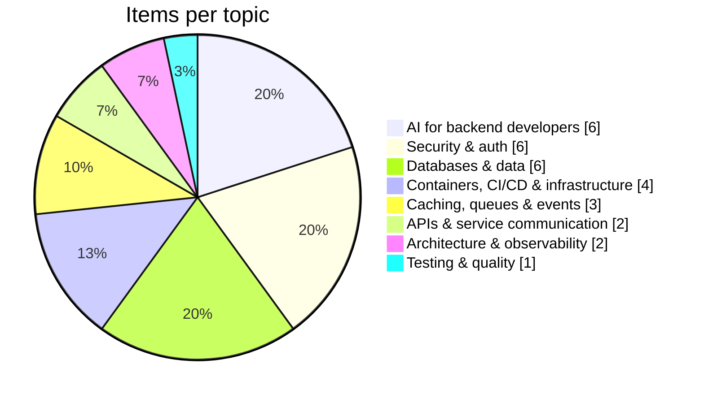

> [!NOTE]
> 🤖 This post was compiled automatically by **Tech Radar Bot** on November 24, 2026 from GitHub (5), GitHub Releases (6), Hacker News (13), DEV Community (6). Each item is grouped by topic and linked to the matching section of this blog.

This week's highlights feature the major release of PostgreSQL 19 introducing concurrent table repacking alongside critical remote code execution vulnerabilities across common stacks. Backend developers also see a continuing shift toward hybrid performance optimization and the widespread adoption of Model Context Protocol (MCP) integrations.

## 📊 This week at a glance

| Topic | Items | Related section |
|---|---:|---|
| 🤖 AI for backend developers | 6 | [🔌 Backend](#/c/backend) |
| 🛡️ Security & auth | 6 | [🔌 Backend](#/c/backend) |
| 🗄️ Databases & data | 6 | [🗄️ Database Design](#/c/database) |
| 🐳 Containers, CI/CD & infrastructure | 4 | [🚀 CI/CD & DevOps](#/c/cicd) |
| ⚡ Caching, queues & events | 3 | [🏗️ System Design](#/c/system-design) |
| 🔌 APIs & service communication | 2 | [🔌 Backend](#/c/backend) |
| 🔭 Architecture & observability | 2 | [🏗️ System Design](#/c/system-design) |
| 🧪 Testing & quality | 1 | [🚀 CI/CD & DevOps](#/c/cicd) |

## 🔥 Top 5 highlights

### 1. EL4CTEO/fast-anything

**GitHub** · ⭐ 3.2k · Rust · new repo · 🤖 AI for backend developers · 📅 2026-11-21 · ⏱ ~2 min read

A profiling tool that uses coding agents to port hot functions to Rust and automatically verifies behavioral equivalence using recorded execution data.

**📌 Key points**

- Compile time: each port is a one-function crate. Seconds, not minutes.
- Cache: every port shares one .fast/target. Delete it whenever you like (fast-anything clean).
- Risk: your code stays as it is. Rust is opt-in per function, checked against real behavior.
- Claude Code plugin: /plugin marketplace add EL4CTEO/fast-anything, then /plugin install fast-anything@fast-anything and…

> [!TIP]
> **Why it matters:** Modern backends increasingly integrate LLMs, vector search and agents — a skill in high demand.

[Read more →](https://github.com/EL4CTEO/fast-anything)

### 2. XinaTian/MROffice

**GitHub** · ⭐ 2.9k · TypeScript · new repo · 🤖 AI for backend developers · 📅 2026-11-10 · ⏱ ~5 min read

An open-source office suite editor that allows embedding and integration with AI agents via the Model Context Protocol.

**📌 Key points**

- Changes you review — what the AI proposes is applied only when you confirm it; if the file changed in the meantime, the proposal is void…
- Memory — a memory graph keeps the people, projects and decisions that matter, so the AI does not start from zero in every conversation.
- Leading models — pick the model for each conversation from today's leading AI models; your files stay in your workspace, or on your own…
- In your project's folder run npx mroffice-embed init (or create an app in the developer console): one "Allow" in the browser, and the…

> [!TIP]
> **Why it matters:** Modern backends increasingly integrate LLMs, vector search and agents — a skill in high demand.

[Read more →](https://github.com/XinaTian/MROffice)

### 3. UK government forced to admit it issued Apple a secret encryption order

**Hacker News** · ▲ 695 points · 💬 389 comments · 🛡️ Security & auth · 📅 2026-11-19 · ⏱ ~6 min read

A tribunal ruling forcing the UK government to confirm its secret capability notice demanding modifications to Apple's encrypted services.

> [!TIP]
> **Why it matters:** One vulnerability can undo everything — security knowledge needs regular refreshing.

[Read more →](https://macanorak.com/uk-government-forced-to-admit-it-issued-apple-a-secret-encryption-order/) · [HN discussion](https://news.ycombinator.com/item?id=50562113)

### 4. Ruby2ßhell: Pre-authentication RCE on stock Rails

**Hacker News** · ▲ 408 points · 💬 189 comments · 🛡️ Security & auth · 📅 2026-11-19 · ⏱ ~2 min read

A critical pre-authentication heap overflow in Ruby string handling that enables remote code execution on standard Rails deployments.

**🗂️ What it covers:** Affected software · Ruby versions · Frameworks · Self-hosted software · Your deployment · Technical details

> [!TIP]
> **Why it matters:** One vulnerability can undo everything — security knowledge needs regular refreshing.

[Read more →](https://verialabs.com/ruby2shell/) · [HN discussion](https://news.ycombinator.com/item?id=50556287)

### 5. PostgreSQL 19

**Hacker News** · ▲ 399 points · 💬 32 comments · 🗄️ Databases & data · 📅 2026-11-20 · ⏱ ~27 min read

PostgreSQL 19 brings native concurrent table repacking, planner advice extensions, and improved parallel background processing.

**📌 Key points**

- New REPACK command that reclaims disk space and reorganizes table contents, which can improve query performance. REPACK (CONCURRENTLY)…
- pg\_plan\_advice extension for controlling query planner decisions and pg\_stash\_advice extension that applies plan advice automatically…
- Better performance in many areas, including automatic scaling of the number of I/O worker processes, quicker foreign-key checks, and…
- Logical replication can now be enabled without a server restart when wal\_level is set to replica.

> [!TIP]
> **Why it matters:** Most performance problems live in the data layer — knowing new tools helps you pick the right store for each job.

[Read more →](https://www.postgresql.org/docs/release/19.0/) · [HN discussion](https://news.ycombinator.com/item?id=50569890)

## 🚀 New releases of tools you know

| Tool | Version | Date | Notes |
|---|---|---|---|
| [astral-sh/ruff](https://github.com/astral-sh/ruff/releases/tag/0.17.6) | `0.17.6` | 2026-11-19 | A routine maintenance release for Ruff fixing syntax issues and improving type-checking rule handling for Python codebases. |
| [nestjs/nest](https://github.com/nestjs/nest/releases/tag/v12.6.0) | `v12.6.0` | 2026-11-20 | A minor NestJS update improving application type inference and introducing graceful shutdown timeouts for gRPC servers. |
| [honojs/hono](https://github.com/honojs/hono/releases/tag/v4.13.21) | `v4.13.21` | 2026-11-23 | A Hono security patch enforcing canonical Base64URL encoding for JWTs and fixing host pollution from path parameters. |
| [redis/redis](https://github.com/redis/redis/releases/tag/8.12.0) | `8.12.0` | 2026-11-22 | Redis 8.12 GA brings reduced Sorted Set memory usage via B+ trees and adds atomic move commands between collections. |
| [duckdb/duckdb](https://github.com/duckdb/duckdb/releases/tag/v2.0.1) | `v2.0.1` | 2026-11-20 | A maintenance patch for DuckDB fixing vector casting anomalies and handling Parquet column statistics edge cases. |
| [open-telemetry/opentelemetry-collector](https://github.com/open-telemetry/opentelemetry-collector/releases/tag/v0.166.0) | `v0.166.0` | 2026-11-23 | A collector update introducing gRPC address shuffling options and tightening validation within the collector builder toolkit. |

## 🧭 By topic

### 🗄️ Databases & data

- **[Distributed, high-performance blob storage on SQLite](https://zerodha.tech/blog/high-performance-distributed-blob-storage/)** — A case study detailing how a financial trading platform built a sharded, high-throughput blob storage system using SQLite. _(Hacker News · ▲ 286 points · 💬 72 comments)_
- **[Postgres 19 Repack: Faster, Built-In Table Bloat Cleanup](https://www.snowflake.com/en/blog/engineering/postgres-19-repack-table-bloat/)** — A technical look at PostgreSQL 19's built-in concurrent repack capability for eliminating table bloat without downtime. _(Hacker News · ▲ 184 points · 💬 29 comments)_
- **[PostgreSQL Extensions in Go](https://jespino.github.io/gopgext/)** — An experimental framework that lets developers write PostgreSQL server extensions in Go via TinyGo compilation. _(Hacker News · ▲ 169 points · 💬 37 comments)_
- **[PostgreSQL 19 Released](https://www.postgresql.org/about/news/postgresql-19-released-3449/)** — The official release announcement of PostgreSQL 19 focusing on administrative tooling, plan hints, and replication features. _(Hacker News · ▲ 144 points · 💬 10 comments)_

### ⚡ Caching, queues & events

- **[Valkey kills the skiplist, cuts sorted set overhead by up to 43%](https://valkey.io/blog/from-skiplist-to-b+tree/)** — A technical deep dive into Valkey's transition from skiplists to a B+ tree variant, cutting sorted set memory overhead substantially. _(Hacker News · ▲ 207 points · 💬 76 comments)_
- **[The queue that never drains: when a RabbitMQ consumer stops keeping up](https://dev.to/crtdrops/the-queue-that-never-drains-when-a-rabbitmq-consumer-stops-keeping-up-bod)** — A practical exploration of capacity limits, decoupling risks, and consumer lag patterns in high-throughput RabbitMQ queues. _(DEV · ❤️ 1 reactions)_

### 🐳 Containers, CI/CD & infrastructure

- **[brunnojob/cifuse](https://github.com/brunnojob/cifuse)** — A CLI and GitHub Action tool that parses unstructured CI test logs into grouped failure signals and diagnostic contexts. _(GitHub · ⭐ 228 · JavaScript · new repo)_
- **[A real Linux kernel, compiled to WebAssembly](https://github.com/pithings/unkernel)** — An initiative compiling the Linux kernel to WebAssembly with real memory management to run full shells and packages locally. _(Hacker News · ▲ 217 points · 💬 81 comments)_
- **[The New Docker: Built to Run on Trust](https://www.docker.com/blog/meet-the-new-docker-built-to-run-on-trust/)** — Docker's brand evolution announcement emphasizing software security, governance, and trust for agent-driven development workflows. _(Hacker News · ▲ 122 points · 💬 200 comments)_
- **[Marking a container unhealthy didn't stop it from taking traffic](https://dev.to/alexgeorgiev17/marking-a-container-unhealthy-didnt-stop-it-from-taking-traffic-54lf)** — An operational post-mortem showing why reverse proxies continue forwarding requests to unhealthy containers without explicit upstream retry flags. _(DEV · ❤️ 14 reactions)_

### 🔭 Architecture & observability

- **[oriliz/agent-crop](https://github.com/oriliz/agent-crop)** — An observability loop tool for tracking time allocations, tool usage, and performance regressions across coding agent workflows. _(GitHub · ⭐ 291 · Python · new repo)_

### 🛡️ Security & auth

- **[OpenSSL: Buffer overflow in EVP\_EncodeBlock() (CVE-2026-121481, CVSS 9.8)](https://github.com/openssl/openssl/pull/33652)** — A critical vulnerability alert detailing an OpenSSL buffer overflow vulnerability in the base64 encoding routine. _(Hacker News · ▲ 376 points · 💬 345 comments)_
- **[Upload2Shell (CVE-2026-125396)](https://pwn.ai/upload2shell)** — Security research explaining an RCE vector that abuses image-processing pipelines and font-loading bugs in Ghostscript. _(Hacker News · ▲ 153 points · 💬 77 comments)_
- **[What this week's nginx HTTP/2 CVEs mean for the server I actually run](https://dev.to/alexgeorgiev17/what-this-weeks-nginx-http2-cves-mean-for-the-server-i-actually-run-3nbf)** — A field test demonstrating the latency and throughput penalty of disabling HTTP/2 on nginx servers as an interim RCE mitigation. _(DEV · ❤️ 23 reactions)_
- **[Java4Shell (CVE-2026-114938): The Bug That Leaked Before Its Patch](https://dev.to/thegdsks/java4shell-one-stray-sign-vs-your-java-server-4j3j)** — An analysis of an unpatched Java base64 deserialization bug exposing critical enterprise backend infrastructure to remote exploitation. _(DEV · ❤️ 10 reactions)_

### 🤖 AI for backend developers

- **[simpsoka/zigzag](https://github.com/simpsoka/zigzag)** — An open-source design tool written in Rust featuring Model Context Protocol support for co-creation alongside autonomous agents. _(GitHub · ⭐ 1.1k · Rust · new repo)_
- **[Pandex – Official European Law for AI Agents, over MCP](https://www.pandex.io)** — An MCP endpoint delivering verified European legal statutes and court records directly into LLM agent execution contexts. _(Hacker News · ▲ 140 points · 💬 36 comments)_
- **[Beyond Vector Search: Building MedMatch V2, an AI-Assisted Clinical Trial Matching Platform](https://dev.to/sneha_kumari/beyond-vector-search-building-medmatch-v2-an-ai-assisted-clinical-trial-matching-platform-2hd2)** — An architecture writeup on augmenting pgvector semantic search with deterministic criteria evaluation for medical trial matching. _(DEV · ❤️ 5 reactions)_
- **[Binding Sherlock Hits to Durable Agent Memory with pgvector](https://dev.to/samuel_oakley/binding-sherlock-hits-to-durable-agent-memory-with-pgvector-1bom)** — Engineering insights on resolving pgvector HNSW locking bottlenecks and embedding drift when building persistent agent memories. _(DEV · ❤️ 2 reactions)_

## ✅ To-do this week

- [ ] 🤖 Try it with **EL4CTEO/fast-anything**: Add a semantic-search endpoint (pgvector) or a small MCP server to a project.
- [ ] 🛡️ Try it with **UK government forced to admit it issued Apple a secret encryption order**: Review your project against the OWASP checklist and try one technique from this post.
- [ ] 🗄️ Try it with **PostgreSQL 19**: Re-run a few familiar JOIN/GROUP BY queries on it and compare the query plans.
- [ ] 📚 Read one more post in [🔌 Backend](#/c/backend).

## ⚙️ About this bot

The bot runs every Monday via GitHub Actions (`.github/workflows/tech-radar.yml`), pulls data from GitHub, Hacker News and DEV, scores items by popularity and backend relevance, opens each link to read its content (README, release notes, articles — respecting robots.txt), and publishes this post. Only short excerpts are quoted, always with a link to the source. Change sources, keywords and topics in `scripts/tech-radar/config.mjs`.
