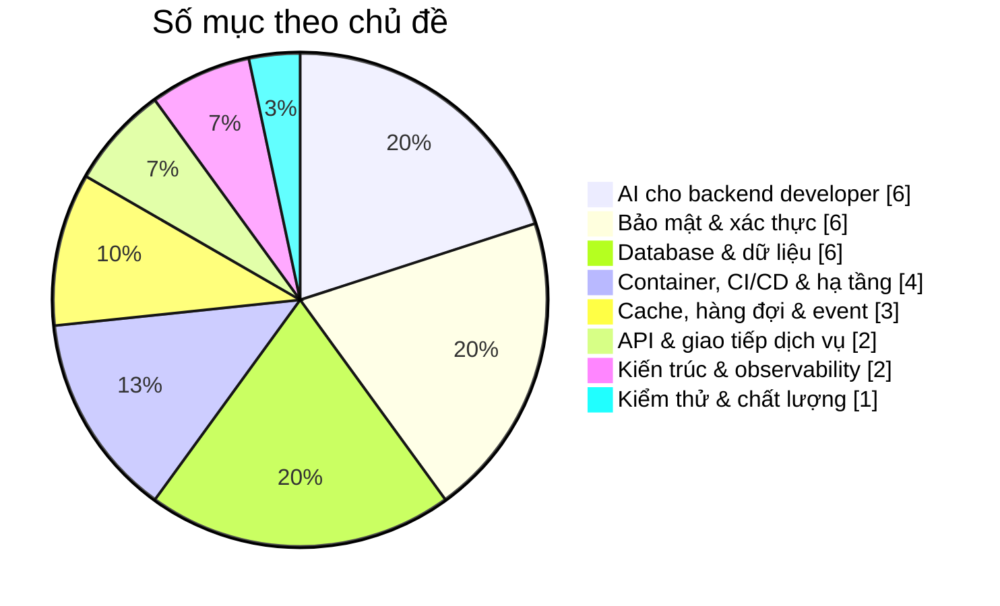

> [!NOTE]
> 🤖 Bài viết được **Tech Radar Bot** tổng hợp tự động ngày 24/11/2026 từ GitHub (5), GitHub Releases (6), Hacker News (13), DEV Community (6). Mỗi mục được xếp theo chủ đề và liên kết tới chuyên mục tương ứng trên blog.

Tiêu điểm tuần này nổi bật với bản phát hành lớn PostgreSQL 19 mang đến lệnh REPACK không khóa và hàng loạt cải tiến mở rộng, cùng làn sóng lỗ hổng bảo mật nghiêm trọng ở cấp độ thực thi mã từ xa (RCE). Bên cạnh đó, hệ sinh thái backend tiếp tục chuyển dịch mạnh mẽ với các giải pháp tối ưu hóa hiệu năng lai ghép và sự bùng nổ của giao thức MCP tích hợp AI vào quy trình kỹ thuật.

## 📊 Toàn cảnh tuần này

| Chủ đề | Số mục | Chuyên mục liên quan |
|---|---:|---|
| 🤖 AI cho backend developer | 6 | [🔌 Backend](#/c/backend) |
| 🛡️ Bảo mật & xác thực | 6 | [🔌 Backend](#/c/backend) |
| 🗄️ Database & dữ liệu | 6 | [🗄️ Thiết kế database](#/c/database) |
| 🐳 Container, CI/CD & hạ tầng | 4 | [🚀 CI/CD & DevOps](#/c/cicd) |
| ⚡ Cache, hàng đợi & event | 3 | [🏗️ Thiết kế hệ thống](#/c/system-design) |
| 🔌 API & giao tiếp dịch vụ | 2 | [🔌 Backend](#/c/backend) |
| 🔭 Kiến trúc & observability | 2 | [🏗️ Thiết kế hệ thống](#/c/system-design) |
| 🧪 Kiểm thử & chất lượng | 1 | [🚀 CI/CD & DevOps](#/c/cicd) |

## 🔥 Top 5 đáng chú ý

### 1. EL4CTEO/fast-anything

**GitHub** · ⭐ 3.2k · Rust · repo mới · 🤖 AI cho backend developer · 📅 2026-11-21 · ⏱ ~2 phút đọc bài gốc

Công cụ tự động phân tích và chuyển đổi các hàm thắt nút cổ chai sang Rust bằng AI agent với cơ chế kiểm thử đối chiếu an toàn.

**📌 Điểm chính**

- Tự động trích xuất các hàm thắt nút cổ chai tốn thời gian thay vì viết lại toàn bộ mã nguồn.
- Xác thực tính tương đương qua dữ liệu gọi hàm thực tế cùng các trường hợp biên ngẫu nhiên.
- Tạo thư viện Rust độc lập với giao tiếp C JSON, hỗ trợ hoàn tác qua biến môi trường.

> [!TIP]
> **Vì sao nên quan tâm:** Backend hiện đại ngày càng phải tích hợp LLM, vector search và agent — đây là kỹ năng đang được tuyển nhiều.

[Xem chi tiết →](https://github.com/EL4CTEO/fast-anything)

### 2. XinaTian/MROffice

**GitHub** · ⭐ 2.9k · TypeScript · repo mới · 🤖 AI cho backend developer · 📅 2026-11-10 · ⏱ ~5 phút đọc bài gốc

Bộ biên tập tài liệu văn phòng mã nguồn mở hỗ trợ nhúng trực tiếp và tích hợp giao thức MCP cho các tác nhân AI.

**📌 Điểm chính**

- Cho phép AI thao tác trực tiếp trên cây đối tượng tài liệu Office thật thay vì văn bản thuần.
- Cung cấp MCP server giúp trợ lý AI đọc, tạo, chỉnh sửa và kết xuất tệp tin văn phòng.
- Hỗ trợ nhúng giao diện vào ứng dụng với cơ chế xác thực phiên và OAuth 2.1 có kiểm soát.

> [!TIP]
> **Vì sao nên quan tâm:** Backend hiện đại ngày càng phải tích hợp LLM, vector search và agent — đây là kỹ năng đang được tuyển nhiều.

[Xem chi tiết →](https://github.com/XinaTian/MROffice)

### 3. UK government forced to admit it issued Apple a secret encryption order

**Hacker News** · ▲ 695 điểm · 💬 389 bình luận · 🛡️ Bảo mật & xác thực · 📅 2026-11-19 · ⏱ ~6 phút đọc bài gốc

Vụ kiện buộc chính phủ Anh thừa nhận yêu cầu bí mật can thiệp vào cơ chế mã hóa đầu cuối trên dịch vụ của Apple.

**📌 Điểm chính**

- Tòa án yêu cầu chính phủ Anh thừa nhận sự tồn tại của thông báo kỹ thuật bí mật gửi Apple.
- Lệnh trước đây yêu cầu tạo cửa sau đối với dữ liệu iCloud được mã hóa trên phạm vi toàn cầu.
- Apple đã phản ứng bằng cách tạm dừng tính năng Advanced Data Protection cho người dùng mới tại Anh.

> [!TIP]
> **Vì sao nên quan tâm:** Một lỗ hổng có thể xóa sạch mọi công sức — cập nhật kiến thức bảo mật là việc phải làm định kỳ.

[Xem chi tiết →](https://macanorak.com/uk-government-forced-to-admit-it-issued-apple-a-secret-encryption-order/) · [Thảo luận trên HN](https://news.ycombinator.com/item?id=50562113)

### 4. Ruby2ßhell: Pre-authentication RCE on stock Rails

**Hacker News** · ▲ 408 điểm · 💬 189 bình luận · 🛡️ Bảo mật & xác thực · 📅 2026-11-19 · ⏱ ~2 phút đọc bài gốc

Lỗ hổng tràn bộ đệm heap nghiêm trọng trong bộ xử lý chuỗi của Ruby dẫn đến nguy cơ thực thi mã từ xa trước xác thực trên Ruby on Rails.

**📌 Điểm chính**

- Lỗi tràn bộ đệm heap 1 byte xảy ra khi viết hoa ký tự ß trong các bảng mã đơn byte.
- Ảnh hưởng mặc định tới các phiên bản Ruby cũ hơn và các framework như Rails hoặc Sinatra.
- Khuyến cáo nâng cấp khẩn cấp lên các bản vá Ruby 3.3.14, 3.4.13 hoặc 4.0.10.

> [!TIP]
> **Vì sao nên quan tâm:** Một lỗ hổng có thể xóa sạch mọi công sức — cập nhật kiến thức bảo mật là việc phải làm định kỳ.

[Xem chi tiết →](https://verialabs.com/ruby2shell/) · [Thảo luận trên HN](https://news.ycombinator.com/item?id=50556287)

### 5. PostgreSQL 19

**Hacker News** · ▲ 399 điểm · 💬 32 bình luận · 🗄️ Database & dữ liệu · 📅 2026-11-20 · ⏱ ~27 phút đọc bài gốc

Bản phát hành chính thức của PostgreSQL 19 đem đến nhiều tính năng dọn dẹp bảng không chặn và cải tiến hiệu năng quản lý dữ liệu.

**📌 Điểm chính**

- Giới thiệu lệnh REPACK CONCURRENTLY giúp thu hồi dung lượng đĩa và tái cấu trúc bảng không khóa.
- Hỗ trợ extension pg\_plan\_advice giúp can thiệp và kiểm soát quyết định của bộ tối ưu hóa truy vấn.
- Cho phép kích hoạt logical replication mà không cần khởi động lại máy chủ khi wal\_level là replica.

> [!TIP]
> **Vì sao nên quan tâm:** Phần lớn sự cố hiệu năng nằm ở tầng dữ liệu — hiểu công cụ mới giúp bạn chọn đúng kho lưu trữ cho từng bài toán.

[Xem chi tiết →](https://www.postgresql.org/docs/release/19.0/) · [Thảo luận trên HN](https://news.ycombinator.com/item?id=50569890)

## 🚀 Bản phát hành mới của công cụ quen thuộc

| Công cụ | Phiên bản | Ngày | Ghi chú |
|---|---|---|---|
| [astral-sh/ruff](https://github.com/astral-sh/ruff/releases/tag/0.17.6) | `0.17.6` | 2026-11-19 | Bản sửa lỗi định kỳ của linter Ruff cho Python giúp cải thiện độ chính xác phân tích cú pháp và quy tắc kiểm tra kiểu dữ liệu. |
| [nestjs/nest](https://github.com/nestjs/nest/releases/tag/v12.6.0) | `v12.6.0` | 2026-11-20 | Phiên bản NestJS bổ sung khả năng tự suy luận kiểu ứng dụng từ adapter và bổ sung các tùy chọn tắt gRPC êm ái. |
| [honojs/hono](https://github.com/honojs/hono/releases/tag/v4.13.21) | `v4.13.21` | 2026-11-23 | Bản vá gia cố bảo mật của Hono đảm bảo mã hóa Base64URL chuẩn cho JWT và xử lý xung đột đường dẫn tham số. |
| [redis/redis](https://github.com/redis/redis/releases/tag/8.12.0) | `8.12.0` | 2026-11-22 | Phiên bản Redis 8.12 GA tối ưu hóa dung lượng bộ nhớ cho Sorted Set bằng B+ tree và bổ sung các lệnh di chuyển phần tử nguyên tử. |
| [duckdb/duckdb](https://github.com/duckdb/duckdb/releases/tag/v2.0.1) | `v2.0.1` | 2026-11-20 | Bản phát hành sửa lỗi nhỏ cho DuckDB 2.0 giải quyết các vấn đề truyền kiểu vector và xử lý metadata tệp Parquet. |
| [open-telemetry/opentelemetry-collector](https://github.com/open-telemetry/opentelemetry-collector/releases/tag/v0.166.0) | `v0.166.0` | 2026-11-23 | Cập nhật định kỳ cho OpenTelemetry Collector bổ sung cấu hình ngẫu nhiên hóa địa chỉ gRPC và cải thiện khả năng sinh mã mở rộng. |

## 🧭 Theo chủ đề

### 🗄️ Database & dữ liệu

- **[Distributed, high-performance blob storage on SQLite](https://zerodha.tech/blog/high-performance-distributed-blob-storage/)** — Bài viết chia sẻ kiến trúc xây dựng hệ thống lưu trữ blob phân tán hiệu năng cao trên nền SQLite cho nền tảng giao dịch lớn. _(Hacker News · ▲ 286 điểm · 💬 72 bình luận)_
- **[Postgres 19 Repack: Faster, Built-In Table Bloat Cleanup](https://www.snowflake.com/en/blog/engineering/postgres-19-repack-table-bloat/)** — Bài phân tích kỹ thuật về cơ chế dọn dẹp phân mảnh bảng tự nhiên tích hợp sẵn mới có mặt trên bản phát hành Postgres 19. _(Hacker News · ▲ 184 điểm · 💬 29 bình luận)_
- **[PostgreSQL Extensions in Go](https://jespino.github.io/gopgext/)** — Công cụ thử nghiệm cho phép lập trình viên viết các extension hiệu năng cao cho PostgreSQL bằng ngôn ngữ Go thông qua TinyGo. _(Hacker News · ▲ 169 điểm · 💬 37 bình luận)_
- **[PostgreSQL 19 Released](https://www.postgresql.org/about/news/postgresql-19-released-3449/)** — Thông báo ra mắt PostgreSQL 19 đánh dấu các bước tiến lớn về dọn dẹp bảng không chặn và tính nhất quán trên standby replica. _(Hacker News · ▲ 144 điểm · 💬 10 bình luận)_

### ⚡ Cache, hàng đợi & event

- **[Valkey kills the skiplist, cuts sorted set overhead by up to 43%](https://valkey.io/blog/from-skiplist-to-b+tree/)** — Phân tích cấu trúc dữ liệu fbtree thay thế skiplist trong Valkey giúp giảm tới 43% chi phí bộ nhớ cho cấu trúc Sorted Set. _(Hacker News · ▲ 207 điểm · 💬 76 bình luận)_
- **[The queue that never drains: when a RabbitMQ consumer stops keeping up](https://dev.to/crtdrops/the-queue-that-never-drains-when-a-rabbitmq-consumer-stops-keeping-up-bod)** — Kinh nghiệm thực tế về xử lý nghẽn hàng đợi RabbitMQ khi tải người tiêu thụ dữ liệu không bắt kịp tốc độ ghi cơ sở dữ liệu. _(DEV · ❤️ 1 lượt thích)_

### 🐳 Container, CI/CD & hạ tầng

- **[brunnojob/cifuse](https://github.com/brunnojob/cifuse)** — Công cụ dòng lệnh cục bộ giúp gom nhóm các lỗi thất bại trong log CI/CD thành bằng chứng điều tra có cấu trúc rõ ràng. _(GitHub · ⭐ 228 · JavaScript · repo mới)_
- **[A real Linux kernel, compiled to WebAssembly](https://github.com/pithings/unkernel)** — Dự án biên dịch nhân Linux thật sang WebAssembly cho phép khởi động môi trường máy chủ hoàn chỉnh ngay trên trình duyệt. _(Hacker News · ▲ 217 điểm · 💬 81 bình luận)_
- **[The New Docker: Built to Run on Trust](https://www.docker.com/blog/meet-the-new-docker-built-to-run-on-trust/)** — Chiến lược định hướng thương hiệu mới của Docker tập trung vào tính bảo mật và khả năng kiểm soát trong kỷ nguyên tác nhân AI. _(Hacker News · ▲ 122 điểm · 💬 200 bình luận)_
- **[Marking a container unhealthy didn't stop it from taking traffic](https://dev.to/alexgeorgiev17/marking-a-container-unhealthy-didnt-stop-it-from-taking-traffic-54lf)** — Phân tích lỗi cấu hình nginx tiếp tục định tuyến tải vào container bị đánh dấu unhealthy do thiếu directive proxy\_next\_upstream. _(DEV · ❤️ 14 lượt thích)_

### 🔭 Kiến trúc & observability

- **[oriliz/agent-crop](https://github.com/oriliz/agent-crop)** — Công cụ giám sát và thu thập dữ liệu thời gian thực giúp lập trình viên backend đánh giá và tối ưu hóa hiệu quả của AI agent. _(GitHub · ⭐ 291 · Python · repo mới)_

### 🛡️ Bảo mật & xác thực

- **[OpenSSL: Buffer overflow in EVP\_EncodeBlock() (CVE-2026-121481, CVSS 9.8)](https://github.com/openssl/openssl/pull/33652)** — Lỗ hổng bảo mật nghiêm trọng trong OpenSSL cho phép tấn công tràn bộ đệm qua hàm mã hóa EVP\_EncodeBlock. _(Hacker News · ▲ 376 điểm · 💬 345 bình luận)_
- **[Upload2Shell (CVE-2026-125396)](https://pwn.ai/upload2shell)** — Nghiên cứu chuỗi tấn công bypass sandbox và thực thi mã tùy ý từ lỗ hổng nạp font chữ trong bộ xử lý file Ghostscript. _(Hacker News · ▲ 153 điểm · 💬 77 bình luận)_
- **[What this week's nginx HTTP/2 CVEs mean for the server I actually run](https://dev.to/alexgeorgiev17/what-this-weeks-nginx-http2-cves-mean-for-the-server-i-actually-run-3nbf)** — Đánh giá tác động thực tế của lỗ hổng RCE trên HTTP/2 của nginx và cái giá đánh đổi hiệu năng khi buộc phải tắt giao thức này. _(DEV · ❤️ 23 lượt thích)_
- **[Java4Shell (CVE-2026-114938): The Bug That Leaked Before Its Patch](https://dev.to/thegdsks/java4shell-one-stray-sign-vs-your-java-server-4j3j)** — Phân tích lỗ hổng nghiêm trọng bị lộ trước bản vá trong tiện ích Base64 của hệ sinh thái Java gây ảnh hưởng hàng loạt máy chủ backend. _(DEV · ❤️ 10 lượt thích)_

### 🤖 AI cho backend developer

- **[simpsoka/zigzag](https://github.com/simpsoka/zigzag)** — Ứng dụng biên tập thiết kế thêu mã nguồn mở viết bằng Rust có hỗ trợ giao thức MCP để tương tác hai chiều với các AI agent. _(GitHub · ⭐ 1.1k · Rust · repo mới)_
- **[Pandex – Official European Law for AI Agents, over MCP](https://www.pandex.io)** — Dịch vụ cung cấp dữ liệu luật pháp Châu Âu chính thức qua giao thức MCP giúp các AI agent trích xuất điều khoản chuẩn xác. _(Hacker News · ▲ 140 điểm · 💬 36 bình luận)_
- **[Beyond Vector Search: Building MedMatch V2, an AI-Assisted Clinical Trial Matching Platform](https://dev.to/sneha_kumari/beyond-vector-search-building-medmatch-v2-an-ai-assisted-clinical-trial-matching-platform-2hd2)** — Kinh nghiệm kết hợp tìm kiếm ngữ nghĩa pgvector và đánh giá tiêu chí loại trừ bằng LLM trong bài toán matching dữ liệu bệnh án. _(DEV · ❤️ 5 lượt thích)_
- **[Binding Sherlock Hits to Durable Agent Memory with pgvector](https://dev.to/samuel_oakley/binding-sherlock-hits-to-durable-agent-memory-with-pgvector-1bom)** — Kỹ thuật giải quyết nghẽn khóa HNSW và chuẩn hóa vector nhúng khi lưu trữ bộ nhớ dài hạn cho AI agent bằng pgvector. _(DEV · ❤️ 2 lượt thích)_

## ✅ Việc nên làm tuần này

- [ ] 🤖 Thử với **EL4CTEO/fast-anything**: Thêm một endpoint tìm kiếm ngữ nghĩa (pgvector) hoặc một MCP server nhỏ vào project.
- [ ] 🛡️ Thử với **UK government forced to admit it issued Apple a secret encryption order**: Rà lại project của bạn theo checklist OWASP và thử áp dụng một kỹ thuật trong bài.
- [ ] 🗄️ Thử với **PostgreSQL 19**: Thử chạy lại vài truy vấn JOIN/GROUP BY quen thuộc trên công cụ này và so sánh kế hoạch truy vấn.
- [ ] 📚 Đọc thêm một bài trong chuyên mục [🔌 Backend](#/c/backend).

## ⚙️ Về bot này

Bot chạy tự động mỗi thứ Hai qua GitHub Actions (`.github/workflows/tech-radar.yml`), lấy dữ liệu từ GitHub, Hacker News và DEV, chấm điểm theo độ phổ biến và mức liên quan tới backend, mở từng link để đọc nội dung (README, release notes, bài viết — có tôn trọng robots.txt), rồi xuất bản thành bài blog này. Bài chỉ trích đoạn ngắn kèm link gốc. Bạn có thể đổi nguồn, từ khóa và chủ đề trong `scripts/tech-radar/config.mjs`.
